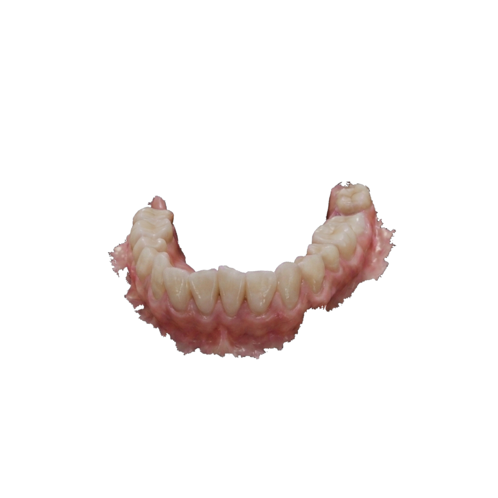
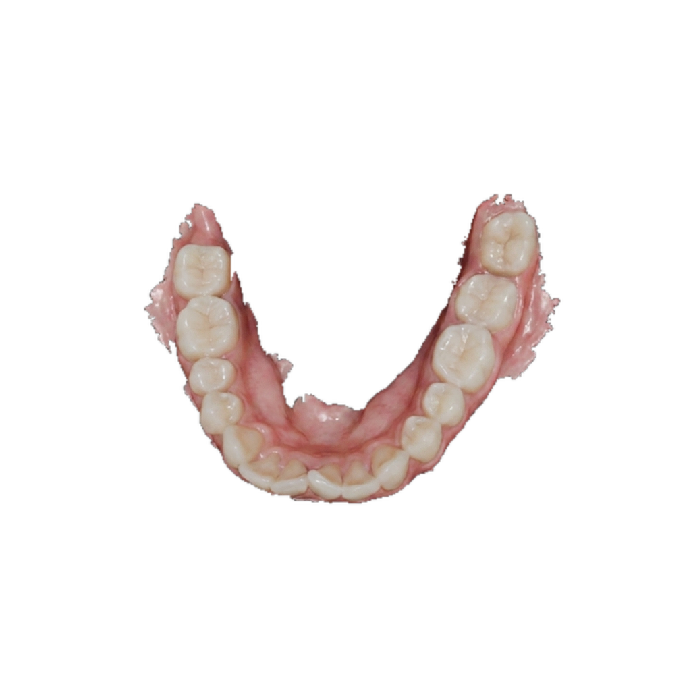
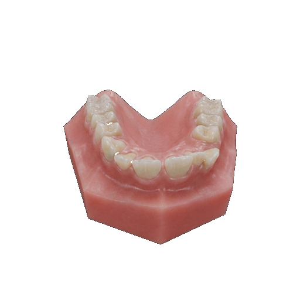
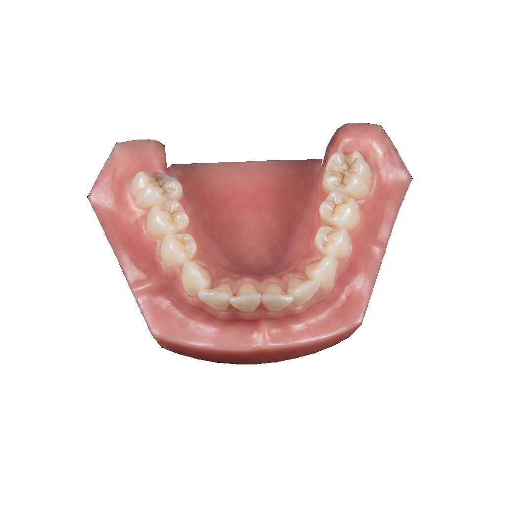

# TRELLIS.2 파이프라인, semantic 조건 주입 방향

TRELLIS.2는 원래 이미지만으로 mesh까지 생성함. 우리는 mesh와 이미지를 이미 가지고 있으므로 mesh 생성 단계는 생략할 수 있음.
아래는 mesh가 주어졌을 때 TRELLIS.2의 생성 결과와 파이프라인을 정리한 것임.


## 1. 결과

| reference image | 생성 영상 |
|---|---|
|  | <video src="../../docs/assets/meetings/20261125/tooth1_image1.mp4" width="260" controls loop muted></video> |
|  | <video src="../../docs/assets/meetings/20261125/tooth1_image2.mp4" width="260" controls loop muted></video> |
|  | <video src="../../docs/assets/meetings/20261125/tooth2_image1.mp4" width="260" controls loop muted></video> |
|  | <video src="../../docs/assets/meetings/20261125/tooth2_image2.mp4" width="260" controls loop muted></video> |

**관찰**
- TRELLIS.2는 자체적으로도 어느 정도 segmentation capability가 있음.
- 다른 mesh의 reference image를 넣어도, 형상이 어느 정도 비슷하면 텍스처를 생성함.
- 밑면이 꽉 찬 mesh는 reference image의 각도와 상관없이 잘 생성됨. 반면 밑면이 뚫린 mesh는 각도에 따라 segmentation이 지켜지는지가 크게 달라지고, 잘 나온 경우에도 잇몸이 찬 mesh보다 segmentation을 잘 인식하지 못함.

**한계와 방향**
- 다만 지금 TRELLIS.2가 텍스처를 만들 때 치아 vertex에 이미 있는 semantic label을 제대로 활용하는 것은 아니고, 위의 segmentation은 모델의 prior일 뿐임.
- 따라서 일부 치아에서 semantic이 다르게 생성되는 문제도 실제 vertex의 semantic label을 활용하면 해결 가능함.
- 우리에게는 mesh vertex마다 잇몸인지, 몇 번 치아인지를 나타내는 명시적인 semantic map이 있지만, GT 텍스처는 없음. 그래서 semantic을 기존 ControlNet 방식으로 TRELLIS에 주입해 학습시키되, GT 없이 학습하는 방향을 탐구하고자 함.
- 현재 도메인은 치아로 한정함.


## 2. TRELLIS.2 한눈에 보기

```
[입력] mesh.obj + 참조 사진
   │
   ├─ A. mesh 정리        merging vertices · 기존 UV 제거 · 정규화            (학습 없음)
   ├─ B. 사진 정리        배경 제거 · 정사각 크롭 · DINOv3 feature   (사진 쪽 모델)
   │
   ├─ C. mesh → 복셀(O-Voxel) → shape latent                      (VAE 인코더)
   ├─ D. 텍스처 DiT가 texture latent 생성                         (shape + 사진 조건)
   ├─ E. 텍스처 디코더가 복셀별 PBR 값 복원                       (VAE 디코더)
   │
   └─ F. 원본 mesh를 UV 펼침 → 복셀에서 PBR 샘플링 → 텍스처 → GLB
```

---


## 3. 단계별 상세 (치아 mesh 기준)

### A. mesh 정리
입력 OBJ를 파이프라인이 쓰는 형태로 정리하는 단계 (학습 없음).
1. **같은 위치 merging vertices**: 결과 vertex 133,620 / face 267,092 (`mesh_unwrap.obj`)
2. **정규화** (`preprocess_mesh`): 가장 긴 변이 1이 되도록 스케일하고 중심을 원점으로 옮김 (`[-0.5, 0.5]³`), y/z 축 교환
   - 원래 크기 약 80 × 66.5 × 39.8 (단위 미확인)

### B. 사진 정리
사진은 **색·material 힌트**로 쓰임

1. **리사이즈**: 긴 변이 1024를 넘으면 축소
2. **배경 제거**: 알파 채널이 있으면 그대로 쓰고, 없으면 BiRefNet(RMBG-2.0)으로 제거
3. **크롭**: 알파 0.8 초과 영역의 bbox를 정사각형으로 크롭하고, 배경은 검정으로 합성
4. **feature 추출**: DINOv3(`dinov3-vitl16`) feature → DiT의 cross-attention 조건
   - 입력 크기: 1024 모드는 1024, 512 이하 모드는 512

### C. mesh → 복셀(O-Voxel) → shape latent
mesh를 sparse 복셀로 바꾸고 shape VAE 인코더로 압축하는 단계.

1. **복셀화** (`mesh_to_flexible_dual_grid`, 학습 없는 기하 알고리즘): mesh와 겹치는 복셀만 남기고, 복셀마다 dual vertex 위치와 `intersected` 플래그를 계산
   - 이번 실행 로그에서 QEF 계산은 1024에서 합계 약 2.8초
2. **인코딩**: sparse voxel을 shape VAE 인코더에 넣어 32채널 shape latent로 압축
3. **cache 저장**: 인코더가 다운샘플 구조를 cache에 저장 → 나중에 디코더가 복셀 위치를 복원할 때 사용

- O-Voxel 구성 : 활성 복셀마다 dual vertex `v ∈ [0,1]³`(복셀 안의 정점), 3축 모서리 교차 플래그 `δ ∈ {0,1}³`, 쿼드를 삼각형으로 나누는 splitting weight `γ`(Algorithm 1에서 0.5 고정)를 가짐
- mesh→O-Voxel 변환: mesh와 교차하는 모서리의 이웃 복셀을 활성화하고, 교차점·법선(Hermite 데이터)을 삼각형에서 해석적으로 구해 복셀마다 QEF를 풂 (면 항 + boundary 항 `λ_bound` + 정규화 항 `λ_reg`).
- 압축률: 공간 **16배 다운샘플** , 1024³ 에셋이 약 9.6K latent 토큰


### D. 텍스처 DiT
shape latent와 사진 feature를 조건으로 texture latent를 생성하는 단계.

1. **shape latent 정규화**: 채널별 `(x - mean) / std` 후 조건으로 사용
2. **입력 구성**: 노이즈 32채널 + shape latent 32채널을 같은 복셀 좌표에서 concat → **총 64채널 입력, 32채널 출력**
3. **사진 조건**: cross-attention으로 별도 입력 (`cond_channels` 1024)
4. **샘플링**: Euler flow, 12 step, guidance interval [0.6, 0.9]
5. **역정규화**: `x * std + mean` (디코더가 VAE 원래 스케일을 기대하기 때문)

- shape 조건: material 생성 단계는 shape 정보를 입력 텐서와 채널 방향으로 concat해서 조건으로 받음 
- 이미지 조건: DINOv3-L feature, cross-attention
- 구조·학습: 폭 1536, 30 블록, 약 1.3B 파라미터, rectified flow(CFM loss)로 학습

### E. 텍스처 디코더
texture latent를 복셀별 PBR 값으로 복원하는 단계. 결과는 **복셀에 저장된 PBR 값**일 뿐이고, mesh에는 아직 입혀지지 않음.

1. **복셀 구조 복원**: 인코더가 저장한 cache로 복원. 복셀 위치를 새로 예측하지 않음
2. **PBR 출력**: 복셀마다 6채널 — base_color 3 + metallic 1 + roughness 1 + alpha 1 (`*0.5+0.5`로 0~1)

- 출력 채널은 `f^mat = (c, m, r, α)`

### F. mesh에 입히기 (`postprocess_mesh`)
복셀의 PBR 값을 원본 mesh의 텍스처 맵으로 옮기고 GLB로 저장.

1. **UV unwrap**: 원본 mesh를 CuMesh `uv_unwrap`으로 새로 펼침 (기존 UV는 기본적으로 무시)
   - 1단계 GPU 클러스터링(법선 원뿔 반각 90°, 경계 refine 100회, 면적/둘레 페널티) → 2단계 xatlas로 chart 펼침·패킹
   - 순수 geometry 기준이며, 사진·텍스처 내용은 보지 않음
   - 결과 : vertex 133,620 → **184,198** (seam 복제), chart 6,726개, face 267,092 그대로
2. **texel → 3D 좌표**: 2048×2048 텍스처 이미지의 texel마다 래스터화로 대응하는 mesh 표면의 3D 좌표를 구함
3. **PBR 샘플링**: 그 좌표를 복셀 좌표 `(pos + 0.5) × resolution`로 바꿔 **trilinear 보간**으로 PBR 값을 읽음
4. **여백 채우기**: UV 여백은 `cv2.inpaint`(Telea)로 채움 (base_color/alpha 반경 3, metallic/roughness 반경 1)
5. **GLB 저장**: vertex·face·UV + 텍스처(base color+alpha, metallic/roughness)를 GLB로 저장 (WebP 확장 사용)


---

## 4. 소요 시간 (RTX 4070 SUPER 12GB)

| 구간 | 1024 | 512 |
|---|---|---|
| 모델 로딩 (디스크→CPU) | 22.4s | 24.3s |
| DINOv3 feature | 1.2s | 0.8s |
| mesh→복셀→shape latent | 4.2s | 1.4s |
| **DiT 샘플링** | **12.9s** | **2.6s** |
| 텍스처 디코더 | 0.8s | 0.5s |
| **UV unwrap** | **11.2s** | **9.9s** |
| `cv2.inpaint` (4회) | 2.1s | 2.1s |
| GLB 저장 | 0.6s | 0.6s |
| **전체** | **58.0s** | **44.8s** |

- 이미지 전처리가 0.01s인 이유는 입력 PNG가 RGBA라서 배경 제거를 건너뛰었기 때문 (RGB면 BiRefNet 시간이 추가됨, 미측정).
- UV unwrap은 해상도와 무관하게 10초 안팎이라 512에서는 DiT보다 오래 걸림. 기존 UV 사용(`USE_UV=1`) 시 줄어들 것으로 보이나 측정하지 않음.
- `run_texturing.sh`로 돌린 실제 벽시계 시간은 GLB까지 41~67초(256/512), 약 119초(1024)였고 편차가 있었음(원인 미확인). 영상(참조 시점 찾기 + mp4 3종)은 별도로 약 85초 추가.

---

