# DirectUV

> **한 줄 요약** : Image → UV (직접 생성)  
> latent UV space에서 Diffusion Transformer가 UV texture를 직접 생성하고, positional encoding(RoPE)에 3D surface 좌표를 넣어(SAPE) attention이 UV grid가 아닌 실제 surface 거리를 기준으로 동작하도록 한 모델

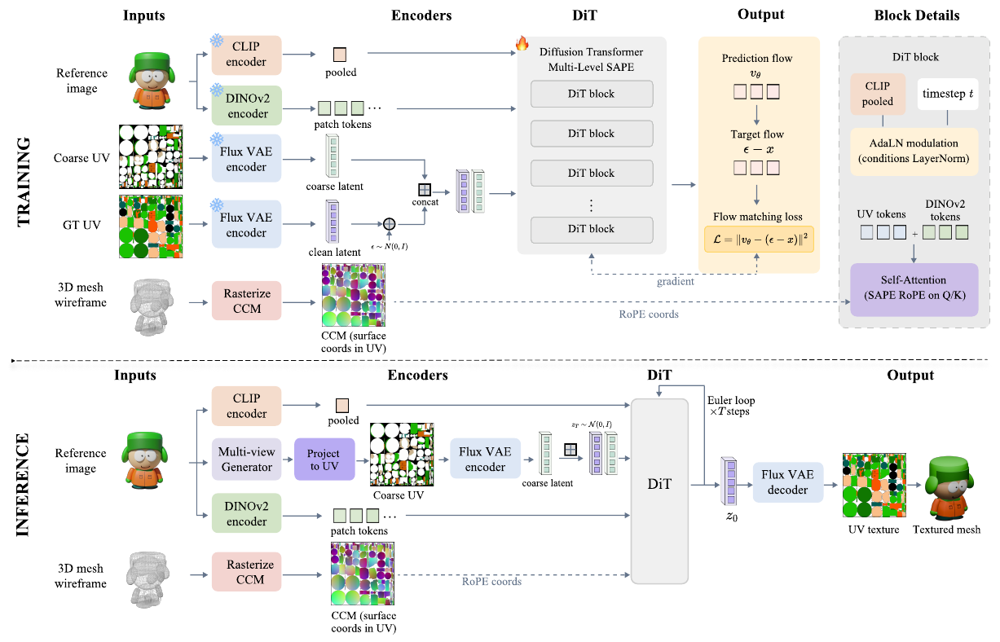

## 1. 배경

**목표**
- 단일 reference image와 mesh를 input으로, seam이 없고 전체 surface에 일관된 고품질 UV texture 생성
- 사실적인 appearance와 3D surface 전체의 consistency를 동시에 만족

**기존 방식의 문제**: 두 가지 paradigm 모두 한계 존재

| 분류 | 방식 | 한계 |
|---|---|---|
| Multi-view projection | 2D diffusion으로 multi-view 이미지를 생성한 뒤 projection, baking, inpainting | multi-view inconsistency, projection 중 error 누적, seam과 misalignment, occluded/grazing-angle 영역을 커버하지 못함 |
| UV space 직접 생성 | TEXGen, TexDreamer 등 | 3D 정보를 보조 module(point cloud attention, cross-attention)로 주입하나, 핵심 attention은 여전히 UV grid 위치 기준 |

- 핵심 문제 : UV chart 사이에서 갈라진 texel(surface에서는 인접하나 UV에서는 멀리 떨어진 texel)을 attention이 관련짓지 못해 seam과 disconnected island 사이의 coherence 저하

**핵심 아이디어**
- positional encoding은 attention이 동작하는 distance metric을 정의하므로, 선택적으로 무시할 수 있는 condition과 달리 모델이 반드시 따르게 됨
- 따라서 3D surface geometry를 보조 module이 아니라 positional encoding 자체에 넣음

**기여**
1. UV texture 생성을 latent UV space의 image-conditioned 직접 생성 문제로 정식화 (single image와 coarse UV map은 생성 target이 아니라 conditioning 신호)
2. SAPE (Surface-Aware Positional Encoding) : per-token 3D surface 좌표를 RoPE에 넣어, attention이 ambient 3D 좌표 간 상대 offset을 기준으로 동작
3. Multi-Level SAPE : multi-head 구조를 이용해 head마다 같은 latent patch의 서로 다른 세분화 수준(granularity)의 좌표를 할당
4. 추가 parameter나 module 없이 occluded/unseen 영역에서 기존 방법보다 우수

## 2. 방법론

### 2-1. Overview

- UV map을 pretrained image VAE의 latent로 인코딩하고, Diffusion Transformer(DiT)가 이 latent를 denoise
- 입력 : reference image, UV parameterization이 있는 mesh
- mesh에서 미리 한 번 계산하는 **CCM (Canonical Coordinate Map)** : UV space의 이미지로, 각 pixel 값이 대응하는 mesh 점의 3D surface 좌표
  - CCM은 conditioning bundle `c`에 포함되지 않고, 오직 SAPE를 통해서만 모델에 들어감
- 생성 target은 UV map 하나뿐이므로 intermediate view의 projection/blending이 만드는 inconsistency 제거

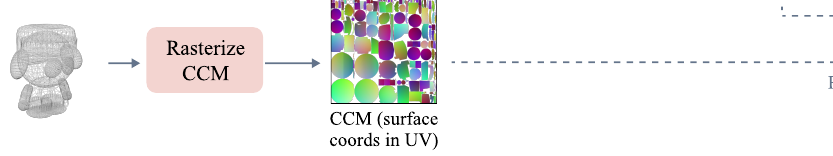

### 2-2. Latent UV Diffusion Formulation

- UV map `I_UV`를 frozen Flux VAE encoder `E`로 공간적으로 downsample된 latent `x = E(I_UV)`로 변환, decoder `D`로 복원
- 이 표현은 pretrained 2D image prior와 정렬되고, VAE의 UV 복원 오차가 거의 없음
- latent가 UV 좌표 구조를 유지하므로, 3D geometry가 보조 module이 아니라 positional encoding을 통해 들어갈 수 있음
- 모델 `v_theta` : Flux DiT 구조 사용

### 2-3. Conditioning

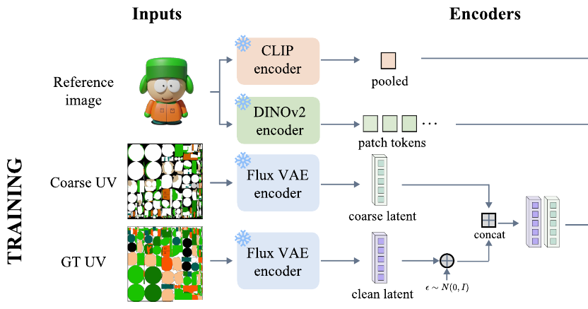

conditioning bundle `c`는 두 신호로 구성되며, 목표 texture와 UV 좌표계를 공유하는지에 따라 주입 경로가 다름

| 신호 | 역할 | 주입 방식 |
|---|---|---|
| Reference image (CLIP pooled feature) | 색, material tone, identity 같은 전역 appearance | Flux의 timestep/text embedding과 같은 modulation 경로(AdaLN)로 모든 token에 균일하게 주입 |
| Reference image (DINOv2 patch tokens) | 공간적으로 국소화된 detail | joint-attention stream에 입력 (원래 구조의 text token 자리를 대체), UV latent token이 관련 image 영역을 attend |
| Coarse UV map | surface-aligned layout 단서 | 같은 Flux VAE로 인코딩하여 noisy UV latent와 channel 방향으로 concatenate (patchify 전, per-position 정렬 유지) |

- Coarse UV map : 하나 이상의 입력 view를 UV space로 projection하여 획득
- image condition은 좌표 정렬이 없으므로 modulation과 cross-attention을 쓰고, coarse UV는 좌표계를 공유하므로 위치 정렬 경로를 씀
- projection 기반 pipeline과 달리 둘 다 순수한 conditioning으로만 쓰이고, UV texture는 latent space에서 처음부터 생성되어 view-dependent inconsistency를 물려받지 않음

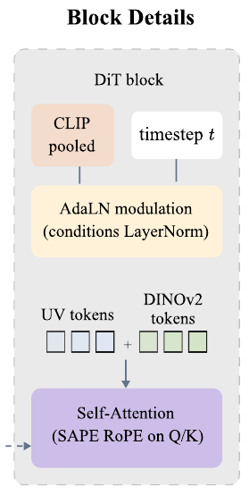

### 2-4. SAPE (Surface-Aware Positional Encoding)

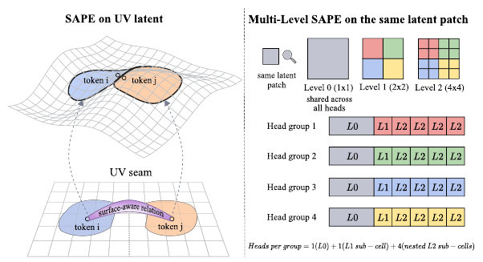

**Spatial Metric Mismatch (문제)**
- 표준 DiT는 regular 2D grid의 positional encoding을 쓰므로 token 관계가 UV 좌표에서 측정됨
- mesh에서는 바로 인접한 texel이 UV seam을 사이에 두고 서로 다른 island에 놓여 UV-grid metric에서는 임의로 멀어짐
- 반대로 UV plane에서 가까운 texel이 실제로는 먼 surface 영역일 수 있음
- 즉 attention이 잘못된 neighborhood prior를 받는 상태

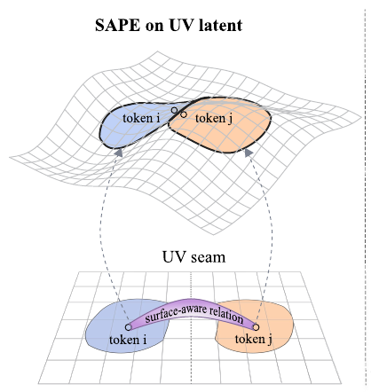

**Surface-Aware RoPE (해결)**
- 2D UV-grid positional encoding을 CCM에서 얻은 positional code로 교체
- latent의 `i`번째 token `x_i`가 덮는 UV 영역 `U_i`가 CCM의 pixel 하나에 대응하도록 CCM을 token grid 해상도로 downsample, 이 값 `S_i ∈ R^3`이 per-token surface 좌표
- head `h`에서 token `x_i`, `x_j`의 query와 key를 `S_i`, `S_j`로 회전

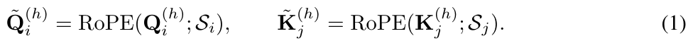

- axis-factorized RoPE 방식 : head의 feature 차원을 `(x, y, z)` 세 축에 대응하는 연속된 세 그룹으로 나누고, 각 그룹을 해당 좌표로 독립적으로 회전
- 내적 `<Q_i, K_j>`는 2D UV grid가 아니라 3D surface 상의 상대 offset `S_j - S_i`에만 의존
- 따라서 surface에서 가까운 texel은 UV에서 떨어져 있어도 직접 attend 가능

**Multi-Level SAPE**

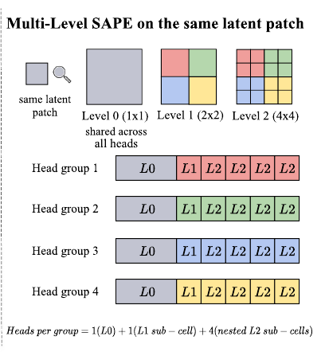
- 문제 : token당 좌표 하나로는 UV island 사이의 넓은 surface 대응과 seam 주변의 미세한 구조를 동시에 포착 불가
- 해결 : 같은 latent patch에 대해 CCM을 `L`개의 해상도로 읽음
  - level `l ∈ {0, ..., L-1}`에서 patch를 `2^l × 2^l`로 분할하여 token당 `4^l`개의 sub-cell 좌표 획득
  - `l = 0`이 기본 SAPE (`S_i^(0) = S_i`)
- 이 level별 좌표를 transformer의 head 차원에 분배
  - head `h`마다 level `l_h`와 해당 level 안의 sub-cell 하나를 할당
  - 각 head는 자기 feature slice를 단일 granularity의 좌표 하나로만 회전 (여러 level을 겹쳐 쓰지 않음)
- head의 조직 (`L = 3`) : `H`개의 head를 `G`개 group으로 묶고, 각 group은 level-1 layout의 sub-cell 하나에 대응
  - group 안에서 head 1개는 level-0 좌표, 1개는 해당 group의 level-1 sub-cell, 나머지 4개는 그 안에 nested된 level-2 sub-cell을 읽음
  - 전체 group이 level-1 layout을 분할하므로, 모든 level의 모든 sub-cell을 head 하나가 정확히 한 번 읽음
- attention은 head별로 계산한 뒤 output projection에서 섞이므로, multi-level 정보는 attention 이후에 통합되고 attention 내부에서는 head마다 깨끗한 단일 granularity의 positional metric을 사용
- 추가 latent map, parameter, 보조 geometry branch 없음

### 2-5. Training과 Inference

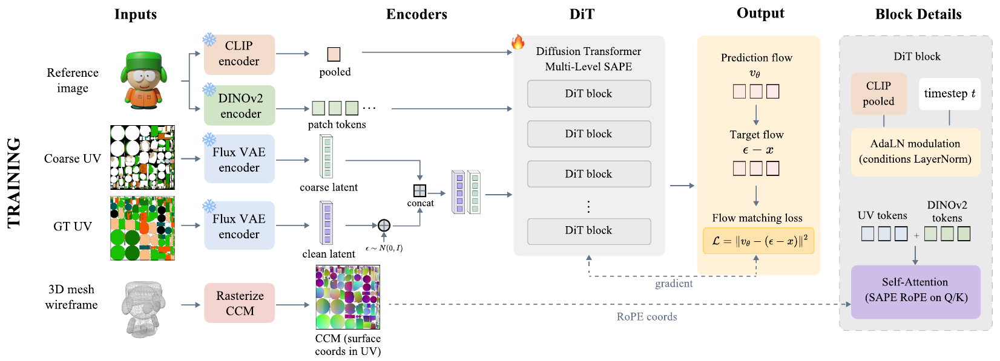

**학습 objective** : rectified flow-matching

- 깨끗한 latent `x`, noise `epsilon ~ N(0, I)`, timestep `t ∈ [0, 1]`에 대해 noisy latent `z_t = (1 - t) x + t epsilon`
- 모델은 flow 방향 `epsilon - x`를 예측

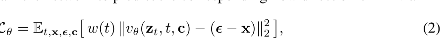

- `t`는 [0, 1]에서 균등 샘플링, `w(t) ≡ 1` (uniform reweighting)

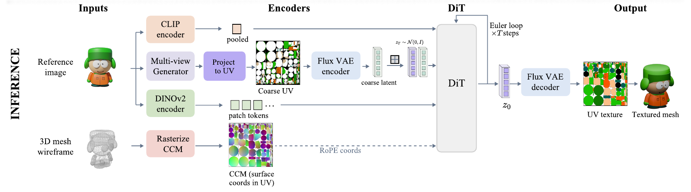

**Inference**
1. reference image에서 off-the-shelf multi-view generator로 multi-view 이미지 생성 (Kiss3DGen 사용)
2. 이를 view-to-UV projection하여 coarse UV map 획득
3. mesh에서 CCM을 한 번 rasterize
4. `z_1 ~ N(0, I)`에서 시작하여 Euler update를 `N` step 반복 (conditioning과 CCM은 step 간 고정, 재추정 없음)
5. 최종 latent를 frozen Flux VAE로 decoding하여 UV texture 복원

## 3. 실험

**데이터**
- TexVerse, PartNext, Objaverse를 합치고 필터링하여 약 100K textured mesh 사용
  - 제외 : face 수가 과도한 mesh, UV layout이 심하게 조각난 mesh, 저품질 UV parameterization, 유효하지 않은 UV supervision
- mesh마다 UV mask, GT UV texture, CCM을 1024×1024로 생성
- 4개 canonical RGB view (azimuth 0°, 90°, 180°, 270°, elevation 5°), 정면 view를 reference image로 사용
- latent normalization : 학습 set에서 VAE latent의 position별, channel별 평균과 표준편차를 미리 계산하여 적용

**구현**
- backbone : Flux 스타일 transformer, MMDiT block 6개 + single-stream block 12개
- attention : `H = 24` head, head 차원 `d_head = 120`, 축 차원 `(40, 40, 40)`
- Multi-Level SAPE : `L = 3`, `G = 4` group (group당 6 head)
  - group 안에서 level-0 1개, level-1 sub-cell 1개, level-2 sub-cell 4개 → 전체 head 비율 `4 : 4 : 16`
- Image conditioning : DINOv2 ViT-L/14 (registers) + CLIP ViT-B/32
- VAE : FLUX.1-dev의 frozen VAE (8× downsampling, 64 latent channel), noisy latent와 coarse UV latent를 concatenate하여 patchify 입력 128 channel, 출력 64 channel
- coarse UV : 학습 중 online으로 구성, 매 step 0/1/2/4개 view를 무작위 선택 (0개는 blank UV)
  - 일부 view는 조명 포함, 일부는 albedo로 렌더링하여 조명 불일치를 만들고, coarse UV가 그대로 복사할 target이 아니라 불완전한 conditioning이 되도록 함
- 학습 : A800 8장, GPU당 batch size 16, 170K step, 8-bit AdamW (lr 1e-5, weight decay 1e-4, grad clip 1.0), bf16, gradient checkpointing
- 추론 : 28 step, FlowMatchEulerDiscreteScheduler, coarse UV는 Kiss3DGen + projection

**평가 설정**
- 평가 data : Google Scanned Objects (GSO) 전체 (학습 data와 겹치지 않는 out-of-distribution test set)
- 각 object마다 정면 view 1장을 모든 방법의 reference image로 사용
- 평가 방법 : albedo shading으로 전방위(top-down, bottom-up 포함) view를 렌더링하여 GT albedo와 비교
- metric : PSNR, SSIM (pixel 단위 fidelity), FID, KID (분포 유사도)

**비교 대상**
- TEXGen : UV space convolution + 3D point cloud attention의 hybrid
- FlexPainter : 여러 control 신호를 통합한 texture 생성 diffusion framework
- Hunyuan3D-2.1 : 3D-aware RoPE를 쓰는 multi-view 생성 후 UV baking
- UniTEX : multi-view projection 후 triplane feature volume으로 completion

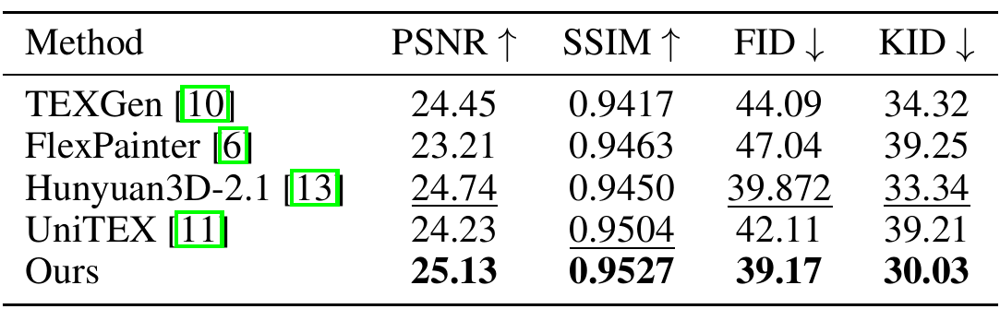

**정량 결과 (GSO)**

| Method | PSNR ↑ | SSIM ↑ | FID ↓ | KID ↓ |
|---|---|---|---|---|
| TEXGen | 24.45 | 0.9417 | 44.09 | 34.32 |
| FlexPainter | 23.21 | 0.9463 | 47.04 | 39.25 |
| Hunyuan3D-2.1 | 24.74 | 0.9450 | 39.872 | 33.34 |
| UniTEX | 24.23 | 0.9504 | 42.11 | 39.21 |
| DirectUV | **25.13** | **0.9527** | **39.17** | **30.03** |

- PSNR과 SSIM에서 최고, FID/KID도 가장 낮음

**정성 결과**

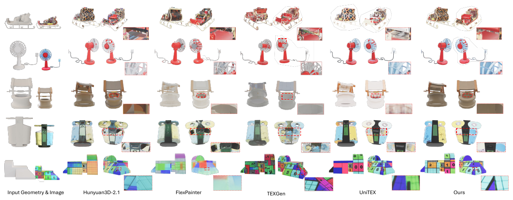

1. 더 세밀한 detail : 숫자 block의 선 획 같은 고주파 패턴을 선명하게 보존
2. Occluded 영역 : 우물과 쓰레기통의 안쪽 같은 심하게 가려진 영역에서 일관되고 그럴듯한 내용 생성 (projection 기반 방법은 흐리거나 불완전)
3. Multi-view inconsistency에 대한 robustness : UV latent에서 직접 denoise하므로 충돌하는 view에 휘둘리지 않음
   - 선풍기 예시에서 UniTEX는 뒷면 커버의 texture를 앞쪽 날개로 잘못 옮기나, DirectUV는 올바른 appearance 유지
   - UniTEX는 projection 결과를 inpainting의 target으로 취급하기 때문

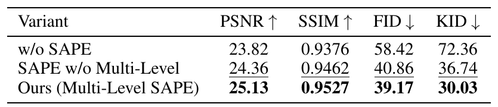

**Ablation**

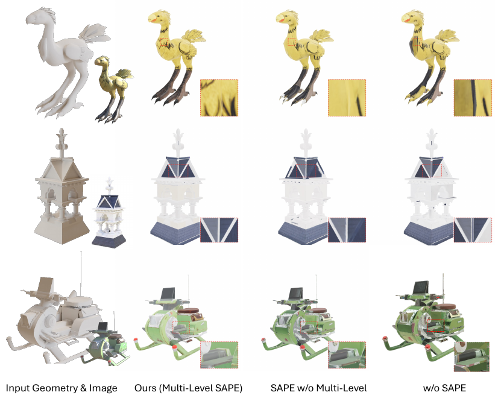

| Variant | PSNR ↑ | SSIM ↑ | FID ↓ | KID ↓ |
|---|---|---|---|---|
| w/o SAPE | 23.82 | 0.9376 | 58.42 | 72.36 |
| SAPE w/o Multi-Level | 24.36 | 0.9462 | 40.86 | 36.74 |
| Ours (Multi-Level SAPE) | 25.13 | 0.9527 | 39.17 | 30.03 |

- **w/o SAPE** : Flux의 표준 2D UV-grid RoPE로 교체하여 surface 좌표 정보가 전혀 없는 상태
  - 모든 metric 하락, 특히 surface가 연결된 UV island 사이에서 열화가 큼
  - UV 평면 거리로만 token을 연결하므로 chart를 가로질러 인접한 texel이 직접 상호작용하지 못해 seam 불일치와 island 사이의 inconsistency 발생 (chocobo 예시 : 다리의 검은 texture가 목에 잘못 생성)
- **SAPE w/o Multi-Level** : 모든 head를 level-0 좌표 하나 `S_i^(0) = S_i`에 묶음
  - seam coherence는 유지되나 texture가 흐려짐
  - 모든 head가 token당 같은 좌표를 읽으므로 latent patch 내부의 sub-token 위치를 구분하지 못해, patch 내부 detail이 decoding 후 거의 균일해짐
  - Multi-level 좌표는 서로 다른 head에 더 세밀한 granularity를 노출하여 이 모호성을 해소하고 고주파 detail 복원

## 4. 부록 요약

**A. Coarse UV는 soft conditioning**

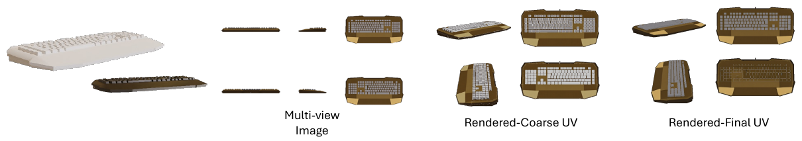

- coarse UV는 projection된 view가 실제 surface 외관을 정확히 보여주지 못하는 영역에서 부정확한 색을 가질 수 있음
- 값을 그대로 복사하지 않고, denoising 중 learned prior가 더 일관된 appearance를 제시하면 coarse UV에서 벗어남
- 예 : 키보드 밑면이 coarse UV에서는 흰색이지만, reference image와 주변 surface가 시사하는 어두운 금속 외피로 최종 texture에서 복원

**B. Coarse UV 완성도에 대한 robustness**

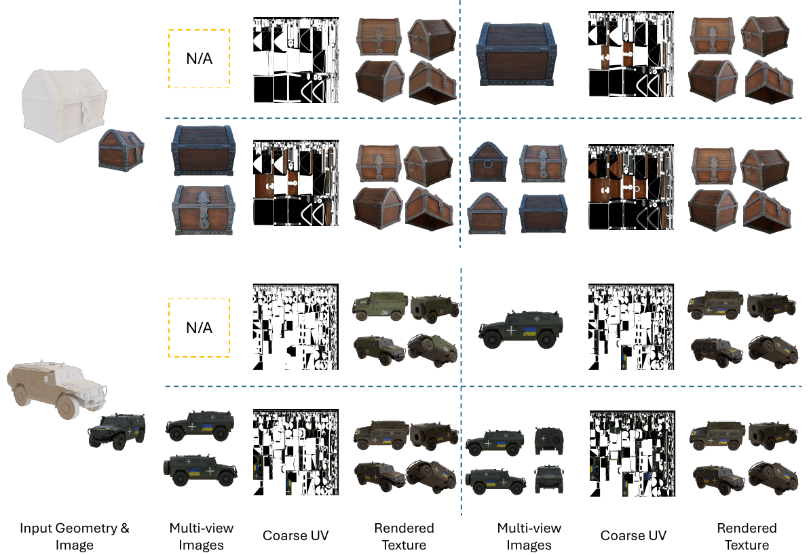

- 학습 중 coarse UV를 만드는 view 수를 `{0, 1, 2, 4}`에서 무작위로 샘플링하여, 한 가지 입력 품질에 의존하지 않게 함
- coarse UV가 완전히 blank인 0-view 설정에서도 reference image와 geometry 조건 denoising만으로 그럴듯한 texture 생성

**C. 생성된 mesh에 적용**

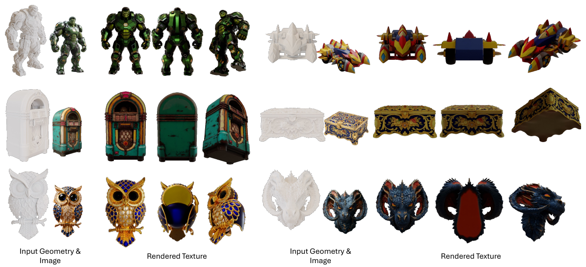

- Tripo, Rodin 같은 image-to-3D shape generator가 만든 mesh에 같은 image로 texturing하여 image-to-textured-mesh 전체 pipeline 구성
- 생성 mesh의 다양한 topology와 UV layout 처리 가능

**E. 추가 결과**

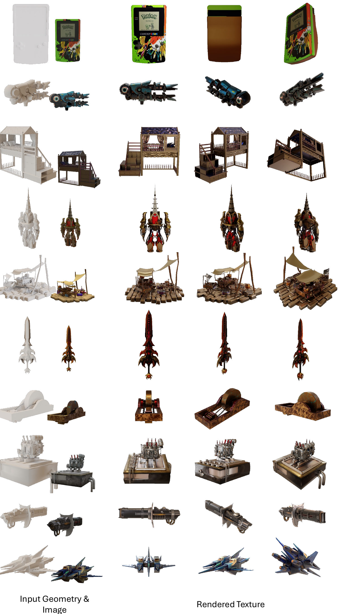

## 5. 한계

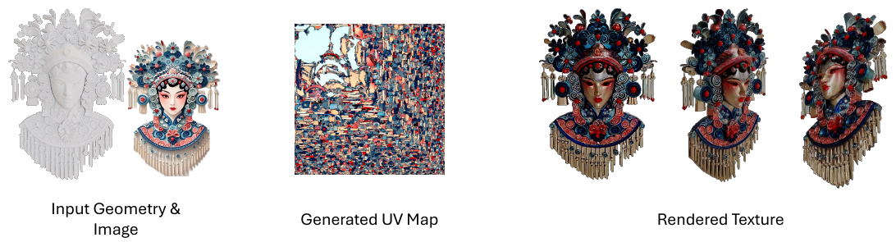

- UV parameterization 품질에 민감
- UV layout이 작은 sliver와 corner patch로 심하게 조각나면, 조각마다 per-token surface 좌표 `S_i`가 비교적 넓은 surface 영역의 정보를 평균하여 CCM 신호가 거칠어짐
  - multi-level 세분화로도 미세한 국소 detail을 충분히 복원하지 못해 흐림(blur)과 색 번짐(color leakage) 발생
- 이 실패는 SAPE 설계 자체가 아니라 UV parameterization과 mesh 품질에서 비롯되며, 향후 UV-aware 전처리나 UV data에 맞춘 tokenization 학습이 해결 방향
