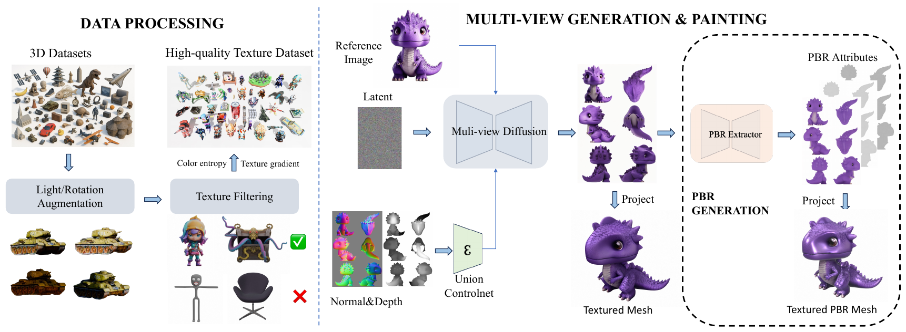
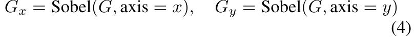
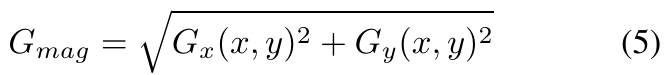
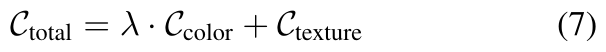

# MVPainter — 논문 목적 및 Method 정리

> **논문:** MVPainter (geometry-guided multi-view diffusion + PBR extractor 기반 3D texture 생성 시스템)  
> **분류:** View → UV projection (+ PBR 추출)  


## 1. 기존 문제와 논문의 해결 방안

### 배경

- 최근 3D 생성은 geometry 생성 후 texture 합성의 2단계(geometry-texture 분리)가 주류.
- geometry 생성(TripoSG, Hunyuan3D 2.0, TRELLIS, Hi3DGen 등)은 크게 발전했지만, **texture 생성이 3D 생성 품질의 상한을 결정하는 약점**으로 남음.
- 주류 texture 방법: 2D image diffusion으로 multi-view RGB를 생성한 뒤, projection으로 3D 표면에 mapping.

### 기존 방법의 세 가지 핵심 과제


| 과제 | 내용 |
|---|---|
| Reference-texture alignment | 생성 texture가 reference 이미지의 시각적 특징을 정확히 반영하는가. 조명 변화나 가림이 있을 때 특히 어려움. |
| Geometry-texture consistency | texture가 3D 표면과 정확히 정렬되는가. |
| Local texture quality | 충분히 세밀한 detail을 만드는가. |

### MVPainter의 해결 방법과 기여

1. **데이터 처리 pipeline:** 조명·회전 증강과 texture 품질 필터링으로, reference 정렬과 세밀한 detail 학습에 맞는 데이터를 구성.
2. **Union ControlNet:** normal, depth 같은 명시적 geometry 신호를 쓰는 geometry-guided multi-view diffusion.
3. **PBR Attributes Extractor:** 생성한 6개 view RGB에서 basecolor, metallic, roughness를 추출.
4. **VLM 기반 평가:** 사람의 인식과 정렬된 평가 전략(위 세 가지 차원)을 제안하고, 세 지표 모두에서 SOTA.
5. 데이터 구축 도구, 학습 pipeline, 평가 script 전체 공개.

**핵심:** MVPainter는 새로운 3D 표현을 쓰지 않음. 기존 multi-view diffusion + projection 방식을 유지하되, **데이터 · geometry 조건 · 학습 순서 · PBR 추출**을 모두 개선해 세 가지 과제를 동시에 푸는 시스템임.

---

## 2. 전체 구조와 문제 정의



reference 이미지 `I_ref`와 3D geometry `G`로 textured mesh를 만드는 생성기 `F`를 구성하는 것이 목표.


<sub>**Eq. 1** · 생성기 `F`는 reference 이미지 `I_ref`와 geometry `G`를 입력받아 textured mesh `M_textured`를 출력함.</sub>

**전체 흐름**

1. 데이터 필터링과 증강으로 detail이 충분하고 조명·시점 변화가 다양한 학습 data 확보.
2. ControlNet 기반 구조로 3D geometry와 구조적으로 일치하는 multi-view texture 이미지 생성.
3. 전용 PBR 추출 module로 basecolor, metallic, roughness map을 추정해 mesh에 projection.

---

## 3. 데이터 처리

### 3.1 조명 증강 (Lighting augmentation)

**문제**

- in-the-wild 입력 이미지는 강한 specular highlight와 그림자 경계를 가짐. 그대로 reference로 쓰면 multi-view diffusion이 조명 artifact에 overfitting.
- Hunyuan3D 2.0의 delighting module은 조명을 지우지만 원래 색 분포까지 바꿔 reference와 불일치가 생김.

**방법**

- **target view 6장:** 균일 조명으로 렌더링 (specular, 그림자 artifact 제거).
- **reference 조건 이미지:** 다양한 조명으로 렌더링. object당 15장이며, 각각 point light, area light, 큐레이션한 HDRI 100개 중 무작위로 설정.

조명 분포가 다른 reference에서도 외관이 일관되고 색이 충실한 texture를 생성하게 되어, in-the-wild 입력에 robust해짐.

### 3.2 회전 증강 (Rotation augmentation)

- 실제 입력 이미지는 정면 canonical view가 아닌 경우가 많음.
- reference 이미지를 렌더링할 때 azimuth를 (-30°, 30°), elevation을 (-10°, 30°) 범위에서 변화시킴.

### 3.3 Texture 품질 필터링

공개 3D dataset에는 단조로운 색, 매우 낮은 채도, 표면 패턴이 없는 저품질 texture가 많아 흐리고 구조가 약한 출력의 원인이 됨. 두 지표로 샘플을 걸러냄.

**① Color Entropy:** HSV 공간에서 H, S, V 각 channel의 256-bin 정규화 histogram에 대한 Shannon entropy.


<sub>**Eq. 2** · channel `c`의 histogram에서 bin `i`의 확률 `p_i`로 계산한 Shannon entropy. 색 분포가 넓고 고를수록 값이 큼.</sub>


<sub>**Eq. 3** · H, S, V 세 channel의 entropy 평균이 `C_color`. 색상과 밝기 변화를 모두 반영한 색 다양성 점수.</sub>

**② Texture Complexity:** grayscale 이미지에 Sobel 연산자로 가로·세로 gradient를 구하고, gradient 크기의 평균을 사용. 공간 주파수와 구조 변화를 반영함.



<sub>**Eq. 4** · grayscale 이미지 `G`에 Sobel을 x, y 방향으로 적용한 gradient `G_x`, `G_y`.</sub>



<sub>**Eq. 5** · 각 픽셀의 gradient 크기 `G_mag = √(G_x² + G_y²)`. 경계·무늬가 뚜렷할수록 큼.</sub>


<sub>**Eq. 6** · `G_mag`를 이미지 전체(H×W 픽셀)에서 평균낸 값이 `C_texture`. 값이 클수록 texture가 복잡하고 detail이 많음.</sub>

### 3.4 종합 점수와 선별

각 object를 균일 조명에서 정면과 측면 view로 렌더링하고, 각 이미지에서 두 지표를 계산해 종합 점수를 구함.



<sub>**Eq. 7** · 종합 점수 = `λ`·`C_color` + `C_texture`. `λ = 35`는 두 지표의 scale을 맞추는 고정 가중치.</sub>

- 전체 object를 점수로 정렬해 **상위 100,000개**로 고품질 texture dataset 구성. Stage 3 fine-tuning에 사용됨.

---

## 4. Geometry 조건 Multi-view 생성

### 4.1 생성 target과 조건

- Zero123++처럼 **6개 target view를 3×2 이미지 grid로 배치**해 하나의 생성 target으로 사용.
- reference 이미지와 geometry prior가 control 신호로 multi-view diffusion을 guide.
- 6개 view의 카메라: azimuth (0, 90, 180, 270, 0, 0), zenith (0, 0, 0, 0, -90, 90).

### 4.2 Union ControlNet


- 표준 ControlNet과 달리 **전용 condition encoder**로 여러 modality의 control 이미지에서 feature를 추출.
- **condition transformer**로 modality 간 상호작용(fusion)을 거친 뒤 ControlNet backbone의 입력으로 사용.
- 현재 구현은 두 신호만 사용하며, 서로 보완적임.
  - **Normal map:** 국소적인 미세 geometry detail → micro-structure 수준의 정밀 제어.
  - **Depth map:** 더 전역적인 공간 scale과 윤곽 정보. 매끄럽고 중복성이 있어 normal map의 noise나 잘못된 detail에 과도하게 의존하는 것을 억제 → 안정성과 정렬 향상.
- position map이나 view direction encoding 등 임의 종류와 개수의 geometry 입력으로 확장 가능.

### 4.3 점진적 3단계 학습

pretrained diffusion은 정면 view에 편향되어 뒷면·측면 생성 품질이 떨어지므로, 전체 multi-view 분포 → geometry 조건 → 세밀한 detail 순서로 학습함.

| 단계 | 학습 대상 | 목적 |
|---|---|---|
| Stage 1: UNet pretraining | UNet만 (geometry 조건 없음) | 6개 target view의 이미지 분포를 학습해 기본 multi-view 생성 능력 확보 |
| Stage 2: ControlNet training | UNet freeze, ControlNet만 | normal, depth 같은 geometry 조건에 반응하여 geometry와 일관된 이미지 생성 |
| Stage 3: 고품질 data fine-tuning | UNet과 ControlNet 함께 | texture 복잡도가 높고 정렬이 정확한 고품질 data로 모든 view에서 고충실도 detail 생성, 복잡한 조명과 드문 시점에서의 robustness 향상 |

---

## 5. PBR Attributes Extractor

baked RGB texture만으로는 사실적인 rendering에 부족하며, basecolor, metallic, roughness가 필요함. 2단계에서 생성한 6개 view RGB에서 PBR map을 추출함.


<sub>**Eq. 8** · PBR 추출기 `F_PBR`은 6개 view RGB `{I_i}`를 입력받아 basecolor `T_base`, metallic `T_metal`, roughness `T_rough` map을 출력함.</sub>

기존 PBR 예측 모델 **IDArb**를 기반으로 두 가지를 개선함.

1. **attention 구조:** view attention, component attention, image attention을 순차가 아닌 **병렬** 구조로 변경. 같은 계층에서 서로 다른 domain 정보를 동시에 인식하고, 각 attention의 domain 정보를 더 잘 보존함.
2. **학습 해상도:** 256×256 → 512×512. 특히 basecolor의 세밀한 detail 포착에 효과적.

---

## 6. 전체 학습 과정과 추론 과정

### 6.1 학습 과정

```text
[데이터]
3D Dataset (약 120만 개)
    → 균일 조명 6 view 렌더링 (target)
    → 무작위 조명·회전 reference 15장 렌더링
    → 색 entropy + gradient 점수로 상위 100k 선별

[Multi-view diffusion]
Stage 1  UNet 학습 (120만, 3~5 epoch)
Stage 2  UNet 고정, ControlNet 학습 (120만, 2~3 epoch)
Stage 3  UNet + ControlNet 함께 fine-tuning (100k, 8~10 epoch)

[PBR 추출기]
pretrained IDArb로 초기화 → 병렬 attention, 512×512
    → ARB-OBJAVERSE (약 570만 PBR data 쌍)로 학습 (2~3 epoch)
```

이 도식은 논문의 구현 세부 설정을 한곳에 모아 보여준 **설명용 재구성**임.

### 6.2 추론 과정

```text
[입력] 3D Geometry G + Reference Image I_ref

① G에서 6개 view의 Normal map, Depth map 렌더링
② Union ControlNet 조건 (Normal + Depth) + I_ref
    → Multi-view Diffusion → 6 view RGB (3×2 grid)
③ 6 view RGB를 mesh에 projection → Textured Mesh (baked RGB)
④ 6 view RGB → PBR Extractor → Basecolor, Metallic, Roughness
⑤ PBR map을 mesh에 projection → Textured PBR Mesh
```

이 도식은 논문 Figure 3을 기반으로 한 **설명용 재구성**임.

### 6.3 구현 세부

**Dataset**

- Objaverse와 같은 방식으로 인터넷에서 추가 수집한 공개 3D 모델을 포함해 약 120만 개.
- object마다 고정 6개 view와 무작위 조명·회전 reference 이미지 15장을 렌더링.
- texture 점수 기준 고품질 100k dataset을 별도 구성.
- PBR 추출기 학습: ARB-OBJAVERSE dataset (약 570만 PBR data 쌍).

**Multi-view diffusion 학습**

| 단계 | 설정 |
|---|---|
| Stage 1 | Adam, lr 3e-5, CosineAnnealingWarmRestarts, 120만 dataset 3~5 epoch |
| Stage 2 | UNet 고정, 같은 optimizer와 scheduler, 120만 dataset 2~3 epoch |
| Stage 3 | ControlNet과 UNet 함께, lr 1.5e-5, 고품질 100k data 8~10 epoch |

**PBR 추출기 학습:** pretrained IDArb로 초기화, 병렬 attention, ARB-OBJAVERSE, lr 5e-6, constant with warmup scheduler, 2~3 epoch.

---

## 7. 한계 및 핵십

- **고정된 6개 시점만 생성:** 대부분 물체에 충분하지만 self-occlusion이 있는 물체는 완전한 coverage가 어려움 → 가변적이고 극단적인 시점에서의 texture 생성이 필요.
- **속도 최적화 부족:** 대규모 data나 실시간 생성 요구에서 계산 효율 개선이 필요.

**최종 핵심:** MVPainter의 기여는 **① 조명·회전 증강과 texture 품질 필터링 데이터 pipeline, ② normal + depth를 쓰는 Union ControlNet과 3단계 학습, ③ 병렬 attention PBR 추출기와 VLM 기반 평가**의 결합임.
