# MVPainter

> **한 줄 요약** : View → UV projection (+ PBR 추출)  
> 데이터 필터링·증강과 Union ControlNet(normal + depth) 기반 multi-view diffusion으로 6개 view를 생성해 mesh에 projection하고, 별도의 PBR 추출기로 basecolor·metallic·roughness를 얻는 3D texture 생성 시스템 (VLM 기반 평가 포함, 전체 오픈소스)

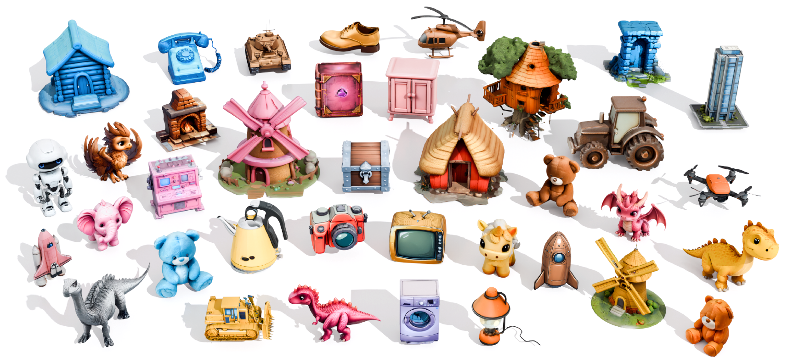

## 1. 배경

**배경**
- 최근 3D 생성은 geometry 생성 후 texture 합성의 2단계("geometry-texture 분리")가 주류
- geometry 생성(TripoSG, Hunyuan3D 2.0, TRELLIS, Hi3DGen 등)은 크게 발전했지만, texture 생성이 3D 생성 품질의 상한을 결정하는 약점으로 남음
- 주류 texture 방법 : 2D image diffusion으로 multi-view RGB를 생성한 뒤 projection으로 3D surface에 mapping

**3D texture 생성의 세 가지 핵심 과제**

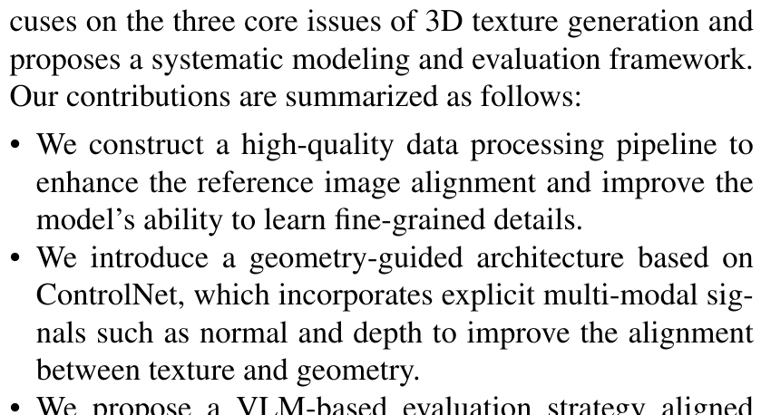

| 과제 | 내용 |
|---|---|
| Reference-texture alignment | 생성 texture가 reference 이미지의 시각적 특징을 정확히 반영하는가 (조명 변화, 가림이 있을 때 특히 어려움) |
| Geometry-texture consistency | texture가 3D surface와 정확히 정렬되는가 |
| Local texture quality | 충분히 세밀한 detail을 만드는가 |

**기여**
1. reference 정렬과 세밀한 detail 학습을 위한 고품질 데이터 처리 pipeline
2. normal, depth 같은 명시적 다중 geometry 신호를 쓰는 ControlNet 기반 geometry-guided 구조
3. 사람의 인식과 정렬된 VLM 기반 평가 전략 (위 세 가지 차원), 세 지표 모두 SOTA
4. 데이터 구축 도구, 학습 pipeline, 평가 script 전체 공개

## 2. 방법론

**문제 정의** : reference 이미지 `I_ref`와 3D geometry `G`로 textured mesh를 만드는 생성기 `F`

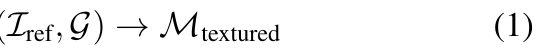

**전체 흐름**
1. 데이터 필터링과 증강으로 detail이 충분하고 조명·시점 변화가 다양한 학습 data 확보
2. ControlNet 기반 구조로 3D geometry와 구조적으로 일치하는 multi-view texture 이미지 생성
3. 전용 PBR 추출 module로 basecolor, metallic, roughness map을 추정해 mesh에 projection

### 2-1. 데이터 처리

**조명 증강 (Lighting augmentation)**
- in-the-wild 입력 이미지는 강한 specular highlight와 그림자 경계가 있어, 그대로 reference로 쓰면 multi-view diffusion이 조명 artifact에 overfitting
- Hunyuan3D 2.0의 delighting module은 조명을 지우지만 원래 색 분포까지 바꿔 reference와 불일치 발생
- 방법
  - 6개 target view는 균일 조명으로 렌더링 (specular, 그림자 artifact 제거)
  - reference 조건 이미지는 다양한 조명으로 렌더링 : object당 15장, 각각 point light, area light, 큐레이션한 HDRI 100개 중 무작위 설정
- 조명 분포가 다른 reference에서도 외관이 일관되고 색이 충실한 texture 생성 → in-the-wild 이미지에 robust

**회전 증강 (Rotation augmentation)**
- 입력 이미지가 정면 canonical view가 아닌 경우가 많음
- reference 이미지 렌더링 시 azimuth를 (-30°, 30°), elevation을 (-10°, 30°) 범위에서 변화

**Texture 품질 필터링**
- 공개 3D dataset에는 단조로운 색, 매우 낮은 채도, surface 패턴이 없는 저품질 texture가 많아 흐리고 구조가 약한 출력의 원인
- 두 지표로 샘플을 걸러냄

① Color Entropy : HSV 공간에서 H, S, V 각 channel의 256-bin 정규화 histogram의 Shannon entropy

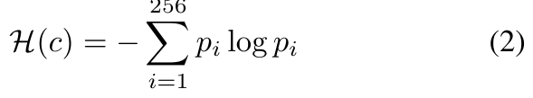

- 세 channel 평균으로 전체 색 다양성 점수 계산 (색상과 밝기 변화를 모두 반영)

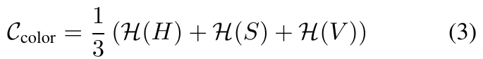

② Texture Complexity : grayscale 이미지에 Sobel 연산자로 가로/세로 gradient를 구하고, gradient 크기의 평균 (공간 주파수와 구조 변화 반영)

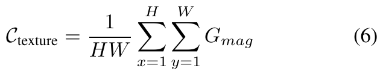

**종합 점수와 선별**
- 각 object를 균일 조명에서 정면과 측면 view로 렌더링해 두 지표를 계산

- `λ = 35` : 두 지표의 scale을 맞추는 고정 가중치
- 전체 object를 점수로 정렬해 상위 100,000개로 고품질 texture dataset 구성

### 2-2. Geometry 조건 Multi-view 생성

- Zero123++처럼 6개 target view를 3×2 이미지 grid로 배치해 생성 target으로 사용
- reference 이미지와 geometry prior가 control 신호로 multi-view diffusion을 guide

**Union ControlNet**

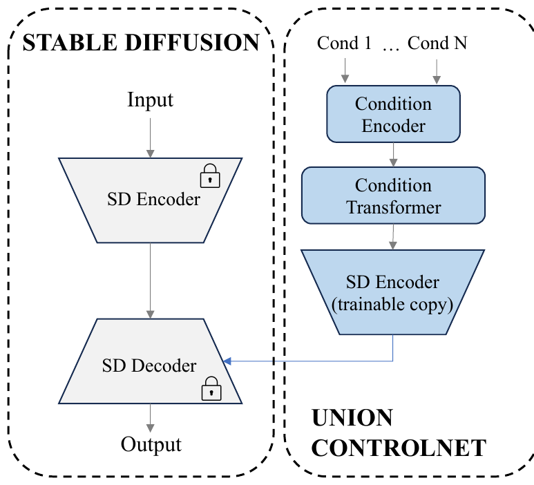

- 표준 ControlNet과 달리 전용 condition encoder로 여러 modality의 control 이미지에서 feature를 추출
- transformer module로 modality 간 상호작용(fusion)을 거친 뒤 ControlNet backbone의 입력으로 사용
- 사용 신호 2가지 (상호 보완)
  - Normal map : 국소적인 미세 geometry detail → micro-structure 수준의 정밀 제어
  - Depth map : 더 전역적인 공간 scale과 윤곽 정보, 매끄럽고 중복성이 있어 normal map의 noise나 잘못된 detail에 과도하게 의존하는 것을 억제 → 안정성과 정렬 향상
- position map이나 view direction encoding 등 임의 종류와 개수의 geometry 입력으로 확장 가능

**점진적 3단계 학습**
- pretrained diffusion은 정면 view에 편향되어 뒷면, 측면 생성 품질이 떨어짐

| 단계 | 학습 대상 | 목적 |
|---|---|---|
| Stage 1 : UNet pretraining | UNet만 (geometry 조건 없음) | 6개 target view의 이미지 분포를 학습하여 기본 multi-view 생성 능력 확보 |
| Stage 2 : ControlNet training | UNet freeze, ControlNet만 | normal, depth 같은 geometry 조건에 반응하여 geometry와 일관된 이미지 생성 |
| Stage 3 : 고품질 data fine-tuning | UNet과 ControlNet 함께 | texture 복잡도가 높고 정렬이 정확한 고품질 data로 모든 view에서 고충실도 detail 생성, 복잡한 조명과 드문 시점에서의 robustness 향상 |

### 2-3. PBR Attributes Extractor

- 사실적인 rendering에는 baked RGB texture만으로 부족하며 basecolor, metallic, roughness가 필요
- 2단계에서 생성한 6개 view RGB `{I_i}`에서 PBR map을 추출

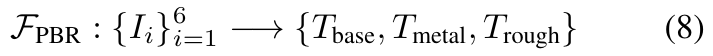

- 기존 PBR 예측 모델 IDArb를 기반으로 두 가지 개선
  1. attention 구조 : view attention, component attention, image attention을 순차가 아닌 병렬 구조로 변경 (같은 계층에서 서로 다른 domain 정보를 동시에 인식, 각 attention의 domain 정보를 더 잘 보존)
  2. 학습 해상도 256×256 → 512×512 (특히 basecolor의 세밀한 detail 포착)

### 2-4. 구현 세부

**Dataset**
- Objaverse와 같은 방식으로 인터넷에서 추가 수집한 공개 3D 모델 포함 약 120만 개
- object마다 고정 6개 view(azimuth 0, 90, 180, 270, 0, 0 / zenith 0, 0, 0, 0, -90, 90)와 무작위 조명·회전 reference 이미지 15장 렌더링
- texture 점수 기준 고품질 100k dataset 별도 구성
- PBR 추출기 학습 : ARB-OBJAVERSE dataset (약 570만 PBR data 쌍)

**Multi-view diffusion 학습**

| 단계 | 설정 |
|---|---|
| Stage 1 | Adam, lr 3e-5, CosineAnnealingWarmRestarts, 120만 dataset 3~5 epoch |
| Stage 2 | UNet 고정, 같은 optimizer와 scheduler, 120만 dataset 2~3 epoch |
| Stage 3 | ControlNet과 UNet 함께, lr 1.5e-5, 고품질 100k data 8~10 epoch |

**PBR 추출기 학습** : pretrained IDArb로 초기화, 병렬 attention, ARB-OBJAVERSE, lr 5e-6, constant with warmup scheduler, 2~3 epoch

## 3. 실험

**평가 설정**
- GPT-4o로 1,000개 object의 설명 prompt 생성 → SDXL로 이미지 생성 → 저품질·중복 제거 후 210장
- TripoSG, Hunyuan3D-2.0, TRELLIS, Hi3DGen으로 각 이미지의 geometry를 생성해 다양한 geometry에 적용 가능함을 평가

### 3-1. Human-aligned 평가 (VLM 기반)

- 기존 FID, PSNR, LPIPS, SSIM은 정답과의 비교에 의존하고 밝기·채도 차이에 왜곡되어 texture 품질을 정확히 반영하지 못함
- GPTEval3D에서 영감을 받아 세 차원(reference 정렬, geometry 일관성, 국소 texture 품질)별 VLM prompt 설계

**Pairwise 비교와 Elo score**

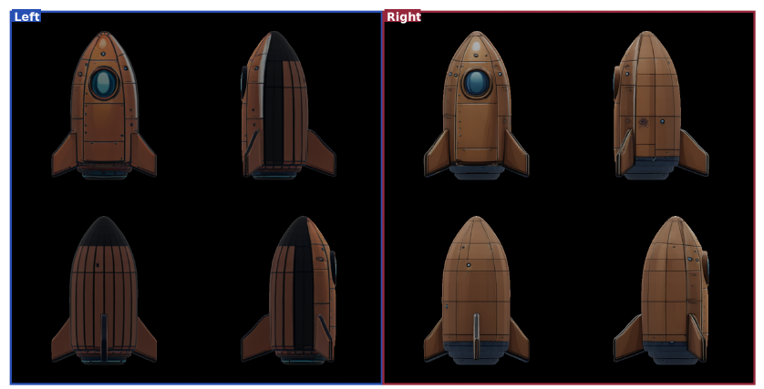

- `n`개 방법 각각의 texture mesh에서 4장을 렌더링하고, 두 방법 `A_i`, `A_j`의 이미지를 이어 붙인 `I_ij`를 VLM(Qwen2.5-VL-32B)이 비교

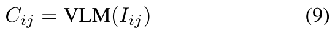

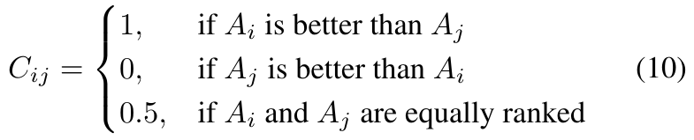

- 비교 결과로 각 방법의 Elo score `R_i` 갱신 (`K`는 Elo 조정 상수)

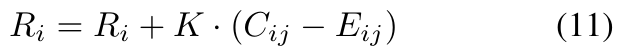

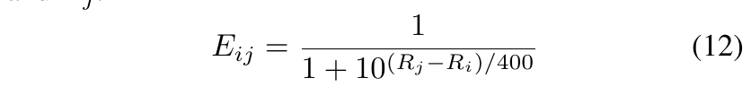

- `E_ij` : 현재 Elo에 따른 기대 점수
- 순서 의존 오차를 피하려고 비교 결과를 무작위로 섞어 Elo 계산을 100번 반복하고 평균
- 모든 방법 결과를 한 이미지에 이어 붙이지 않는 이유 : 이미지가 너무 크면 VLM이 국소 detail을 놓쳐 평가가 부정확해짐

### 3-2. RGB texture 비교

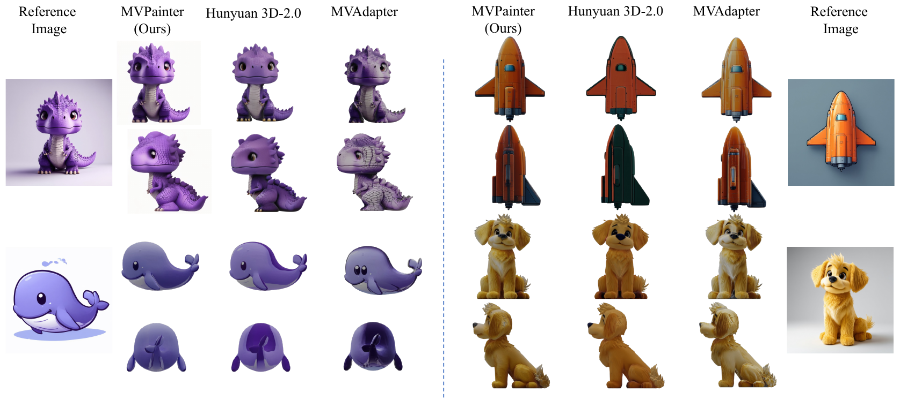

- Hunyuan3D-2.0 : delighting module로 깨끗하고 색 스타일이 일관되지만, 물체 고유 색을 바꿀 수 있고(강아지) 하이라이트로 강조되던 detail이 사라져 전반적으로 detail 부족
- MVAdapter : detail은 풍부하지만 geometry 정렬이 나쁨(고래 눈 위치, 강아지 코와 눈 어긋남), 하이라이트를 texture로 오해하는 등 조명 처리가 미흡
- MVPainter : 조명 처리, geometry 일관성, 국소 detail 보존 모두 우수

**VLM 기반 Elo score**

| Geometry | Method | Reference-texture Alignment | Geometry-texture Consistency | Local Texture Quality |
|---|---|---|---|---|
| TripoSG | Hunyuan2 | 816 | 838 | 816 |
| | MVAdapter | 1030 | 1026 | 1050 |
| | **MVPainter** | **1109** | **1136** | **1134** |
| Hunyuan2 | Hunyuan2 | 846 | 835 | 824 |
| | MVAdapter | 1034 | 1032 | 1031 |
| | **MVPainter** | **1120** | **1132** | **1146** |
| TRELLIS | Hunyuan2 | 861 | 846 | 828 |
| | MVAdapter | 1033 | 1040 | 1056 |
| | **MVPainter** | **1105** | **1114** | **1117** |
| Hi3dGen | Hunyuan2 | 865 | 859 | 837 |
| | MVAdapter | 1010 | 993 | 1008 |
| | **MVPainter** | **1125** | **1148** | **1156** |

- 어떤 geometry 생성기와 결합해도 MVPainter가 최고 → 다양한 geometry 입력에 robust

**사람 평가 (TripoSG mesh, 5명 pairwise 비교로 Elo 계산)**

| Method | Reference-texture Alignment | Geometry-texture Consistency | Local Texture Quality |
|---|---|---|---|
| Hunyuan2 | 918 | 628 | 845 |
| MVAdapter | 938 | 1180 | 1041 |
| **MVPainter** | **1144** | **1192** | **1114** |

- 사람 평가 추세가 VLM 평가와 거의 일치하지만 Elo 차이의 크기는 다름
- geometry 일관성과 국소 texture 품질처럼 세밀한 시각 검사가 필요한 차원에서 차이가 더 큼 (현재 VLM은 미세 detail 포착이 사람보다 약함), 전역 수준의 texture 품질 평가에는 충분히 신뢰 가능

### 3-3. PBR 추출기 비교

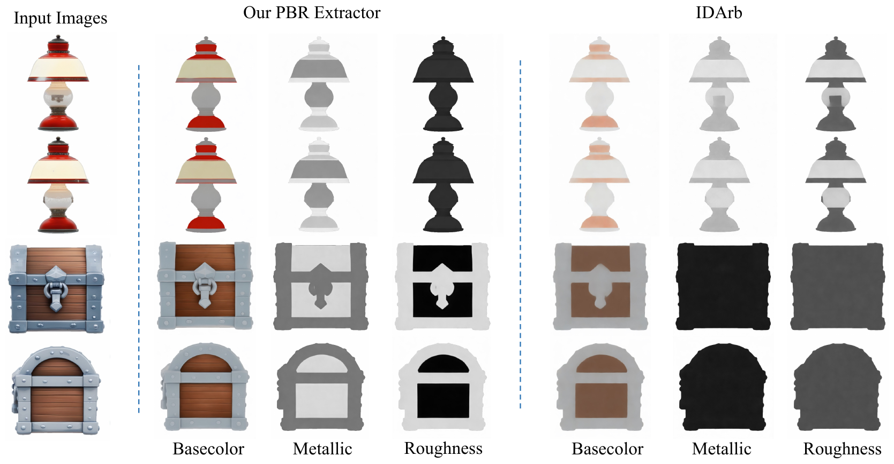

- 병렬 attention과 해상도 향상으로 IDArb보다 조명을 효과적으로 제거하면서 basecolor의 surface detail을 더 많이 보존

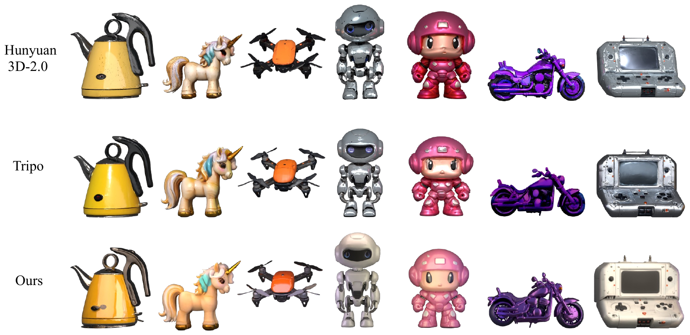

- Tripo와 Hunyuan3D-2.0의 PBR 모델(공식 웹 application, 비공개)과 비교해도 비슷한 성능

### 3-4. Ablation

**조명 증강**

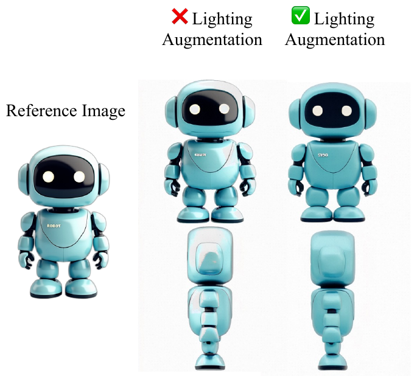

- 조명 증강이 없으면 diffusion이 모든 조명 효과를 texture에 bake
- 정적으로는 더 "사실적"으로 보이지만, 상호작용 환경에 놓이면 baked 조명 때문에 사실감 저하

**회전 증강**

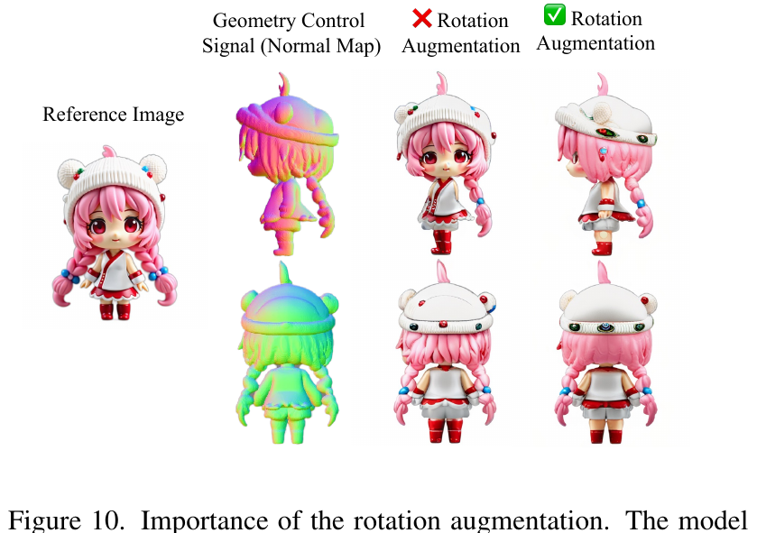

- reference에 정렬된 geometry를 90도 회전시켜 control 신호로 넣어 테스트
- 회전 증강이 없으면 첫 번째 생성 view가 geometry와 심하게 어긋남
- 원인 : 학습 set에서 첫 시점 target 이미지가 reference와 매우 비슷해, diffusion이 geometry 조건 대신 reference를 그대로 따르는 "shortcut"을 학습
- 회전 증강이 이 shortcut을 막아 reference 의존을 줄이고 학습 분포 밖의 reference에 대한 일반화 향상

**고품질 data fine-tuning**

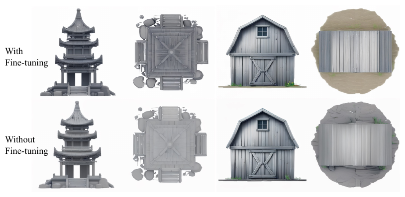

- fine-tuning 후 국소 detail이 훨씬 풍부, 특히 top view에서 두드러짐
- top view는 reference에서 직접 정보를 가져오기보다 고품질 dataset의 풍부한 texture 분포에서 더 직접적으로 이득을 얻기 때문

**추가 결과 (다른 geometry 생성기)**

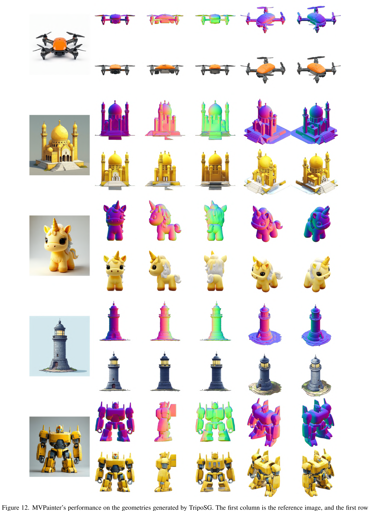

- 논문에는 Hunyuan3D-2.0, TRELLIS, Hi3DGen geometry에 대한 결과(Fig. 13~15)도 있음

## 4. 한계 및 향후 방향

- 고정된 6개 시점만 생성 : 대부분 물체에 충분하지만 self-occlusion이 있는 물체는 완전한 coverage가 어려움 → 가변적이고 극단적인 시점에서의 texture 생성 필요
- 속도 최적화가 충분하지 않음 : 대규모 data나 실시간 생성 요구에서 계산 효율 개선 필요
