# MatLat

> **한 줄 요약** : View → UV (PBR multi-view 생성)  
> pretrained VAE를 residual prediction + KL regularization으로 fine-tuning하여 PBR channel(albedo, roughness, metallic)을 pretrained latent 분포에 맞춘 material latent space를 만들고, locality regularization과 correspondence-aware attention으로 multi-view 일관성을 높인 PBR texture 생성 모델

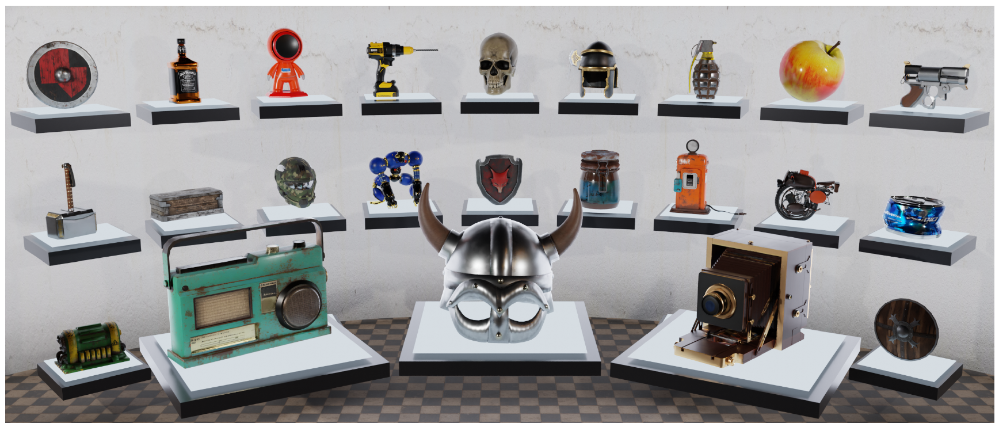

## 1. 배경

**목표**
- 주어진 3D mesh에 대해 text prompt로 고품질 PBR texture(albedo, roughness, metallic) 생성
- PBR texture는 임의 조명에서 물리적으로 정확한 relighting을 가능하게 하여 production-ready asset의 핵심 요소

**기존 방식의 문제**
- 대규모 고품질 PBR texture dataset 부족 : 공개 dataset은 수만 개 수준, TexVerse를 더해도 이미지 dataset보다 자릿수가 작음
- 처음부터 학습하는 방법 : PBR data 부족으로 품질이 낮음
- SDS 기반 방법 : 고품질 PBR material 이미지를 만들지 못하고 과포화(saturation) artifact, 계산 비용이 큼
- 가장 효과적인 전략은 pretrained 2D 모델로 multi-view 이미지를 생성해 mesh에 projection하는 것이지만, PBR에는 두 가지 큰 문제
  1. RGB latent로 학습된 diffusion을 PBR에 바로 쓰기 어려움 : roughness, metallic이라는 추가 channel을 pretrained encoder에 넣으면 큰 domain gap 발생
  2. multi-view 일관성 유지가 어려움 : 실패하면 mesh에 unprojection할 때 겹치는 영역이 흐려지고 artifact 발생

**핵심 아이디어** : Material Latent space(MatLat)를 학습하는 2단계 pipeline
1. PBR texture 이미지로 pretrained VAE를 fine-tuning하여 Material VAE(MatVAE) 학습
2. 적응된 latent space에서 multi-view material 이미지를 생성하도록 diffusion model fine-tuning

**두 가지 핵심 구성 요소**
- Latent space 적응 (MatVAE) : pretrained latent space를 확장해 roughness와 metallic을 넣으면서 pretrained prior 보존
  - 기존 대부분은 pretrained encoder를 freeze하고 zero-channel padding으로 추가 channel을 넣음 → 심한 분포 불일치
  - MatLat은 encoder를 fine-tuning하되 원래 latent 분포에서 벗어나지 않도록 분포 regularization 적용
  - 투명 이미지나 RGB-D 합성에서 비슷한 시도가 있었지만, PBR texture 생성에 적용한 첫 연구
- Locality regularization : latent token과 이미지 pixel의 공간 정렬을 강제하여 correspondence-aware attention(CAA)과 함께 multi-view 일관성 향상
  - CAA는 latent-이미지 mapping이 공간 locality를 유지할 때 효과적인데, pretrained RGB encoder에서는 대체로 성립하지만 추가 material channel에서는 깨지는 경우가 많음

**관련 연구 정리**

| 분야 | 기존 방법 | 한계 |
|---|---|---|
| PBR texture 생성 | 처음부터 학습, SDS 기반, multi-view diffusion | 품질 저하, 과포화와 느림, PBR channel 처리 |
| Pretrained diffusion prior 활용 | channel을 나누고 padding하여 frozen RGB encoder에 입력 | 인코딩된 latent 분포가 pretrained latent와 크게 다름 |
| Multi-view 일관성 | dense multi-view attention | geometry 정보를 쓰지 않아 비효율적이고 결과가 최적이 아님 |

## 2. 방법론

### 2-1. 문제 설정

- `M` : 3D mesh surface, `y` : 목표 외관을 지정하는 text prompt
- `N`개의 camera 시점 `{c_i}`, 각각 회전 `R_i`와 이동 `t_i`로 orthographic projection `Π_i` 정의
- 각 view `c_i`마다 5-channel PBR material 이미지 `x_i` 생성 : albedo `a_i`(3 channel), roughness `r_i`(1), metallic `m_i`(1)
- multi-view 이미지를 생성하여 mesh에 projection

### 2-2. 기존 방법 : Frozen VAE

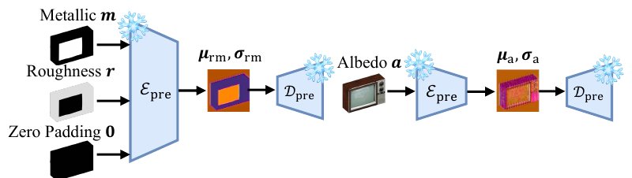

- MaterialMVP 등 대부분의 기존 연구가 사용하는 방식
- pretrained VAE를 freeze하고 encoder를 재사용하여 5-channel PBR 이미지의 latent를 얻음
- pretrained VAE의 3-channel 입력에 맞추기 위해 albedo와 roughness/metallic을 따로 인코딩
  - roughness와 metallic을 concat하고 zero-padding : `E_pre([r, m, 0])`
  - albedo : `E_pre(a)`
- diffusion model은 두 latent를 concat한 `[z_rm, z_a]`로 fine-tuning
- 문제
  - albedo latent `z_a`는 RGB 이미지와 의미가 비슷해 pretrained latent space와 가깝지만, `z_rm`은 roughness/metallic의 시각 특성이 달라 out-of-distribution latent가 되어 생성 품질 저하
  - latent code 두 개를 생성하므로 diffusion 추론 비용이 두 배

### 2-3. MatVAE : Residual Prediction과 KL Regularization

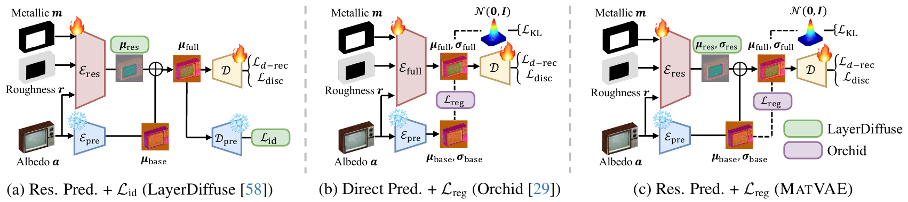

PBR channel을 pretrained diffusion prior를 보존하면서 하나의 latent code로 인코딩

**Residual prediction**
- albedo와 RGB의 의미 유사성을 이용해, pretrained encoder `E_pre`로 albedo를 인코딩한 분포를 base latent 분포로 사용
- 학습 가능한 residual encoder `E_res`가 roughness와 metallic 정보를 주입
  - `E_res`가 5-channel 입력 `x`에서 residual parameter `(μ_res, σ_res)`를 예측하여 base 분포를 보정

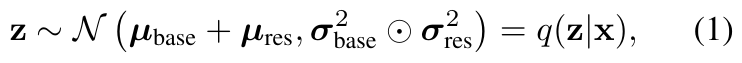

- `⊙` : element-wise 곱
- 학습 가능한 decoder `D`가 latent `z`를 5-channel PBR 이미지 `x̂ = D(z)`로 복원
- pretrained encoder는 freeze하고 `E = (E_pre, E_res)`와 `D`를 아래 목표로 최적화

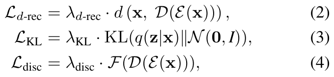

- `d(·,·) ∈ {ℓ2, LPIPS}` : 재구성 거리, `F` : adversarial loss의 discriminator

**KL regularization**
- 위 목표만으로는 학습된 표현 공간이 pretrained latent 분포에서 벗어날 수 있음
- 학습된 latent 분포와 pretrained 분포 사이의 divergence를 벌점으로 부여

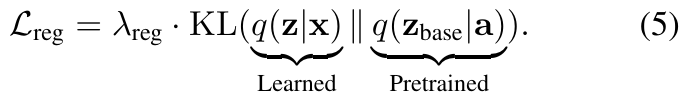

**MatVAE = residual prediction + KL regularization**

**기존 연구와의 차이**

| 방법 | 방식 | 한계 |
|---|---|---|
| LayerDiffuse (투명 이미지) | residual prediction이지만 latent 평균만 예측(deterministic encoder), identity-consistency loss `L_id` 사용 | pretrained VAE의 부드러운 latent 표현을 해칠 수 있고, 분포 수준의 정렬을 강제하지 않음 |
| Orchid (depth, normal) | KL regularization을 쓰지만 `(μ_full, σ_full)`을 직접 예측 | 학습 초기부터 pretrained 분포에서 벗어날 수 있음 |
| MatVAE | residual의 평균과 표준편차를 모두 예측하고 KL regularizer로 분포 정렬 | - |

- `E_res`의 마지막 convolution layer를 0으로 초기화 → 학습 시작 시 residual이 0이라 pretrained latent 분포를 정확히 재현하고, 새 modality에 점진적으로 적응 (최적화 안정)

### 2-4. Multi-View 일관성

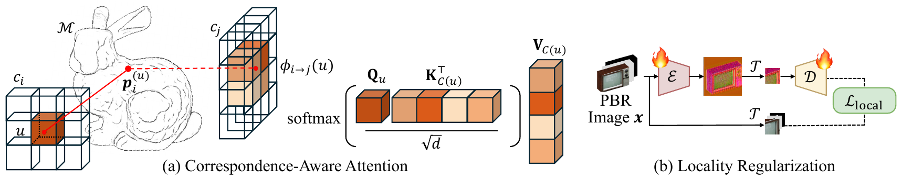

**Correspondence-Aware Attention (CAA)**
- 기존 dense multi-view attention : 모든 view의 모든 token끼리 attention, geometry나 visibility prior가 없어 대응을 암묵적으로 학습해야 함 → 느린 수렴과 view 불일치
- CAA : 명시적인 점 대응을 attention 계산에 포함
  - view `c_i`의 pixel `u`가 관측하는 surface 점 `p_i^(u) = Π_i^(-1)(u)`
  - 다른 view `j`에서 그 점이 보이면, projection `φ_{i→j}(u) = Π_j(p_i^(u))`의 최근접 pixel이 대응 pixel
  - 나머지 `N-1`개 view의 유효 대응 집합 `C(u)`, 실제로는 `φ_{i→j}(u)` 중심의 `K×K` local window
  - attention을 대응 집합으로 제한

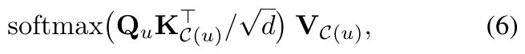

**Locality Regularization**
- CAA는 latent 공간에서 view 간 feature 교환을 촉진하지만, 목표는 decoding된 pixel 공간에서의 일관성
- 따라서 latent token과 대응 이미지 pixel 사이의 공간 locality가 필요 (각 pixel이 주로 공간적으로 가까운 latent token에서 decoding되어야 함)
- pretrained encoder에서는 성립하지만, 추가 PBR channel로 fine-tuning한 MatVAE에서는 깨질 수 있음 → CAA가 geometry와 무관한 token 사이에서 정보를 교환하게 되어 일관성 저하
- patch 단위 재구성을 강제하는 locality regularizer 도입

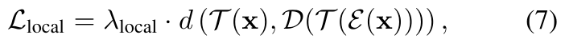

- `T` : 무작위 crop 연산, `d = ℓ2`
- latent를 잘라 decoding한 결과가 이미지의 같은 영역과 맞도록 하여, 각 pixel이 주로 정렬된 latent token에서 복원되게 함
- Eq. (2)의 재구성 loss를 locality regularization으로 교체한 MatVAE 최종 학습 목표

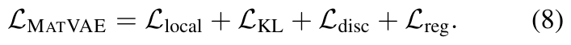

### 2-5. MatLat 학습 목표

- latent diffusion(velocity) 모델 `u_θ`를 multi-view PBR latent `Z`로 fine-tuning (mesh를 `N`개 시점에서 렌더링하고 각 view를 MatVAE로 인코딩)
- diffusion model의 attention block에 원래 attention layer에 더해 CAA module 삽입
- Conditional Flow Matching : data latent와 Gaussian noise 사이의 선형 경로 `Z_t = (1-t)Z + tϵ`

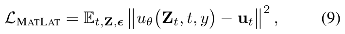

- `u_t = ϵ - Z` : 순간 velocity, `y` : 조건 text caption

## 3. 실험

**설정**
- Stable Diffusion 3.5-Medium의 pretrained VAE와 diffusion model에서 fine-tuning
- 학습 data : Objaverse-XL의 PBR textured asset 40,723개, caption은 Bootstrap3D와 Cap3D
- 학습 때 mesh마다 고정 26개 시점에서 렌더링, 생성은 6개 canonical view(front, back, left, right, top, bottom)
- 평가 : PacTure를 따라 학습에 없는 mesh 128개, mesh당 20개 camera view (0° elevation 8개, 30° 6개, 45° 4개, ±90° 2개)
  - albedo, roughness, metallic 이미지와 무작위 HDR environment map에서의 shaded RGB 이미지 렌더링

**평가 지표**
- shaded, albedo 이미지 : FID(CLIP embedding 공간), KID, CLIP 유사도(text-image 정렬)
- roughness, metallic : 정답과의 RMSE
- c-PSNR(correspondence-PSNR) : 생성 multi-view material 이미지의 일관성 측정, 각 pixel과 다른 view의 대응 pixel 사이 PSNR (Appendix A.1)
- texture 하나 생성에 걸리는 시간

### 3-1. Ablation

| Id | Method | Shaded FID_CLIP ↓ | Shaded KID ↓ | Shaded CLIP ↑ | Albedo FID_CLIP ↓ | Albedo KID ↓ | Albedo CLIP ↑ | Rough. RMSE ↓ | Metal. RMSE ↓ | c-PSNR ↑ | Time ↓ |
|---|---|---|---|---|---|---|---|---|---|---|---|
| 1 | Frozen VAE | 3.419 | **1.052** | 0.318 | 4.926 | 1.560 | **0.315** | 0.193 | 0.251 | 19.869 | 111s |
| 2 | Res. Pred. + `L_reg` (Ours) | **3.083** | 1.327 | 0.318 | **4.599** | 1.574 | 0.314 | 0.158 | 0.134 | **21.934** | 34s |
| 3 | Res. Pred. + `L_id` (LayerDiffuse) | 3.210 | 1.090 | 0.317 | 4.871 | 1.525 | 0.312 | 0.165 | **0.128** | 20.977 | 34s |
| 4 | Direct Pred. + `L_reg` (Orchid) | 3.192 | 1.146 | **0.319** | 4.768 | 1.472 | 0.312 | 0.161 | 0.170 | 21.468 | 34s |
| 5 | w/o `L_local` | 3.419 | 1.611 | 0.316 | 5.873 | 4.122 | 0.312 | **0.154** | 0.182 | 19.437 | 34s |
| 6 | w/o CAA | 3.110 | 1.088 | 0.317 | 4.732 | **1.388** | 0.312 | 0.155 | 0.151 | 18.687 | 38s |

- 각 경우 pretrained VAE와 diffusion을 각각 200K, 20K step fine-tuning (Frozen VAE는 encoder fine-tuning이 없어 diffusion을 45K step으로 학습량 맞춤), diffusion 구조와 학습 방식은 MatLat과 동일

**Latent space 적응 (row 1~4)**
- Frozen VAE는 shaded, albedo 모두 MatLat보다 FID가 높고 KID는 약간 좋거나 비슷
- roughness/metallic RMSE의 차이가 커서, 추가 channel이 out-of-distribution latent를 만들어 품질을 떨어뜨림을 시사
- MatLat이 Frozen VAE보다 약 3배 빠름 (Frozen VAE는 domain 간 상관관계를 위해 별도 branch와 cross-domain attention layer를 씀)
- 다른 encoder fine-tuning 방식(LayerDiffuse, Orchid)보다 FID가 좋고 KID는 약간 높음 (Inception 기반 KID 결과는 Appendix A.2에서 별도 논의)

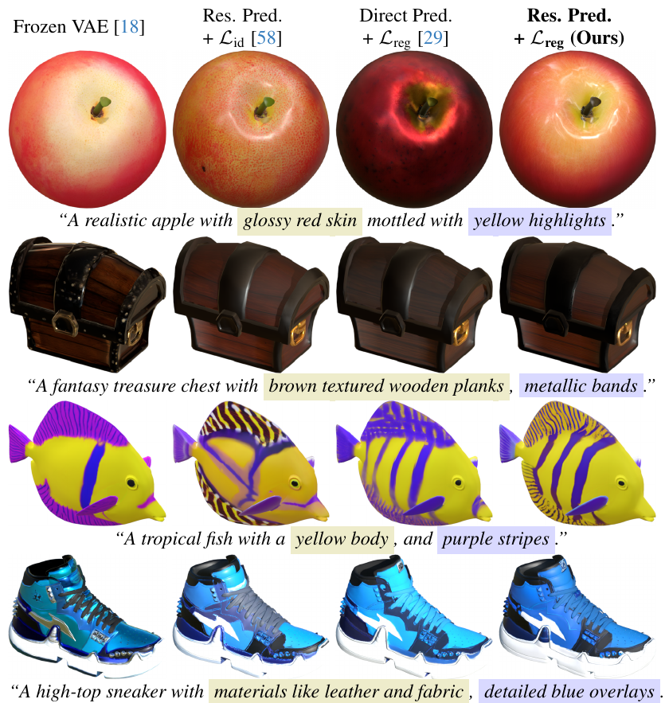

- residual prediction과 `L_reg`의 결합이 text 정렬(사과의 광택 있는 표면)과 세밀한 detail(물고기 지느러미)을 개선

**CAA와 locality regularization (row 5~6)**
- CAA만 쓰고 `L_local`이 없으면 (row 5) 대부분 지표가 하락하고 c-PSNR이 크게 떨어짐 : latent-pixel mapping이 공간적으로 local하지 않아 CAA가 무관한 영역 사이로 정보를 전파
- `L_local`만 쓰고 CAA가 없으면 (row 6) 대부분 지표는 유지되지만 c-PSNR이 낮음 : dense multi-view attention으로 대응을 암묵적으로 추론해야 하므로 view 정렬이 약함
- 둘을 결합한 MatLat이 성능 저하 없이 가장 높은 c-PSNR

### 3-2. 다른 방법과 비교

- 각 baseline의 공식 checkpoint와 기본 설정으로 생성한 뒤 같은 설정에서 렌더링하고 평가
- 비교 범주 : 처음부터 학습(SC), SDS 기반 최적화(SDS), multi-view diffusion(MV)

| Method | Type | Shaded FID_CLIP ↓ | Shaded KID ↓ | Shaded CLIP ↑ | Albedo FID_CLIP ↓ | Albedo KID ↓ | Albedo CLIP ↑ | Rough. RMSE ↓ | Metal. RMSE ↓ | Time ↓ |
|---|---|---|---|---|---|---|---|---|---|---|
| MeshGen | SC | 8.637 | 11.105 | 0.282 | 11.322 | 16.193 | 0.282 | **0.143** | 0.201 | 195s |
| TexGaussian | SC | 6.025 | 3.571 | 0.301 | 12.119 | 9.381 | 0.299 | 0.145 | 0.243 | 73s |
| Paint-it | SDS | 8.547 | 5.382 | 0.309 | 13.063 | 10.665 | 0.299 | 0.168 | 0.200 | 1260s |
| DreamMat | SDS | 5.422 | 2.668 | 0.311 | 9.621 | 6.002 | 0.311 | 0.167 | 0.165 | 2400s |
| FlashTex | SDS | 7.119 | 5.354 | 0.305 | 12.320 | 10.441 | 0.298 | **0.143** | 0.186 | 285s |
| MaterialAnything | MV | 6.582 | 5.287 | 0.312 | 12.691 | 9.325 | **0.317** | 0.233 | 0.200 | 500s |
| MaterialMVP | MV | 6.309 | 5.744 | 0.294 | 9.630 | 8.811 | 0.290 | 0.175 | **0.133** | 35s |
| MatLat | MV | **3.083** | **1.327** | **0.318** | **4.599** | **1.574** | 0.314 | 0.158 | 0.134 | **34s** |

- SC 방법 : 제한된 고품질 PBR supervision 때문에 품질이 낮음
- SDS 방법 : SC보다 낫지만 개선 폭이 작고, DreamMat은 약 40분이 걸림
- MatLat : albedo CLIP(MaterialAnything이 약간 높음)을 제외하고 shaded와 albedo에서 모든 baseline보다 우수

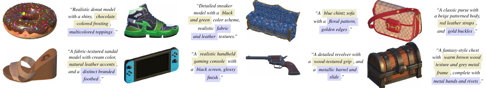

## 4. 추가 분석 (Appendix)

**Correspondence-PSNR 정의 (A.1)**
- 생성한 `N`개 view `{x_i}`와 mesh에서, `i`번째 view의 pixel `u`에 대해 `j`번째 view의 대응 pixel 집합 `C_{i→j}(u)`
- 모든 대응 쌍의 MSE를 channel 수 `C = 5`와 전체 대응 쌍 수 `M`으로 정규화하고, `c-PSNR = 10 log10(1 / MSE)`

**KID 논의 (A.2)**
- Inception 특징은 ImageNet 의미에 강하게 묶여 있어 렌더링된 material 이미지의 지각 유사도를 잘 반영하지 못할 수 있음
- CLIP 기반 KID에서는 MatLat이 일관되게 우수

| Method | Shaded KID_CLIP ↓ | Albedo KID_CLIP ↓ |
|---|---|---|
| Frozen VAE | 2.123 | 3.547 |
| Res. Pred. + `L_reg` (Ours) | 1.496 | **2.855** |
| Res. Pred. + `L_id` | 1.977 | 3.710 |
| Direct Pred. + `L_reg` | 1.917 | 3.254 |
| w/o `L_local` | 2.660 | 8.820 |
| w/o CAA | **1.424** | 3.154 |

**Direct vs. Residual prediction (A.3)**

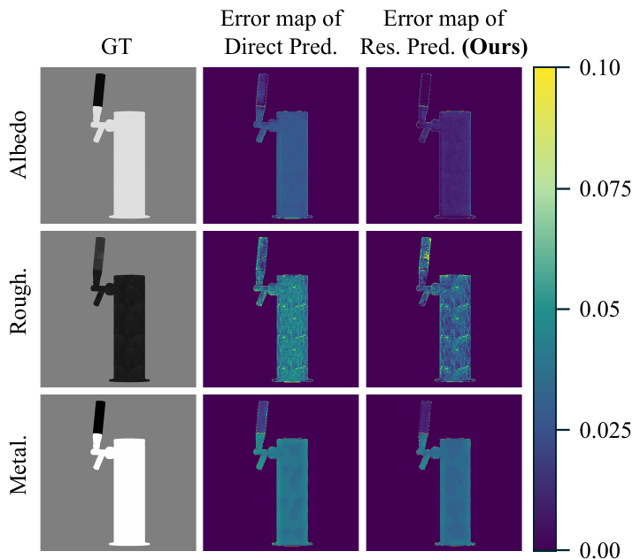

- 같은 초기 단계(10k iteration)에서 residual prediction의 albedo 재구성 오차가 더 작음 (zero 초기화로 원래 latent 표현 보존)
- direct prediction은 몇 번의 update만으로도 albedo 재구성 품질이 눈에 띄게 저하
- roughness, metallic 오차는 비슷하지만, albedo의 안정성이 이후 생성 성능 향상으로 이어짐

**Locality regularization 분석 (A.4)**

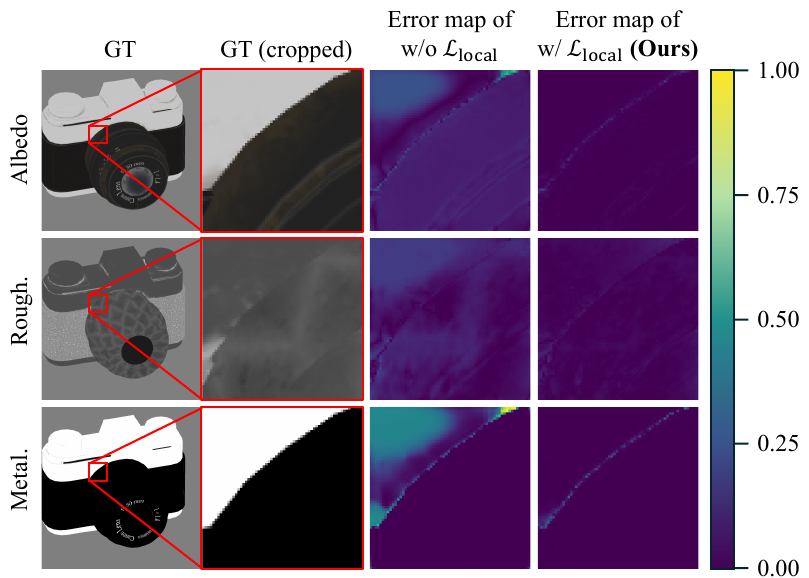

- `L_local`을 쓰면 crop patch 재구성 오차가 크게 줄어 latent-이미지 공간 정렬이 개선
- 제거하면 encoder가 공간적으로 먼 latent token 사이의 정보를 얽어, CAA가 무관한 영역으로 정보를 전파
- crop 크기 민감도 : 64×64 latent grid에서 50% 확률로 정사각형 crop, 기본 크기 범위 `[3, 32]`

| Crop range | FID_CLIP (shaded) | FID_CLIP (albedo) | c-PSNR |
|---|---|---|---|
| [3, 32] | **3.083** | **4.599** | **21.934** |
| [24, 48] | 3.208 | 5.027 | 20.571 |
| [32, 64] | 3.339 | 4.719 | 20.980 |

- 모든 crop 범위가 crop 없는 학습보다 우수하고, 작은 patch가 local window에서 동작하는 CAA와 잘 맞는 더 강한 locality prior를 제공

**Latent 분포 불일치 (A.5)**
- SD3.5-medium latent prior(PBR dataset의 text prompt로 생성한 5K sample)와 인코딩된 PBR latent 사이의 sliced Wasserstein distance

| SWD(z, z_a) | SWD(z, z_rm) | SWD(z, z_ours) |
|---|---|---|
| 0.539 | 0.897 | 0.560 |

- pretrained VAE의 albedo latent `z_a`는 prior와 비교적 가깝지만, roughness+metallic latent `z_rm`은 크게 다름 (추가 PBR channel이 불일치를 유발한다는 주장을 뒷받침)
- MatVAE는 material 정보를 넣으면서도 불일치를 크게 줄임

## 5. 구현 세부 (Appendix B)

**MatVAE**
- Stable Diffusion 3.5-Medium의 pretrained VAE로 초기화, 원래 encoder `E_pre`와 decoder `D_pre`는 freeze
- offset encoder `E_res` : `E_pre`와 같은 구조, 첫 convolution만 5-channel 입력 `[a, r, m]`을 받도록 수정
  - 중간 layer는 `E_pre` weight로 초기화, 출력 layer는 0으로 초기화하여 시작 시 `μ_res = 0`, `σ_res = 1`
- decoder `D` : `D_pre`의 마지막 convolution을 5-channel 출력으로 확장, 나머지 layer는 복사
- 학습 : Adam, learning rate 3e-5, batch 8, 200k iteration, RTX Pro6000 8장에서 60시간
- loss 가중치 : `λ_local = 3`, `λ_KL = 1e-6`, `λ_disc = 0.02`, `λ_reg = 3e-9`
- locality regularization : 50% 확률로 이미지 면적의 0.2%~25%에 해당하는 정사각형 영역을 무작위 crop

**Diffusion fine-tuning**
- MMDiT backbone의 SD 3.5-Medium
- 각 joint attention layer에 병렬 CAA branch 추가 : 원래 projection weight를 공유하고 rank 32 LoRA layer 추가, 출력은 원래 attention 출력에 residual로 더함
- 입력 geometry와 정렬하기 위해 해당 view의 렌더링 position map과 normal map을 noisy latent와 concat
- 학습 : CFM 목표, SD3와 같은 logit-normal 분포로 timestep 샘플링, Adam lr 5e-5, batch 4, 20k iteration, RTX Pro6000 8장에서 약 24시간
- 추론 : 6개 canonical view, Euler sampler 30 step, CFG scale 4.0
- UV 변환 : 5-channel material 이미지로 decoding한 뒤 MVAdapter pipeline을 따라 upscale, camera pose와 mesh로 UV에 unprojection, UV 공간 inpainting으로 가려진 영역 채움

**Baseline 구현**
- MeshGen과 MaterialMVP는 image 조건이므로 Stable Diffusion 2-Depth로 참조 이미지를 생성하여 입력
- 나머지는 공식 구현과 기본 설정 사용

**Data 처리**
- Objaverse-XL에서 PBR texture가 있는 mesh 40,851개 선별, 128개를 평가용으로 분리
- mesh마다 26개 고정 시점에서 albedo, roughness, metallic과 조건용 normal, position map 렌더링
- diffusion 학습 iteration마다 26개 중 6개 view를 무작위 선택
- text 조건 : Bootstrap3D caption 우선, 없으면 Cap3D
- 평가 렌더링 : Poly Haven의 HDR environment map 785개 중 무작위 선택, 생성 결과와 정답에 같은 설정 적용

## 6. 추가 결과 (Appendix C)

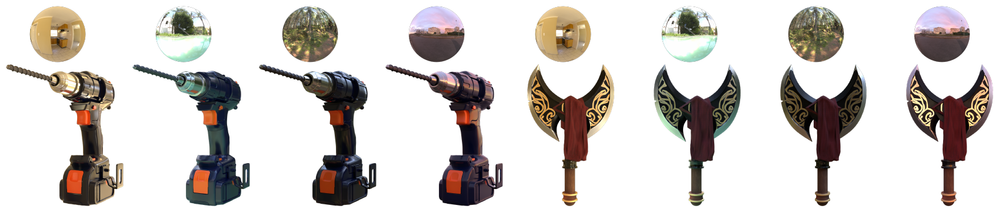

- 같은 object를 4개 environment map으로 렌더링해도 외관 변화가 일관되어, 조명 의존 효과가 그럴듯한 PBR texture임을 보여줌

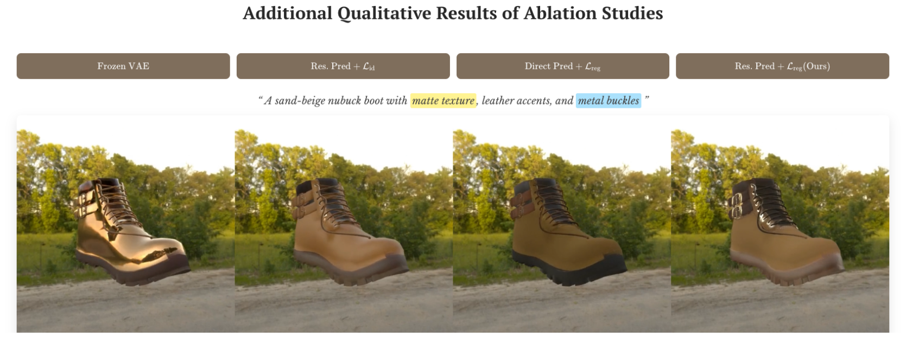

- Frozen VAE는 신발 표면이 과도하게 금속처럼 빛나는 비현실적 재질
- LayerDiffuse 방식(`L_id`)과 Orchid 방식(direct prediction)은 금속 버클 같은 세밀한 detail을 놓침

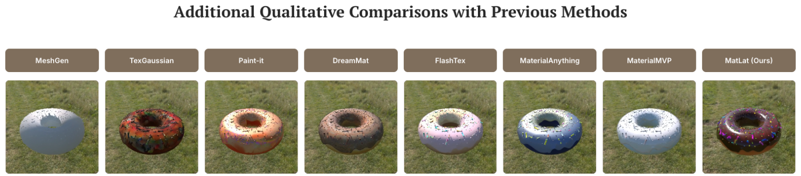

- 처음부터 학습한 모델은 품질이 낮고 text 정렬이 약함
- SDS 기반 방법은 세밀한 detail이 부족하고 색이 과포화

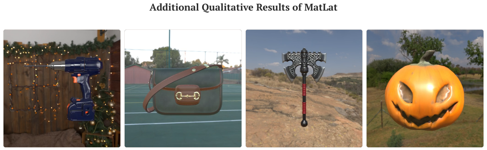

## 7. 한계

- 논문 본문과 Appendix에 별도의 한계 섹션이 없음
