# NaTex

> **한 줄 요약** : 3D native latent diffusion  
> texture를 dense color point cloud(3D 공간의 연속 color field)로 보고, geometry-aware color VAE와 multi-control color DiT로 3D 공간에서 색을 직접 생성 (multi-view 생성과 baking 없음)

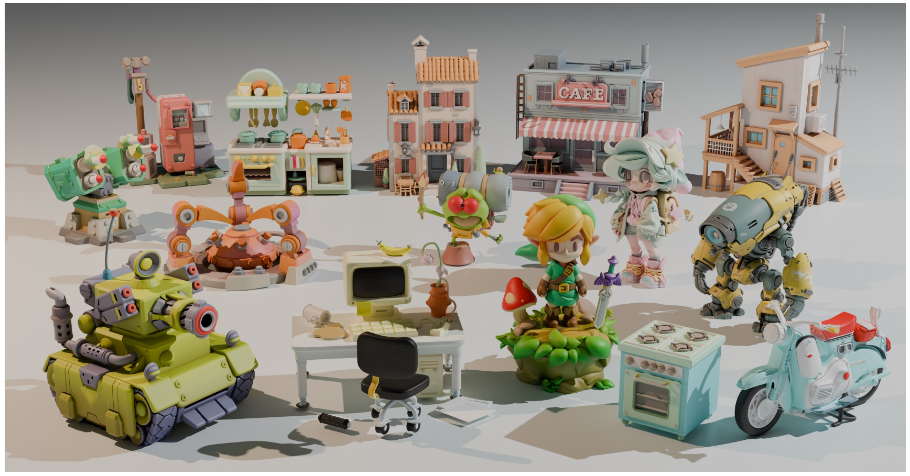

## 1. 배경

**목표**
- 단일 이미지와 mesh에서, 3D 공간에서 직접 texture 색을 예측하는 native texture 생성
- multi-view diffusion(MVD) pipeline의 근본 한계를 우회

**MVD texturing의 근본 문제 3가지**

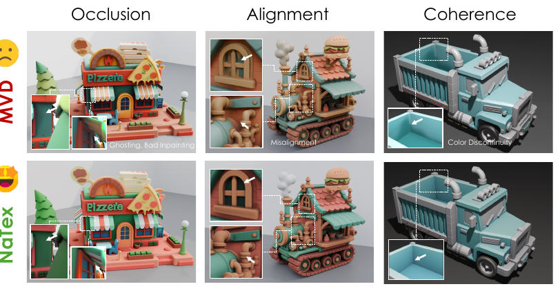

| 문제 | 현상 | 피할 수 없는 이유 |
|---|---|---|
| Occlusion | 가려진 영역의 ghosting, 나쁜 inpainting | 어떤 방식으로 view를 골라도 가려진 영역은 반드시 생김 |
| Alignment | texture와 미세 geometry의 경계 불일치 | latent space diffusion 자체의 오차로 pixel 단위 경계 정렬이 어렵고, 2D normal control은 미세 detail에 부정확 |
| Coherence | view 간 내용, 색, 조명의 불연속 | multi-view 일관성 유지가 비싸고, 최신 video 모델도 충분히 해결 못 함 |

- 이 오차들은 projection과 baking 과정에서 누적됨 (modality 변환에서 오는 cascading error)
- 기존 native 3D 방법은 proxy 표현(UV map, point 기반 feature, Gaussian Splatting)을 써서 data 효율이 낮고 cascade error가 생김

**핵심 아이디어**
- texture를 3D의 "1급 시민"으로 다룸 : texture를 dense color point cloud로 보고, 3D 좌표에 대한 RGB를 latent diffusion으로 직접 예측
- 3D에서 바로 생성하므로 inpainting 같은 후처리가 불필요
- geometry 전체를 직접 주입하므로 3D를 2D view(depth, normal)로 투영할 때의 정보 손실이 없음
- 전체 texture를 하나의 통일된 표현으로 다루므로 global consistency 유지가 쉬움

**기여**
1. color field 생성을 위한 확장성 높은 framework (material 생성, part segmentation 등으로 확장 가능)
2. geometry-aware color VAE : geometry branch가 국소 shape 단서를 인코딩하여 색 생성에 geometry 인식 부여
3. multi-control color DiT : geometry, image, color 조건을 유연하게 통합
4. texture coherence와 alignment에서 SOTA

**관련 연구와의 차이**
- MVD texturing(상용 제품 다수 포함) : projection 기반이라 multi-view consistency와 미세 geometry 정렬 문제를 피하기 어려움
- 기존 native 방법 : face color, point color, UV color, texture field, Gaussian Splatting 예측 (GAN, feed-forward, diffusion)
- TexGaussian, TexOct : octree 표현, TexGarment : UV map을 이미지로 보고 2D VAE 사용, Trellis : SLAT 표현으로 textured asset을 한 번에 생성
- UniTEX : refinement module이지만 triplane 표현의 복잡도 때문에 저해상도로 제한

## 2. 방법론

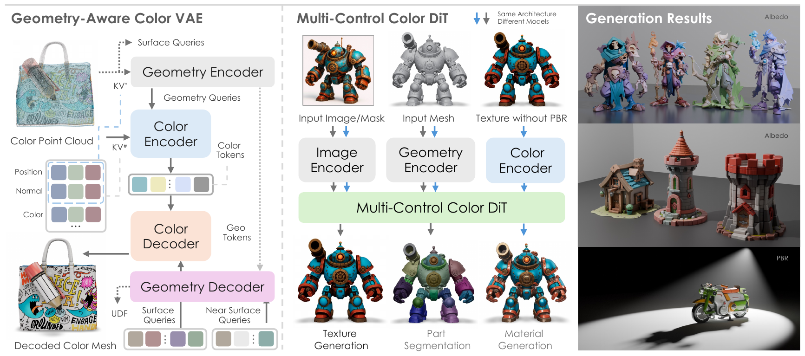

전체 구조 : 표준 latent diffusion 구조
- Geometry-aware color VAE : 재구성(reconstruction)
- Multi-control color DiT : 생성(generation), 같은 구조로 다양한 응용에 맞게 다른 모델 학습

### 2-1. Color 표현과 VAE

**Color 표현**
- view space(2D 투영)나 UV space 대신, texture를 3D의 color field로 표현
- textured mesh에서 dense color point cloud를 sampling하여 사용
- view space 방법 대비 : 3D에서 바로 동작하여 가려진 영역을 inpainting 없이 처리
- UV space 방법 대비 : UV 품질에 의존하지 않고, 생성 모델에 적합한 구조적이고 일관된 표현

**Geometry-Aware Autoencoding**

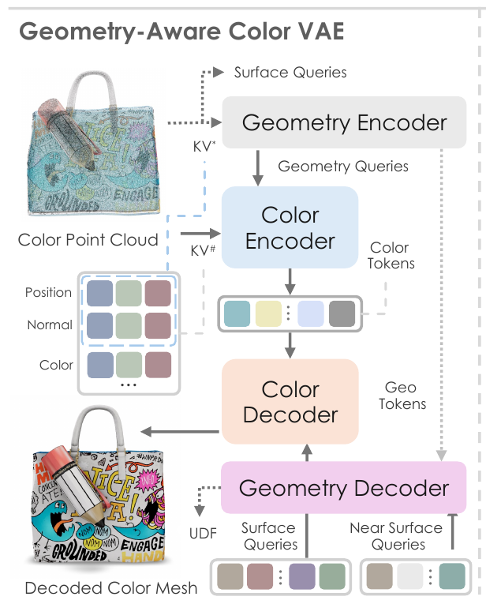

- 3DShape2VecSet과 비슷한 VAE 구조로 color point cloud 인코딩
- 입력 : textured mesh에서 sampling한 point cloud `P_c ∈ R^(N×9)` (RGB 색, 위치, normal)
- 출력 : 연속 color field `f(x) = c` (3D 좌표 `x ∈ R^3`를 색 `c ∈ R^3`로 mapping)
- 3DShape2VecSet과의 차이
  - shape이 아니라 color point cloud를 autoencoding
  - point query로 cross-attention하여 latent vector set으로 압축하는 방식은 유지
  - 단, latent set이 "순서가 있음(ordered)" : point query가 추론 때 입력 geometry에서 sampling되어 알려져 있으므로, point 단위의 geometry 조건을 줄 수 있음

**Dual branch (geometry branch + color branch)**
- 단순한 방법은 같은 point cloud를 별도 ShapeVAE로 인코딩하는 것이지만, 더 긴밀하게 통합
- texture VAE와 병렬로 geometry VAE branch 추가
  - geometry encoder : 위치와 normal만 사용
  - color encoder : 위치, normal, 색 세 가지 모두 사용
- geometry query : color point cloud에서 무작위 sampling한 point query
- geometry branch가 만든 geometry latent set을 color encoder의 query로 사용하여 texture 압축을 guide
- 두 encoder 모두 Hunyuan3D-VAE와 같은 backbone (cross-attention과 self-attention 여러 층)
- 80배 이상의 압축으로 이후 DiT 학습을 효율적으로 확장

**학습 loss**
- geometry VAE와 texture VAE를 함께 학습 : KL term, color regression loss, truncated UDF loss

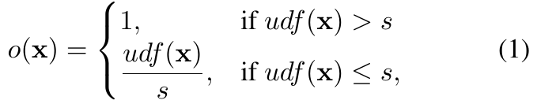

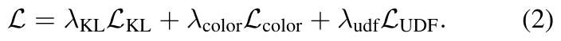

- truncated UDF를 쓰는 이유 : 표준 SDF loss에는 watertight mesh가 필요한데, color point cloud를 watertight mesh와 대응시키는 것이 어려움
- color regression loss : surface 위(on-surface)와 surface 근처(near-surface) 점을 모두 supervision
  - near-surface 점은 query 점을 normal 방향으로 threshold `γ` 안에서 무작위로 offset하여 생성
- `λ_KL`, `λ_color`, `λ_udf` : loss 가중치

**추론 시 출력 방식**
- UV texture map : UV 좌표를 3D로 mapping한 뒤 3D 좌표로 색을 질의
- per-face / per-vertex 색 : vertex 좌표나 face 중심 좌표에서 직접 질의
- geometry VAE처럼 임의 해상도로 동작하여 다양한 출력 대상에 맞게 decoding 가능

**Reconstruct any Field**
- RGB 형태로 표현할 수 있는 신호는 모두 같은 latent space에 넣을 수 있음
- PBR material : metallic과 roughness를 수정된 albedo처럼 표현 (blue channel은 0으로 고정)
- semantic part segmentation : 이산적인 part label을 색 값으로 mapping

### 2-2. Multi-Control Color DiT

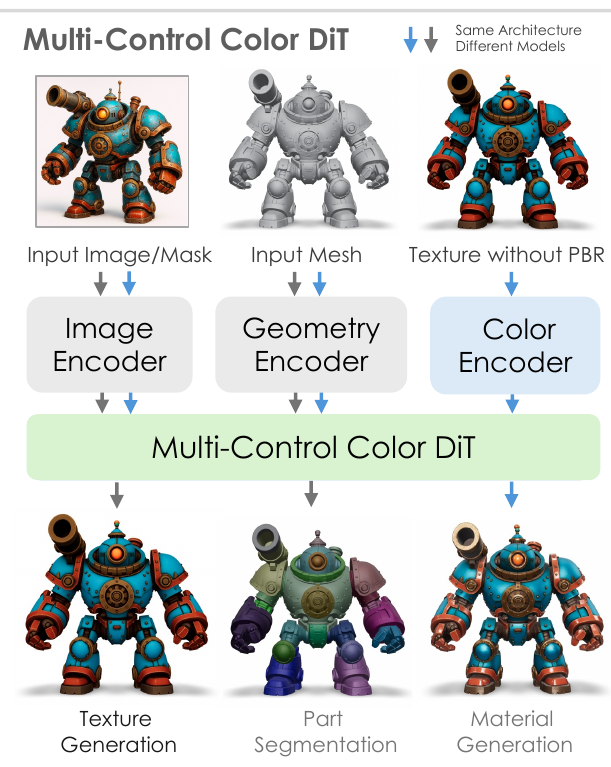

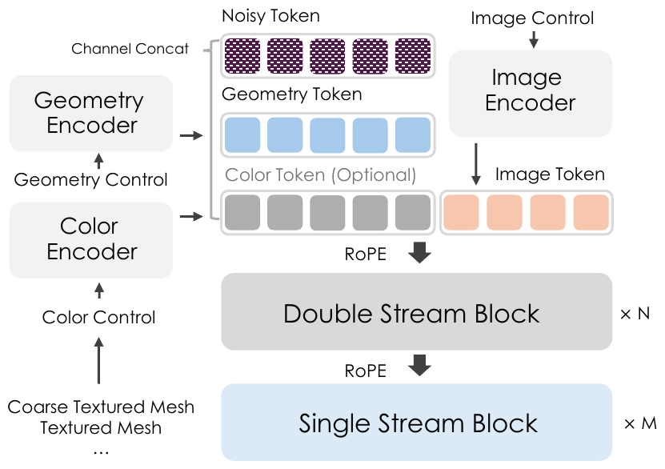

- rectified flow diffusion transformer와 비슷한 구조로 texture latent set 생성
- double stream block `N`개 + single stream block `M`개

**Image Control**
- Hunyuan3D-2를 따라 DINOv2-Giant 사용, 마지막 hidden layer의 embedding(class token 제외)
- Hunyuan3D-2의 518 해상도 대신 1022로 확대 (고해상도 조건이 미세 detail 포착에 도움)
- image token 길이를 줄이기 위해 binary mask로 object를 crop하여 원래 비율 유지
- image token에는 추가 positional embedding 없음 (DINO가 담고 있는 위치 정보로 충분)

**Geometry Control (native geometry control)**
1. sampling한 point query의 위치로 RoPE 적용 : 대략적인 구조 guide
2. VAE에서 얻은 geometry latent set을 추가 embedding으로 사용 : 미세한 guide
- geometry latent set은 texture latent set과 구조가 같으므로(isomorphic), noisy texture latent와 channel 방향으로 concatenate하여 point 단위의 geometry guide 제공

**Color Control**
- 초기 texture를 추가 조건으로 사용 (texture 조건 material 생성, texture inpainting과 refinement 등)
- 주어진 texture에서 color point cloud를 sampling하여 VAE로 인코딩한 조건 color latent set을 noisy texture latent, geometry latent와 channel 방향으로 concatenate
- sequence 길이를 늘리지 않으면서 더 강한 guide

**학습과 추론**
- 학습 : color point cloud를 VAE로 인코딩하여 정렬된 geometry latent set과 texture latent set 획득, 각 latent token의 위치로 noisy texture latent에 RoPE 적용
- flow matching loss로 학습
- albedo 생성에는 MaterialMVP를 따라 illumination-invariant loss를 추가한 hybrid loss 사용

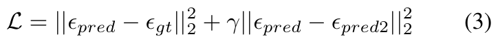

- `ϵ_pred`, `ϵ_pred2` : 조명이 다른 두 입력 이미지에 대한 예측
- 추론
  1. UV 좌표나 vertex 위치를 point cloud로 변환하고, 입력 geometry에서 normal sampling
  2. VAE의 geometry branch로 geometry latent set과 latent 위치 생성
  3. geometry 조건과 입력 이미지를 generator에 넣어 diffusion sampling으로 최종 texture 생성

### 2-3. 응용

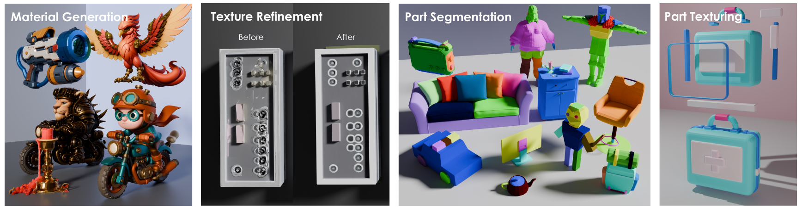

| 응용 | 방법 |
|---|---|
| Material Generation | roughness와 metallic을 RGB color point cloud의 두 channel로 표현, albedo latent set을 조건으로 받는 material DiT 학습 |
| Texture Refinement | color control로 초기 texture를 받아 가려진 영역을 inpainting하고 texture를 수정하는 neural refiner, 강한 조건 덕분에 5 step만으로 가능 |
| Part Segmentation | 추가 학습 없이, 입력 이미지의 2D segmentation을 넣으면 3D part segmentation과 정렬된 texture를 생성 |
| Part Texturing | 3D에서 색을 직접 예측하므로 part별 texturing이 전체 texturing만큼 간단, 가려진 영역도 자연스럽게 처리 |

## 3. 실험

**구현 (Appendix A)**
- color VAE 300M parameter, color DiT 1.9B parameter (NaTex-2B), flow matching 목표
- VAE는 최대 6144 token으로 학습하고 추론 때 token 수를 늘림
- DiT : batch size 256, 처음 500 step linear warm-up 후 constant scheduler, learning rate 1e-4에서 이후 1e-5로 감소
- illumination-invariant loss는 pretraining이 수렴한 뒤 가중치 5로 도입
- classifier-free guidance : 학습 중 10% 확률로 조건 embedding을 0으로 대체
- 별도 언급이 없으면 diffusion 5 step, guidance scale 2
- 데이터 : Blender로 원본 mesh에서 균일한 color point cloud sampling, 입력 이미지는 object 주변 24 view를 elevation 45°~-30° 범위에서 무작위로 렌더링, 조명은 point light, area light, HDRI map 중 무작위 선택

### 3-1. Reconstruction

| Latent Size | PSNR ↑ | PSNR* ↑ | SSIM* ↑ | LPIPS* ↓ |
|---|---|---|---|---|
| 6144 × 64 | 28.74 | 31.70 | 0.980 | 0.0492 |
| 12288 × 64 | 29.95 | 33.19 | 0.984 | 0.0445 |
| 24576 × 64 | 30.86 | 34.30 | 0.987 | 0.0411 |

- PSNR은 color point cloud에서 직접 계산, `*`는 6개의 orthogonal 렌더링 view에서 계산
- 최대 6144 token으로 학습했지만 latent 크기를 늘릴수록 재구성 품질 향상

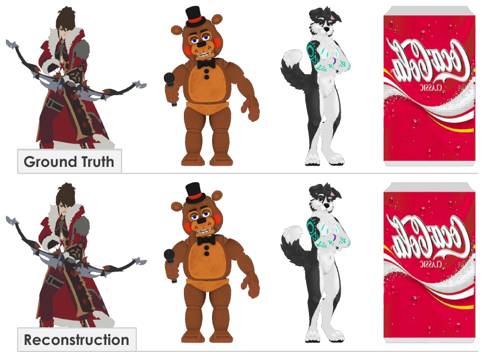

### 3-2. Generation

- 비교 대상 : Paint3D, TexGen, Hunyuan3D-2, RomanTex, MaterialMVP (albedo 결과만 비교)
- MaterialMVP의 평가 protocol과 같은 test set 사용

| Method | cFID ↓ | CMMD ↓ | CLIP ↑ | LPIPS ↓ |
|---|---|---|---|---|
| Paint3D | 26.86 | 2.400 | 0.887 | 0.126 |
| TexGen | 28.23 | 2.447 | 0.882 | 0.133 |
| Hunyuan3D-2 | 26.43 | 2.318 | 0.889 | 0.126 |
| RomanTex | 24.78 | 2.191 | 0.891 | 0.121 |
| MaterialMVP | 24.78 | 2.191 | **0.921** | 0.121 |
| NaTex | **21.96** | **2.055** | 0.908 | **0.102** |

- CLIP은 MaterialMVP가 가장 높고, 나머지 세 지표는 NaTex가 최고

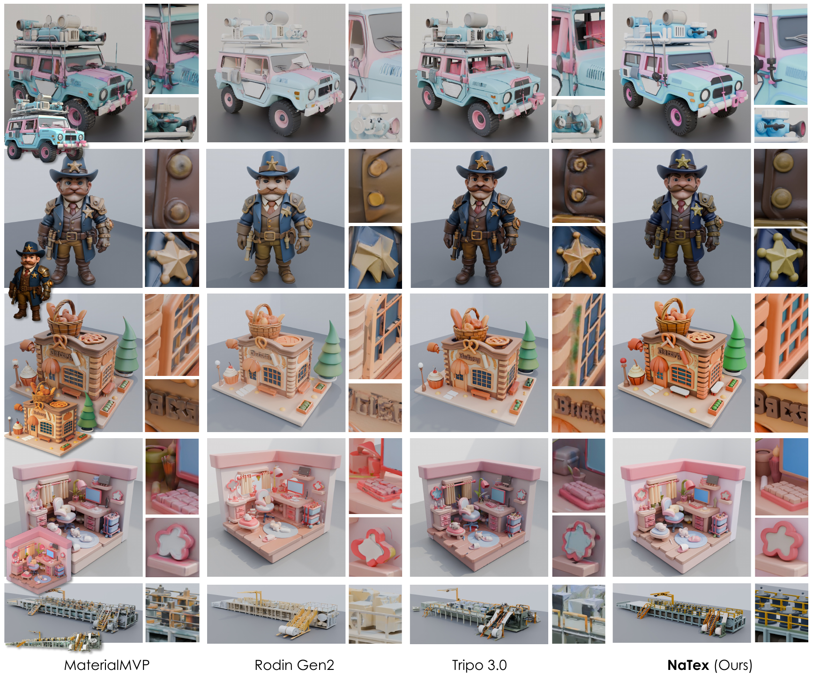

- 상용 모델(Rodin-Gen2, Tripo 3.0)은 자체 geometry를 쓰고, 다른 방법은 Hunyuan3D 2.5의 같은 geometry 사용
- 비교 방법들은 모두 geometry 경계를 따라 texture를 정렬하지 못하나, NaTex는 거의 완벽한 정렬
- 가려진 영역이 없는 경우(캐릭터)에도 다른 방법은 별과 단추가 어긋나는 artifact 발생

### 3-3. Refinement / Inpainting

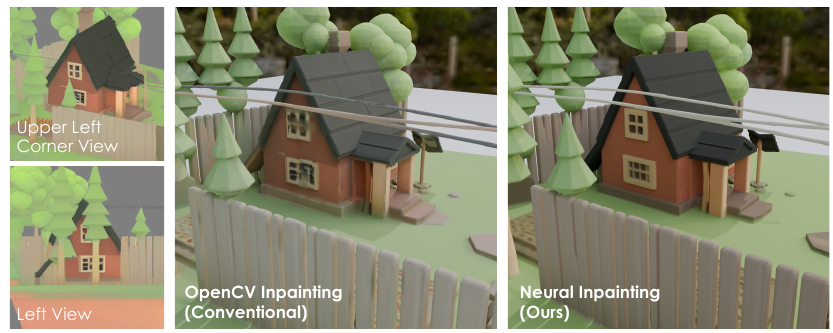

- color control로 refinement/inpainting module로 사용
- OpenCV interpolation 기반 기존 inpainting보다 가려진 영역(집 창문)을 더 깨끗하고 잘 정렬된 texture로 채움

### 3-4. Ablation

**Geometry 조건 방식**

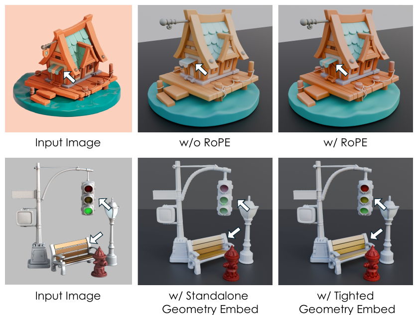

- 변형 1 : 각 color token에서 RoPE 제거
- 변형 2 : geometry-aware color VAE의 tight shape embedding 대신, 별도 shape VAE(Hunyuan3D-VAE)의 shape embedding 사용
- 두 조건 모두 image-texture 정렬을 개선 (집 차양의 줄무늬, 신호등 색)
- shape embedding은 texture-geometry 정렬에도 영향 : tight embedding이 없으면 색이 번짐 (의자 등받이)

**추론 설정**

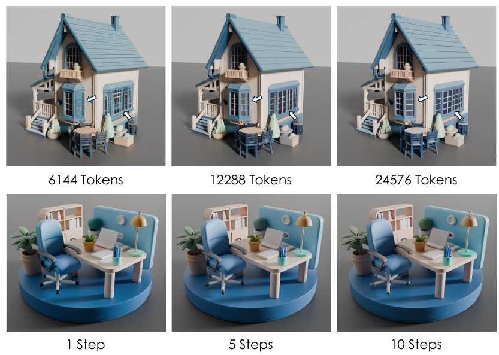

- 최대 6144 token으로 학습했지만 추론 때 token 수를 늘리면 생성 품질과 정렬이 점차 향상 (창문)
- distillation 없이도 강한 조건 덕분에 1 step 생성 가능

## 4. 응용 상세 (Appendix B)

**Material Generation**
- albedo가 입힌 textured mesh를 조건으로 하는 2-channel texture 생성 문제로 정식화
- texture 생성과 같은 color VAE 재사용, roughness와 metallic을 RGB color point cloud의 두 channel로 표현
- 새 material DiT를 학습 : image control(입력 이미지) + color control(albedo가 입힌 mesh) + geometry control(입력 geometry)
- 추론은 2단계 : 먼저 albedo 예측, 그다음 예측한 albedo로 roughness와 metallic 예측
- native 생성의 장점을 그대로 물려받아 잘 정렬되고 일관된 roughness/metallic map 생성
- 기존 MVD 방식은 정렬 문제와 material 속성 오판(과한 반사, 금속이어야 할 곳이 금속이 아님 등)이 있음

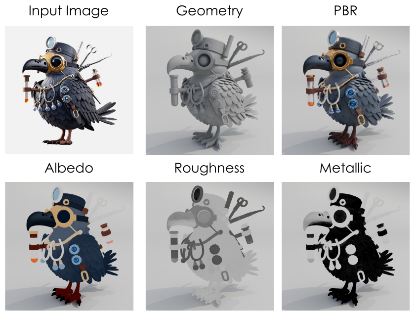

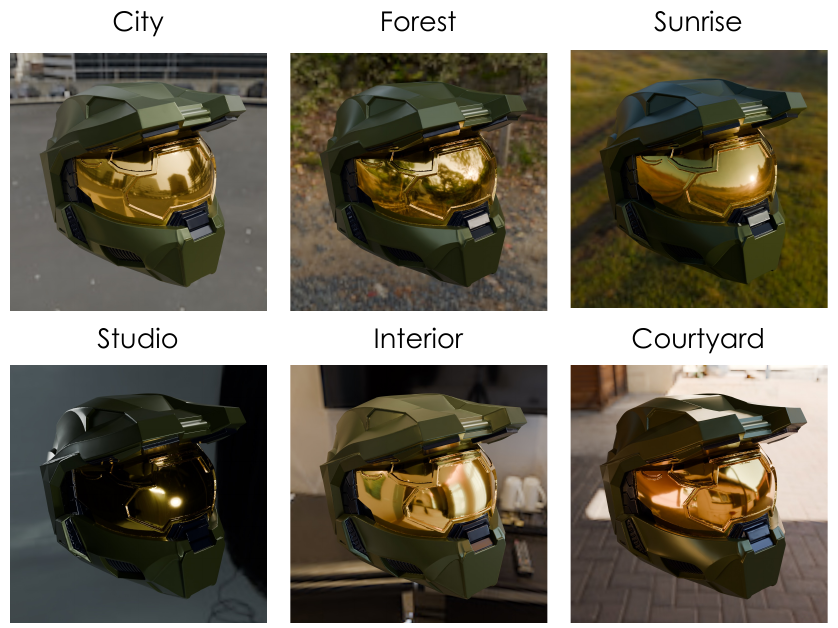

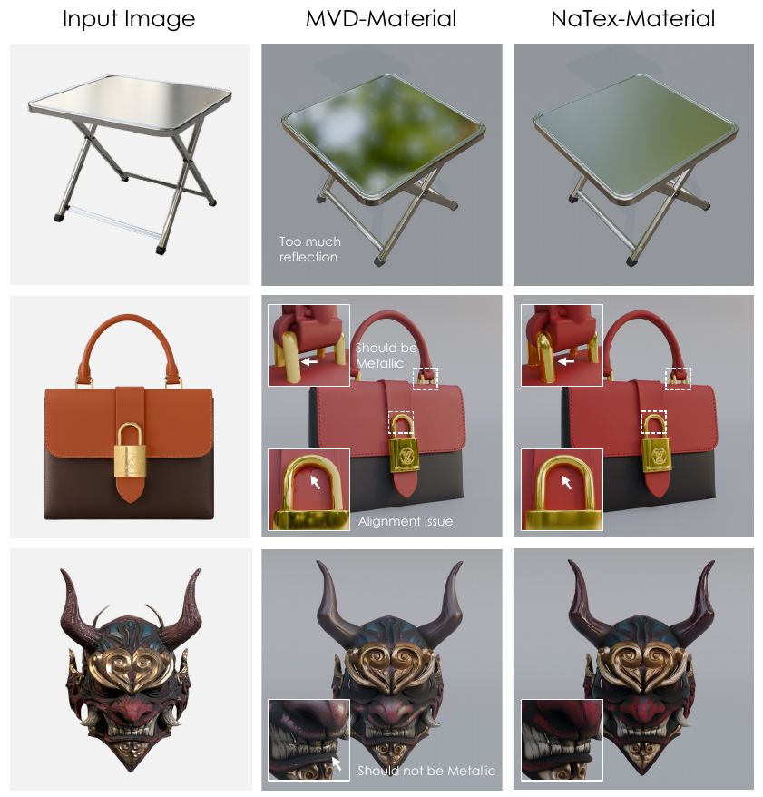

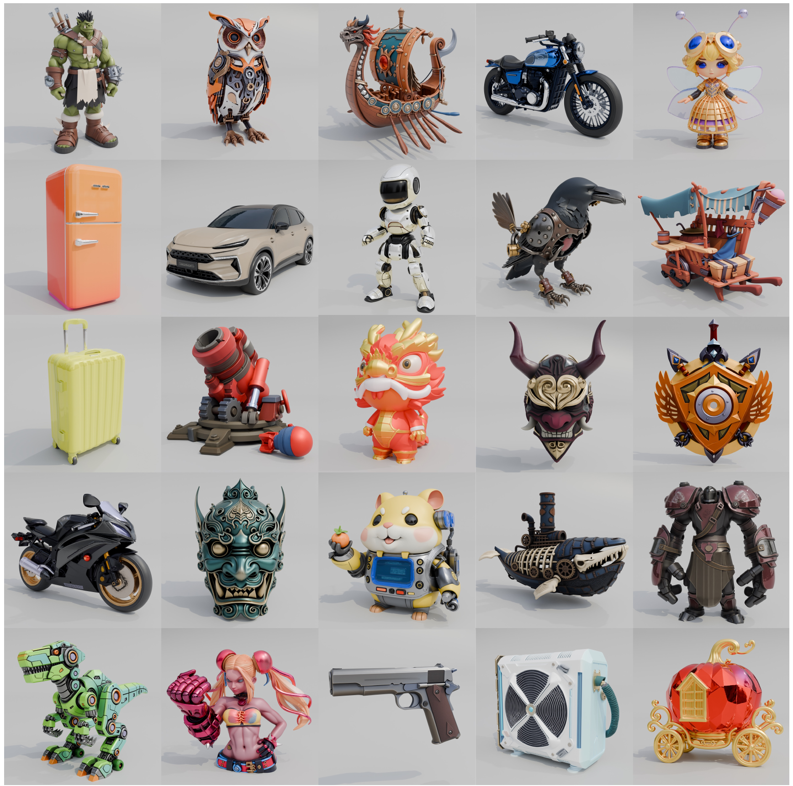

**Part Segmentation**
- 입력 RGB 이미지에 SAM으로 semantic segmentation을 하고, NaTex-2B에 2D mask를 넣어 textured mesh 획득 (추가 학습 없음)
- zero-shot 방식은 복잡한 구조에서 조각나거나 불일치할 수 있어, 전용 dataset으로 base model을 fine-tuning
- fine-tuning한 모델은 복잡한 경우에도 경계가 잘 정렬된 정확한 3D segmentation

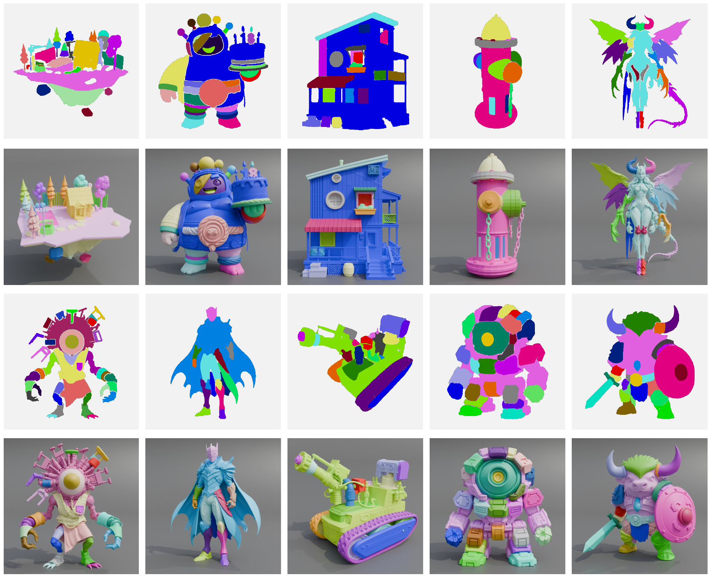

**Part Texturing**
- 기존 MVD 방식은 내부 영역에서 어려움을 겪으나, NaTex는 각 part surface의 색을 3D에서 직접 예측
- 추가 학습 없이 part 사이의 가려진 영역도 정확하게 texturing

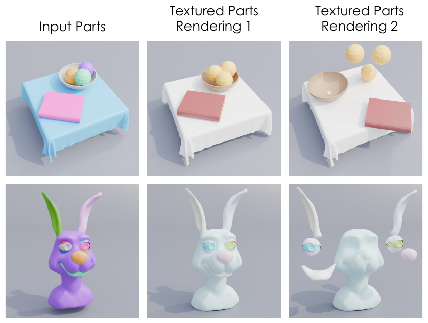

**Texture Refinement**
- color control로 초기 texture를 조건으로 NaTex-2B를 fine-tuning하면 MVD pipeline의 2단계 refiner로 사용 가능
- projection 오류를 고치고 가려진 영역을 자동으로 inpainting
- distillation 없이 5 step으로 처리 가능

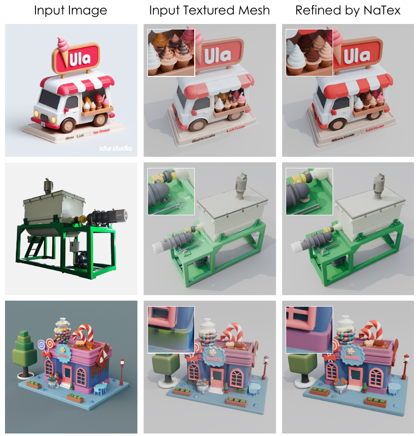

## 5. 한계 및 향후 방향 (Appendix C)

- VAE의 재구성 품질을 높여 더 높은 해상도의 texture 지원 필요
- material 생성을 위한 data curation 개선 필요
- part segmentation의 모호성을 줄이고 세분성(granularity) 향상 필요
- part texturing에서 인접한 part의 닫힌 surface를 처리하는 새로운 방법 필요
- texture refinement에 2D prior를 더 활용하고 기존 MVD 연구를 접목하는 방향
