# OmniFabric

> **한 줄 요약** : Image → sewing pattern UV (garment)  
> 단일 의류 이미지에서 VLM과 video 생성 모델로 sewing pattern UV의 coarse texture를 만들고, DiT 기반 texture normalization model로 왜곡과 baked-in artifact를 제거하여 simulation 가능한 3D garment texture 생성

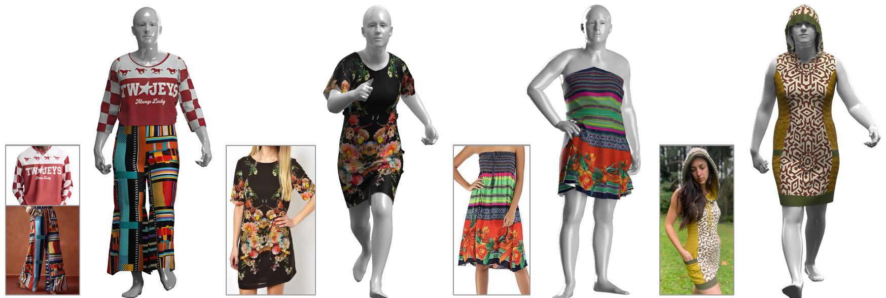

## 1. 배경

**목표**
- 단일 in-the-wild 의류 이미지에서 production-ready 3D garment texture 생성
- 2D sewing pattern 공간에서 직접, 전체적으로 일관된(globally coherent) texture map 합성
- 결과 texture는 왜곡, 조명, 그림자, 주름이 없는 정규화된 상태여야 cloth simulation과 relighting에 사용 가능

**의류 texture 합성이 특히 어려운 이유**
- 천의 복잡한 동역학 때문에 깊은 주름, self-occlusion, 극단적인 pose 변화가 자주 발생

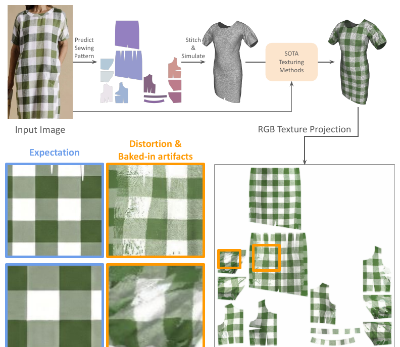

**기존 방식의 문제**
- 일반 3D texturing(Text2Tex, TEXTure, Paint3D, Meta 3D TextureGen, Hunyuan3D 등)
  - multi-view diffusion prior로 drape된 3D geometry에 직접 projection하여 "칠함"
  - 접힌 surface를 펼치면 큰 geometry 왜곡과 occlusion 발생
  - 자연 사진으로 학습된 prior라 조명과 surface appearance가 얽혀 그림자, 하이라이트, geometry 유발 주름이 texture에 baked-in
  - Paint3D, Meta 3D TextureGen의 UV refinement는 가려진 영역의 inpainting만 하고 왜곡이나 baked-in artifact는 고치지 못함
- FabricDiffusion
  - 평평한 2D sewing pattern 공간에서 합성하여 simulation-ready texture를 만들지만, 이미지에서 tileable한 국소 material patch만 추출
  - 전체 texture layout을 무시하므로 비대칭 디자인, 큰 프린트, 불규칙한 패턴을 재구성하지 못함

**핵심 질문과 아이디어**
- reference 이미지와 2D sewing panel 사이의 pixel 단위 대응을 어떻게 만들고, baked-in artifact와 왜곡 없이 texture를 옮길 것인가
- 국소 material 추출이 아니라 reference 이미지 전체 맥락을 쓰는 전역 texture 합성으로 전환
- canonical 3D mesh를 spatial anchor로 써서 이미지 pixel을 sewing pattern UV로 mapping
- texture 합성은 실제 의류 제작 방식과 맞도록 sewing pattern의 UV 공간에 기반해야 한다고 주장

**기여**
1. 단일 in-the-wild 이미지로 고품질의 전역적으로 일관된 3D garment texture를 합성하는 framework
2. 사실적이고 다양한 textured sewing pattern을 대규모로 만드는 자동 data engine
3. canonical 3D mesh를 spatial anchor로 써서 이미지 pixel을 sewing pattern UV 공간으로 mapping하는 전략
4. 전역 정렬 texture를 초기화한 뒤, DiT 기반 UV 공간 normalization network로 왜곡과 baked-in artifact를 고치는 coarse-to-fine pipeline

## 2. 방법론

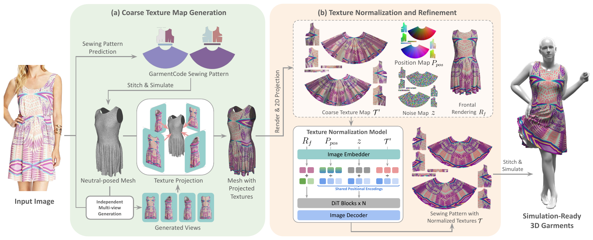

### 2-1. 문제 정의

- 입력 : reference 이미지 `I`, 기성 sewing pattern 예측 모델이 만든 sewing pattern `P`와 그 3D garment mesh `M_R`
- 목표 : sewing pattern 공간에서 정규화된 texture map `T ∈ R^(H×W×3)` 생성
  - 왜곡, view 의존 조명, cast shadow, geometry 유발 주름이 없는 상태
- diffusion 패러다임에 따라 조건부 분포 mapping 문제로 정식화

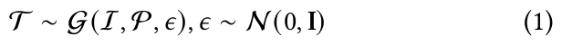

- `T`는 엄밀한 의미의 intrinsic albedo는 아니지만 가까운 근사이며, roughness, metallic, normal map 같은 나머지 속성은 외부에서 지정하여 CLO 같은 cloth simulation engine에 바로 사용 가능

### 2-2. Stage 1 : Coarse Texture Map 초기화

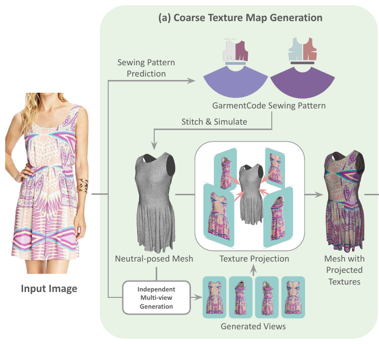

목표 : reference 이미지의 시각 정보를 모두 활용하는 coarse texture 초기화 (이미지와 sewing pattern 사이 pixel 대응 확보)

**Pose aware texture alignment**
- Nano Banana Pro(이미지 생성 VLM)로 reference 이미지 `I`를 `I'`로 repose
  - rest-pose garment mesh `M_R`의 정면 실루엣과 정확히 맞도록 정렬
- 정렬된 `I'`를 `M_R`과 sewing pattern `P`에 직접 pixel projection하여 textured frontal render `R_f` 생성
- Nano Banana Pro는 원래 texture를 높은 정확도로 유지하면서 의류를 원하는 pose로 조작

**Consistent multi-view synthesis**
- 정면에서 가려진 UV 영역은 여전히 비어 있음
- 대규모 video 생성 모델(Veo 3)로 `R_f` 조건의 360도 회전 영상 생성 (시간적 prior로 구조 일관성 확보)
- 영상에서 4개 직교 view(front, back, left, right) `V`를 샘플링하여 `M_R`에 projection하고 `P`의 UV 좌표로 mapping → coarse texture map `T'`
- 의류가 canonical A-pose라 4개 view로 surface detail 대부분을 포착

**Non-overlapping texture projection (Supplementary B.1)**
- 기존 방법(Hunyuan3D-2.0 등)은 multi-view diffusion이 만든 독립 이미지를 projection
- multi-view diffusion은 view 간 정렬을 위해 고주파 detail을 희생하는 경향이 있어, 구조적으로 일관된 video prior의 frame을 사용
- 겹침 최소화 전략
  1. 관측이 가장 덜 겹치는 front, back view를 먼저 mesh에 projection
  2. side view는 아직 칠해지지 않은 영역에만 projection (projection 기반 inpainting)
  3. seam의 작은 artifact와 불연속은 이후 normalization model이 수정

### 2-3. Stage 2 : UV 공간 Texture Refinement

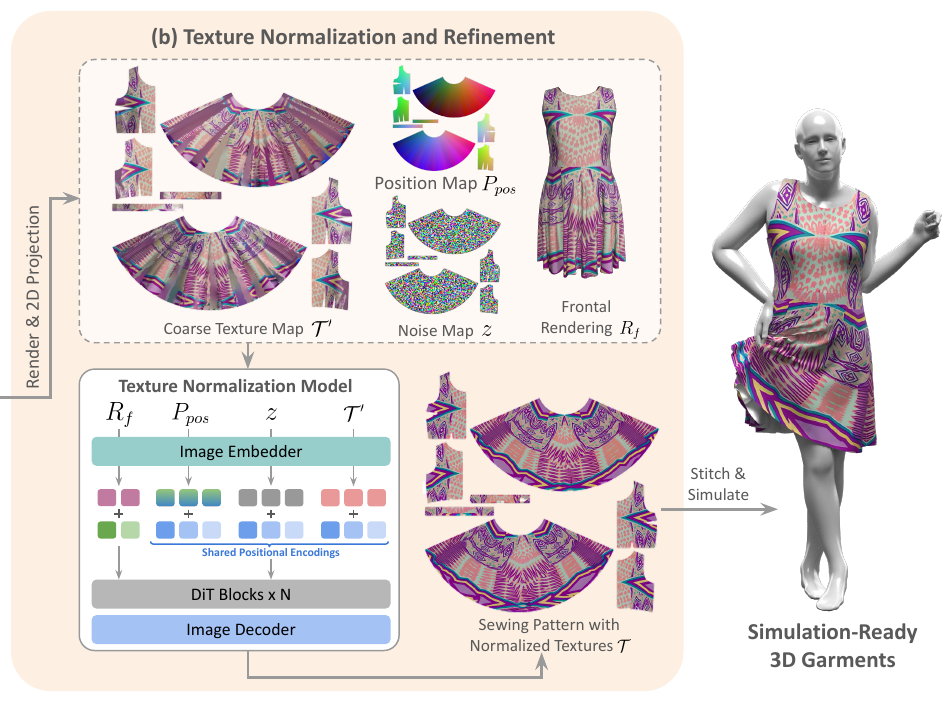

- `T'`는 전체 texture는 일관되지만 그림자, 물리적 주름, 칠해지지 않은 영역, 공간 왜곡 같은 baked-in artifact를 포함
- texture normalization model로 `T'`를 정규화된 `T`로 수정

**Multi-condition diffusion 학습 목표**
- FabricDiffusion(국소 textile patch 하나만 조건)과 달리 multimodal 조건 집합 `y` 사용

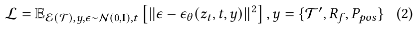

| 조건 | 의미 | 역할 |
|---|---|---|
| `T'` | coarse texture map | 생성 prior의 distillation, pixel 정렬 내용 제공 |
| `R_f` | textured frontal rendering | 의류 외관의 전체적인 시각 참조, 전역 layout과 일관성 이해 |
| `P_pos` | 3D position map (`M_R` vertex의 3D 위치를 `P`의 2D layout으로 projection) | 분리된 UV panel 사이의 공간 연결성 학습, 조각난 UV island 사이를 매끄럽게 |

- `z_t` : 시점 `t`의 정답 texture noisy latent

**모델 구조와 학습**
- Diffusion Transformer(DiT) 구조, OminiControl 방식을 따라 모든 조건을 하나의 token sequence로 처리
- joint self-attention : 조건 token(`T'`, `R_f`, `P_pos`)과 noisy latent token이 같은 transformer block 안에서 상호작용
- dynamic positional encoding
  - `T'`, `P_pos`, 목표 `T`는 같은 2D panel layout을 공유하므로, 같은 공간 좌표의 image patch에 동일한 positional encoding 부여
  - `R_f`만 별도 좌표계의 positional encoding 사용
  - 이 단순한 설계로 `P_pos`의 구조 단서를 보면서 `T'`의 빈 texture를 생성
- pretrained DiT weight에서 시작하여 합성 textured sewing pattern data로 LoRA fine-tuning

## 3. 합성 학습 데이터 생성

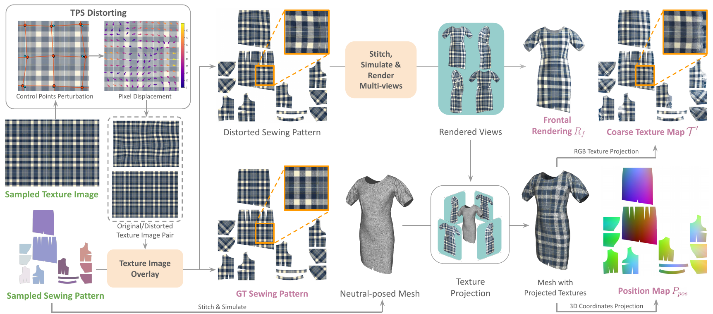

목표 : 실제 의류의 복잡한 외관을 보이면서 정규화된 정답 texture map을 갖는 학습 쌍 생성

**Textured sewing pattern 생성**
- 기존 의류 dataset은 복잡하고 고해상도인 texture가 부족하고 단순 반복 패턴뿐
- 실제 패션 이미지(DeepFashion)를 참조로 사용
  1. LLM(Qwen)으로 texture layout, 의미 요소, 색 팔레트를 담은 상세 설명 생성
  2. 설명과 참조 이미지를 VLM(Gemini)에 넣어 다양한 디자인의 texture 합성
  3. GarmentCodeData에서 샘플링한 sewing pattern에 texture를 overlay
- 참조 이미지의 texture를 정확히 재현하는 것이 아니라, 학습에 충분한 다양성을 주는 그럴듯한 texture를 만드는 것이 목적

**Sewing pattern 재배치 (Supplementary A.1)**
- 실제 의류 제작에서는 큰 앞판처럼 기능 그룹 안에서는 texture가 이어지지만, 소매와 가슴처럼 구조적 seam에서는 끊김
- 소매의 앞/뒤 조각처럼 관련 panel을 하나의 공간 그룹으로 합친 뒤 texture를 overlay하여, 그룹 내 연속성과 현실적인 끊김을 함께 재현

**학습 tuple 구성 `(T', R_f, P_pos, T)`**
- 원래 texture에 무작위 TPS(Thin Plate Spline) 왜곡을 적용
  - 원래 texture : 정답 `T`
  - 왜곡된 texture : sewing pattern에 overlay하여 물리 simulation
- TPS 왜곡 : texture 비율에 맞춘 regular grid의 각 control point `p_i`를 `p̂_i = p_i + δ_i`로 이동

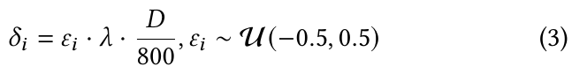

- `λ = 25`(기본값)가 전체 왜곡 크기를 조절, `D`는 texture 이미지 해상도
- grid와 이동한 grid 사이에 TPS를 fit하여 full-resolution texture 전체를 warp
- sewing pattern을 A-pose SMPL body에 stitch하고 drape하여 3D mesh `M_R` 생성, 정면 렌더링 `R_f` 획득
- `P_pos` : mesh vertex의 xyz 좌표를 2D panel layout에 projection
- `T'` : `R_f`와 무작위로 샘플링한 view `R_a`를 neutral-posed mesh에 projection한 뒤 2D pattern 공간으로 펼침
  - 물리 유발 artifact와 변형이 의도적으로 baked-in되어, 모델이 왜곡 제거와 정규화된 base color 복원을 학습

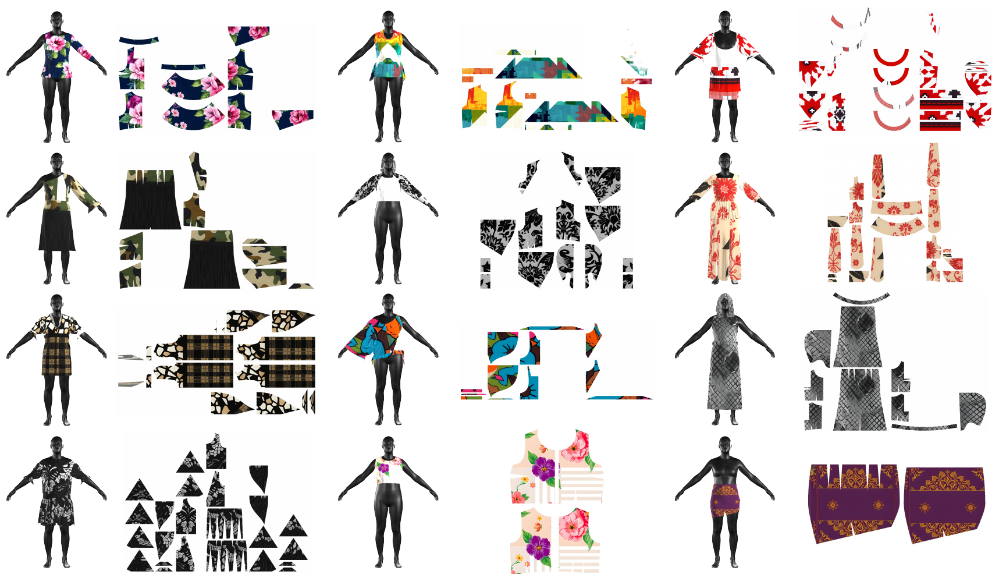

## 4. 실험

**Dataset**
- GarmentCodeData에서 고유하고 다양한 의류 3K개 샘플링
- 의류 style당 평균 10개 texture 변형으로 총 30K개 textured sewing pattern 생성
- NVIDIA Warp로 sample마다 다른 random seed로 simulation (같은 sewing pattern도 다른 `M_R`과 주름 생성)
- 조명 : 흰색 point light의 무작위 부분집합
- test/train 비율 0.1로 held-out set 구성
- in-the-wild 이미지(DeepFashion, 웹에서 수집한 최신 의류 디자인)에 대해서도 평가 (정답이 없어 주로 정성 비교)

**Metric** : LPIPS, DISTS(시각 유사도와 구조 일관성), SSIM, MS-SSIM(pixel 단위 구조 정확도), CLIP-s(reference 이미지와 의미 정렬)

**비교 대상**
- Hunyuan3D-2.0, Paint3D : multi-view 생성으로 단일 view 너머의 prior 활용
- FabricDiffusion : 국소 textile 패턴을 정규화하여 baked-in artifact 없는 texture 생성
- 세 baseline 모두 pretrained weight에서 fine-tuning (Paint3D는 position encoder, Hunyuan3D는 multi-view image generator, FabricDiffusion은 paired textile data로 texture generator)

**구현**
- DiT 기반 normalization model, OminiControl 방식의 multi-conditioning
- A6000 1장, batch size 8로 LoRA fine-tuning (VAE와 DiT backbone은 freeze)
- sewing pattern map을 1024×1024로 resize, pad하여 학습, 추론 때 되돌린 뒤 super-resolution(Real-ESRGAN)으로 upscale
- multi-view 생성은 Veo 3, 정면 texture 전이는 Nano Banana Pro, sewing pattern 예측은 ChatGarment
- 1회 추론 평균 약 5분 (Gemini 서버 부하에 따라 다름), Gemini 모델 실패율(관계없는 texture 생성) 2% 미만

### 4-1. 정성 결과

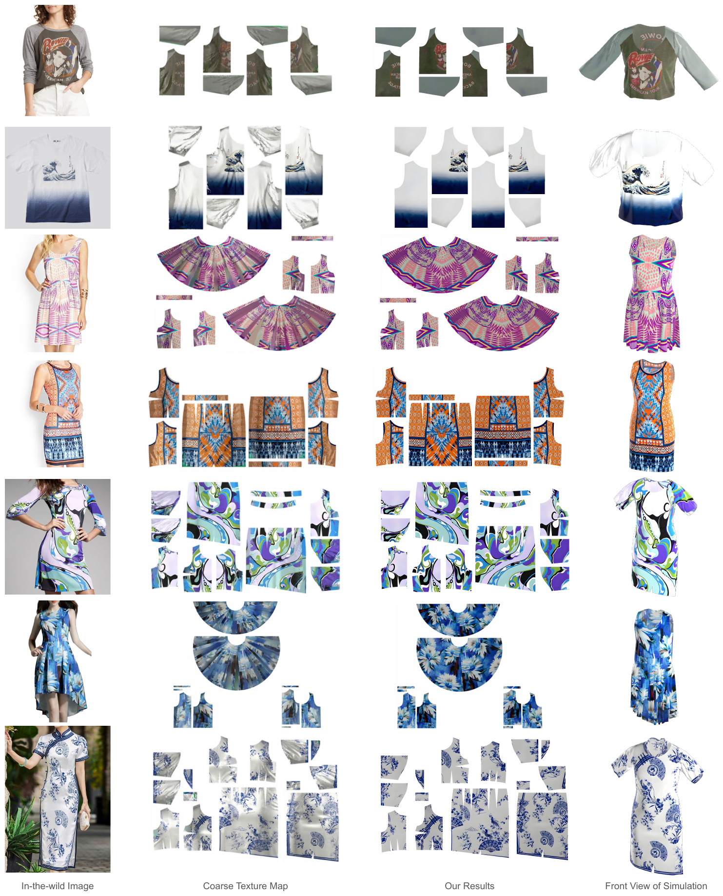

- coarse texture map을 만든 뒤 normalization model이 왜곡과 baked-in artifact를 제거
- 로고와 프린트 그래픽, 밀도 높은 고주파 패턴까지 재구성
- 합성 data로만 fine-tuning했지만 실제 이미지에서 잘 동작하여 확장성이 큼

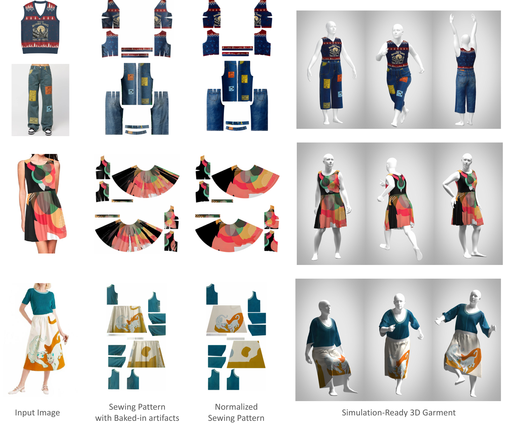

- CLO에서 simulation : 예측한 정규화 RGB base color를 albedo로 쓰고, roughness, metallic, 반사 강도, 자동 생성 normal map은 CLO 기본 Fabric_Matte preset 값 사용
- 극단적인 동작과 다양한 조명에서도 구조와 texture 일관성 유지

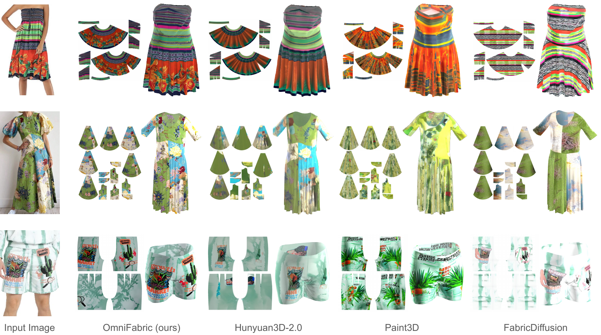

- Hunyuan3D와 Paint3D는 복잡한 texture에서 고주파 detail을 보존하지 못함
- FabricDiffusion은 국소 textile patch를 tiling하므로 전역적으로 일관된 외관을 만들지 못함
- OmniFabric은 비대칭 texture와 로고까지 정확히 생성

### 4-2. 정량 비교

**합성 dataset** (모든 baseline에 같은 `R_f`와 `M_R`을 주고, 결과 3D texture를 sewing pattern UV로 다시 projection하여 비교)

| Method | LPIPS ↓ | SSIM ↑ | MS-SSIM ↑ | DISTS ↓ | CLIP-s ↑ |
|---|---|---|---|---|---|
| FabricDiffusion | 0.273 | 0.645 | 0.707 | 0.259 | 0.906 |
| Paint3D | 0.311 | 0.657 | 0.704 | 0.266 | 0.890 |
| Hunyuan3D-2.0 | 0.223 | 0.712 | 0.717 | 0.220 | 0.924 |
| OmniFabric | **0.092** | **0.868** | **0.905** | **0.121** | **0.963** |

**실제 data user study** (13명, 실제 이미지 10개)

| Method | Overall rank ↓ | Fidelity ↑ | Back-view ↑ | Global Coherence ↑ |
|---|---|---|---|---|
| FabricDiffusion | 3.40 | 1.75 | 2.69 | 3.15 |
| Paint3D | 3.41 | 1.86 | 2.81 | 3.03 |
| Hunyuan3D-2.0 | 2.10 | 3.43 | 3.41 | 3.50 |
| OmniFabric | **1.09** | **4.44** | **4.35** | **4.41** |

- Overall rank는 1~4 순위(낮을수록 좋음), 나머지는 1~5점(높을수록 좋음)

### 4-3. 오픈소스 모델로 재현

- 비공개 Gemini 모델 대신 FLUX.2(이미지 생성)와 Ministral 3(prompt up-sampling)로 대체
- textured frontal view `R_f`와 4개 직교 view의 실루엣을 조건으로 multi-view 생성

| 설정 | LPIPS ↓ | SSIM ↑ | DISTS ↓ | CLIP-s ↑ |
|---|---|---|---|---|
| 기본 설정 (비공개 모델) | 0.092 | 0.868 | 0.121 | 0.963 |
| 오픈소스 모델 | 0.114 | 0.847 | 0.149 | 0.955 |

### 4-4. 오차 누적 분석

중간 출력(repose한 reference `I'`, 생성 multi-view `V`)을 정답으로 단계별로 교체

| 설정 | LPIPS ↓ | SSIM ↑ | DISTS ↓ | CLIP-s ↑ |
|---|---|---|---|---|
| (a) GT `I'` + GT `V` | 0.105 | 0.849 | 0.159 | 0.944 |
| (b) Pred. `I'` + GT `V` | 0.121 | 0.837 | 0.176 | 0.935 |
| (c) Pred. `I'` + Pred. `V` | 0.144 | 0.804 | 0.166 | 0.938 |
| (d) Pred. `I'` + Pred. `V` + SP Norm. | **0.092** | **0.868** | **0.121** | **0.963** |

- (a)~(c)는 texture projection, pose 정렬, multi-view 생성 단계를 거치며 오차 누적
- (d) sewing pattern normalization이 누적된 artifact를 효과적으로 수정

### 4-5. Ablation

| 설정 | LPIPS ↓ | SSIM ↑ | DISTS ↓ | CLIP-s ↑ |
|---|---|---|---|---|
| OmniFabric | **0.092** | **0.868** | **0.121** | **0.963** |
| (a) w/o coarse texture map `T'` | 0.407 | 0.601 | 0.306 | 0.887 |
| (b) w/o frontal view rendering `R_f` | 0.097 | 0.850 | 0.129 | 0.962 |
| (c) w/o position map `P_pos` | 0.098 | 0.848 | 0.130 | 0.961 |

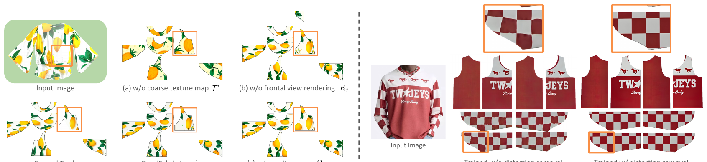

- `T'` 제거 : 성능이 크게 하락, pixel 정렬 내용 대신 "비슷해 보이는" texture를 무작위로 생성
- `R_f` 제거 : 결과 저하, `R_f`가 의류 외관의 전체 참조를 주어 sewing pattern 조각들 사이의 전역 layout과 일관성 이해에 도움
- `P_pos` 제거 : 결과 저하와 함께 texture와 요소가 잘못된 위치에 생성 (빈 영역에 레몬이 생김)
- 학습 data의 geometry 왜곡 : 왜곡 제거를 학습해야 소매의 체크 패턴 같은 구조 패턴을 정규화하고, 글자와 로고도 깨끗하게 생성

### 4-6. 다른 sewing pattern 예측 방법과의 호환성 (Supplementary C.2)

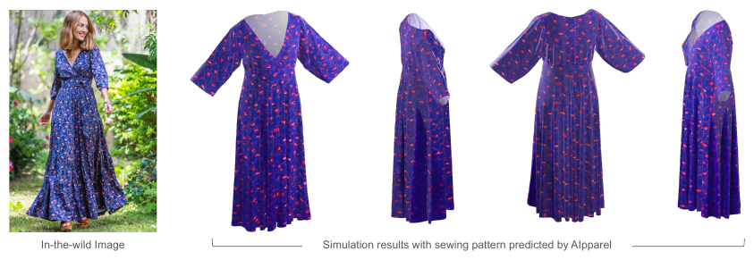

- ChatGarment 대신 AIpparel(대형 Vision-Language Model 기반)로 예측한 sewing pattern에도 그대로 적용 가능
- pattern 예측이 불완전하면 simulation geometry가 입력과 약간 어긋날 수 있으나, texture 전이 모델이 이미지 texture를 예측 의류의 실루엣에 맞춰 전역 일관성 유지

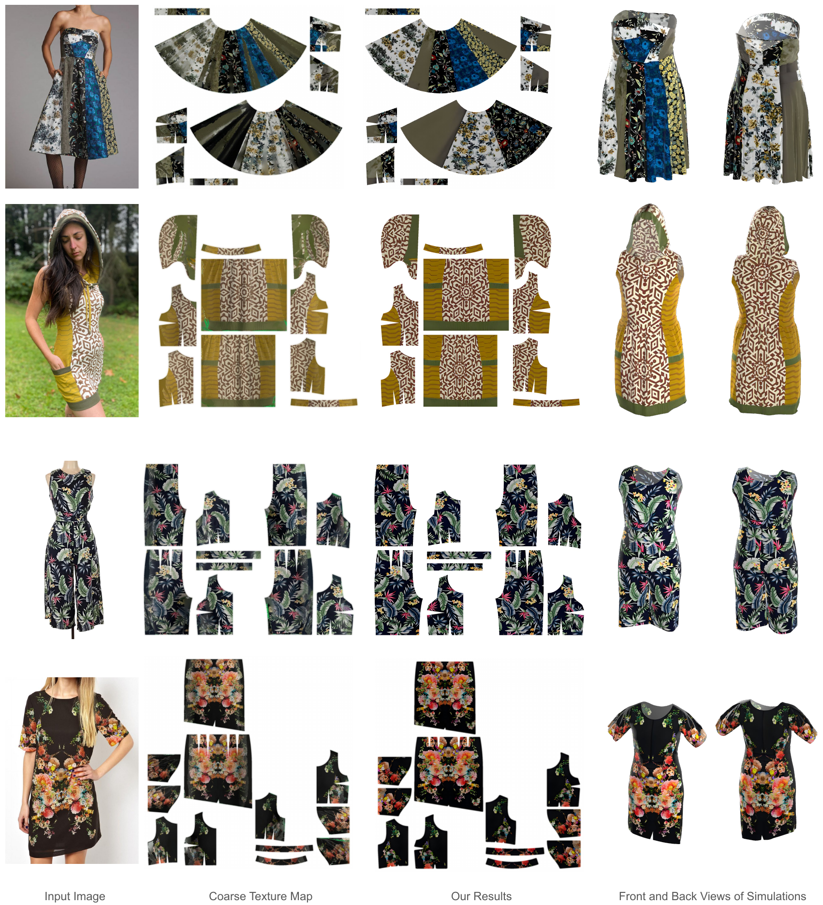

## 5. 한계 및 향후 방향

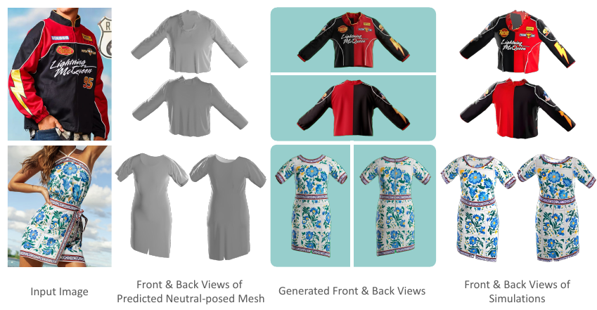

- 부정확하게 생성된 multi-view 때문에 texture가 어긋날 수 있음
- ChatGarment가 예측한 잘못된 geometry `M_R`을 수정할 수 없음 (단, normalization model의 역할은 geometry와 무관하게 왜곡, 주름, 그림자, projection artifact를 줄이는 것)
- albedo와 shading을 엄밀한 물리 기반으로 분리하지는 않음 (Supplementary D)
- 생성 prior에 의존하므로 보이지 않거나 가려진 영역은 hallucination될 수 있음, 여러 frame이나 video를 입력으로 쓰면 줄일 수 있음
- 반사가 강한 가죽이나 금속성 직물처럼 view 의존 효과가 큰 재질은 충실히 재구성하기 어려움
- 향후 방향 : albedo와 함께 roughness, metallic, normal map을 포함한 완전한 PBR material map을 함께 예측
