# StableMaterials

> **한 줄 요약** : Text/Image → tileable PBR material  
> 주석이 없는 SDXL texture까지 semi-supervised adversarial distillation으로 학습에 넣어 다양성을 높인 latent diffusion 기반 PBR material 생성 모델 (refiner로 고해상도, LCM과 features rolling으로 4 step tileable 생성)

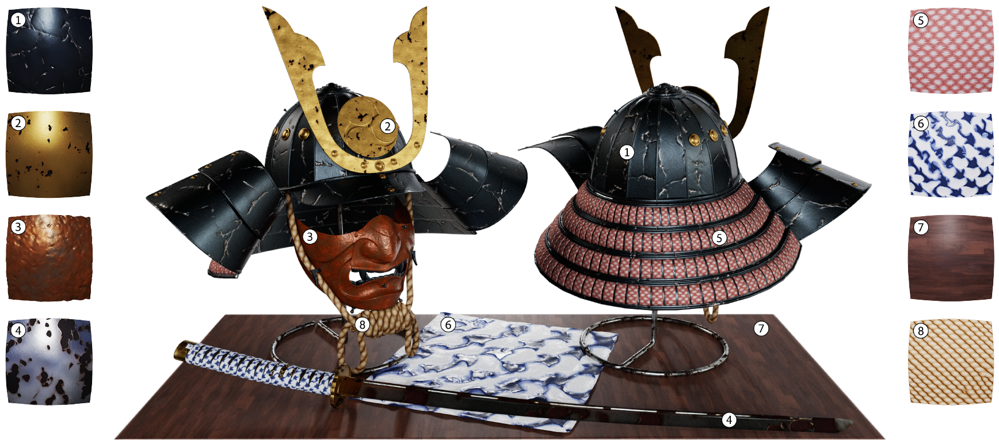

## 1. 배경

**목표**
- text 또는 image prompt로 사실적인 PBR material 생성
- 출력 : 고해상도, tileable(이어 붙여도 경계가 없는) material map
  - diffuse 속성(basecolor), specular 속성(roughness, metallic), mesostructure(height, normal)

**기존 방식의 문제**
- 학습 기반 material 생성은 학습 data의 품질과 다양성에 크게 의존
- 대규모 material dataset(Deschaintre et al., OpenSVBRDF, MatSynth)도 다양성이 LAION 같은 대규모 이미지 dataset에 비해 크게 부족
- LoRA나 Diff-Instruct 같은 fine-tuning/distillation은 같은 domain 안에서는 쉽지만, 이미지에서 material처럼 domain이 다르면 어려움
- 기존 material 생성 방법
  - MatFuse : 256×256 해상도 제한, 흐리거나 단순한 결과, 복잡한 texture에 약함
  - Material Palette, Substance 3D Sampler : texture 생성 후 SVBRDF 추정의 2단계, 빛과 surface 상호작용에서 material 속성을 추측하는 편향이 있고, 가끔 surface 대신 원근이 있는 자연 이미지를 생성
  - Material Palette : prompt마다 LoRA를 fine-tuning하여 시간과 계산 부담
  - MatGen : 고품질이지만 과도한 sharpening artifact, 복잡한 prompt를 잘 따르지 못함

**핵심 아이디어**
- semi-supervised adversarial training
  1. 주석이 없는(non-PBR) sample을 학습에 포함
  2. 대규모 pretrained SDXL의 지식을 distillation
- SDXL로 text prompt에서 texture를 생성하지만, 모델은 SVBRDF map을 출력하므로 생성 texture로 직접 supervision 불가
- 따라서 texture와 material의 공통 latent 표현을 학습하고, supervised loss에 unsupervised adversarial loss를 더해 주석 없는 sample에 대해서도 사실적인 map을 생성하도록 강제

**기여**
1. StableMaterials : semi-supervised learning으로 주석 없는 data를 학습에 포함하는 diffusion 기반 PBR material 생성 모델
2. 대규모 모델과의 격차를 줄이는 새로운 adversarial distillation 기법
3. 적은 diffusion step에서 생기는 artifact를 줄이는 "features rolling" tileability 기법
4. material 생성에서 SOTA 성능

## 2. 방법론

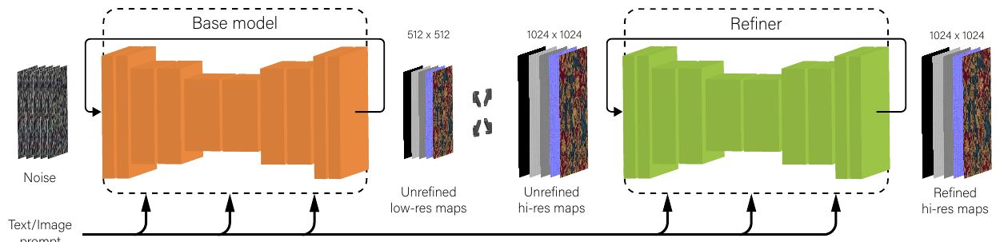

- MatFuse(LDM을 pixel 단위 반사 속성 합성에 적용)를 기반으로 함
- MatFuse의 multi-encoder VAE를 더 효율적인 single-encoder 모델로 교체
- SDXL에서 지식을 distillation하는 semi-supervised 학습으로 생성 다양성 향상
- latent consistency distillation과 features rolling으로 빠른 tileable 생성
- 전용 refiner 모델로 global consistency를 유지하며 고해상도 출력

### 2-1. Material 표현

- SVBRDF texture map 생성 : GGX 분포 함수를 쓰는 spatially varying Cook-Torrance microfacet 모델과 material의 mesostructure 표현
- 생성하는 map : base color, normal, height, roughness, metalness
  - roughness : specular lobe의 폭
  - metalness : 도체(conductor) 영역 표시

### 2-2. Material 생성 모델

압축 VAE `E`(material map을 latent로 인코딩)와 latent 분포를 modeling하는 diffusion 모델 `ϵ_θ`로 구성

**Map Compression (3단계)**
1. multi-encoder VAE 학습
   - encoder `E_1, ..., E_N`와 decoder `D`, 각 encoder `E_i`가 `i`번째 map `M_i`를 latent `z_i`로 인코딩
   - concat한 `z = concat(z_1, ..., z_N)`을 decoding하여 `M̂ = D(z)` 복원
   - loss : pixel 공간 L2, LPIPS, patch 기반 adversarial loss, rendering loss, KL penalty
2. single-encoder 모델로 fine-tuning
   - 원래 decoder는 freeze하고 encoder `E'`만 학습하여, concat된 material map을 같은 latent `z`로 압축
   - disentangled latent 표현을 유지하면서 parameter 수를 줄임
3. texture와 material의 공유 latent space 구축
   - texture 하나(예 : base color)를 `z`로 압축하는 autoencoder를 decoder freeze 상태로 fine-tuning
   - 이 network가 diffusion 모델의 semi-supervised 학습에 사용됨

**Diffusion Model**
- 압축된 latent `z`에서 time-conditional U-Net으로 denoising (Rombach et al. 기반)
- 학습 시 deterministic forward diffusion `q(z_t | z_{t-1})`로 noisy latent를 만들고, 모델이 backward diffusion으로 원래 latent 복원

**Conditioning**
- text 또는 image prompt로 생성 제어, pretrained CLIP으로 단일 feature vector 인코딩
- 학습 시 image와 text prompt를 번갈아 사용
  - image 조건 : material을 ambient 조명으로 렌더링한 이미지
  - text 조건 : caption (없으면 짧은 설명 tag 생성)
- 각 batch에서 한 modality를 무작위로 drop (text 75%, image 25% 확률)

### 2-3. Semi-Supervised Adversarial Distillation

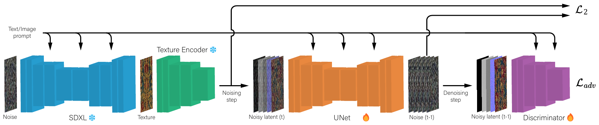

- 목적 : 대규모 dataset으로 학습한 이미지 생성 모델과의 격차를 줄이기 위해 SDXL에서 지식 distillation
- 문제 : texture(이미지 1장)와 material(여러 map)의 domain 차이로 직접 distillation이 비현실적
- 해결 : 주석 있는 material에 대한 supervised loss + SDXL texture의 latent 분포를 실제 material과 맞추는 unsupervised adversarial loss
- 주로 supervised로 학습하므로 mode collapse를 피하고, adversarial loss는 distillation 전략으로 작동

**Supervised Loss**

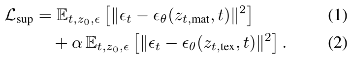

- `z_{t,mat}`, `z_{t,tex}` : step `t`의 material과 texture noisy latent
- `α = 0.15` : 주석 없는 texture sample의 상대적 중요도

**Adversarial Loss**

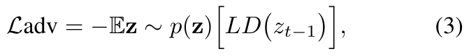

- denoise된 latent `z_{t-1} = concat(z_{t-1,mat}, z_{t-1,tex})`에서 계산, `LD(·)`는 latent discriminator의 출력
- texture와 material을 비슷하게 다루도록 유도하여, 주석 없는 texture에서 시작해도 material 같은 출력을 만들게 함
- SDXL texture가 실제 material의 feature를 따르도록 하여 shading artifact를 막고 다양성을 높임

**Latent Discriminator**
- Sauer et al.을 따라 hinge loss로 학습, VAE로 인코딩한 실제 latent `z_{t-1,real}`과 generator가 denoise한 가짜 latent `z_{t-1,fake}`를 비교
- time-conditional : generator와 같은 timestep `t`와 CLIP embedding을 입력받음
- 구조는 diffusion 모델의 U-Net encoder와 같고 같은 weight로 초기화 (latent space에 대한 이해를 활용)
- ground truth material latent만 실제 sample로 취급
- 기존 adversarial distillation(빠른 생성 목적)과 달리, material과 texture의 domain 격차를 메우는 것이 목적

### 2-4. Fast High-Resolution Generation

**Few-step 생성 (LCM)**
- Latent Consistency Model을 fine-tuning
- augmented PF-ODE(Probability Flow ODE)를 1단계 guided distillation하여, consistency 함수 `f_θ(z_t, c, t) → z_0`로 `t = 0`의 해를 직접 예측
- 2단계 방법과 달리 guidance scale `ω`를 PF-ODE에 직접 통합하고 skip-step 전략으로 시점 간 일관성 확보
- 4 step 생성 가능

**Features rolling (tileability)**
- 기존 noise rolling은 반복 diffusion으로 tileability를 얻지만, step 수가 적으면 효과가 떨어짐 (LCM과 결합 시 seam 발생)
- rolling을 noisy 입력이 아니라 U-Net feature로 옮김 : 각 convolution과 attention layer 안에서 feature map을 무작위로 roll한 뒤 되돌림
- 적은 diffusion step으로도 경계 연속성 유지
- 구조가 뚜렷한 material은 전체 layout 유지를 위해 첫 diffusion step 이후부터 features rolling 적용

**Latent Upscaling & Refinement**
- features rolling과 patch 기반 diffusion만으로는 tile 사이에 불일치가 생길 수 있음
- SDXL처럼 SDEdit을 쓰는 2단계 pipeline
  1. 512×512 해상도로 생성
  2. strength 0.5로 원하는 해상도까지 refine (새 고주파 detail과 global consistency의 균형)
- refiner는 4K material에서 downsampling 없이 512×512로 잘라낸 crop으로 학습하여 미세한 surface detail 포착

## 3. 실험

**Dataset**
- MatSynth와 Deschaintre et al. dataset을 합쳐 총 6,198개의 고유 PBR material (원래 train/test 분할 사용)
- 5개 material map(basecolor, normal, height, roughness, metallic)과 다양한 environment 조명에서의 렌더링
- SDXL로 만든 texture-text 쌍 4,000개 추가 (ChatGPT가 제안한 material prompt 200개 사용)

**구현**
- 모든 모델을 RTX4090 1장(24GB)에서 gradient accumulation으로 학습
- Autoencoder : Adam, batch size 8, 1,000,000 iteration, learning rate 4.5e-4, 300,000 iteration 이후 `L_adv` 활성화
  - multi-encoder VAE 학습 후 single-encoder로 fine-tuning하여 parameter를 271M에서 101M으로 감소
  - single encoder와 texture encoder는 decoder를 freeze한 채 100,000 step fine-tuning
- Latent Diffusion : supervised로 400,000 iteration(batch 16, AdamW, lr 3.2e-5), 이후 semi-supervised로 200,000 iteration(batch 8) fine-tuning
- Refiner : 50,000 iteration, batch 16, lr 2e-7
- 두 모델 모두 입력/출력 18 channel의 OpenAI U-Net 구조
- LCM : 10,000 iteration, batch 16, AdamW, lr 1e-6, linear β schedule, 추론 시 `T = 4` step

**추론 속도와 메모리**
- denoising 4 step + refinement 2 step, LCM sampler, half precision, 최대 8 patch 병렬

| 해상도 | StableMaterials (LCM) | LDM (DDIM 50 step + refinement 25 step) |
|---|---|---|
| 512 × 512 | 0.6s | - |
| 1024 × 1024 | 1.5s, 6.5GB | - |
| 2048 × 2048 | 4.9s, 7.4GB | 20.6s |
| 4096 × 4096 | 18.6s, 12GB | 65.4s |

### 3-1. 생성 결과

- 학습 category에 있는 in-domain 개념과 새로운 out-domain 개념을 모두 포함하도록 test prompt 선택 (학습 prompt와 겹치지 않음)

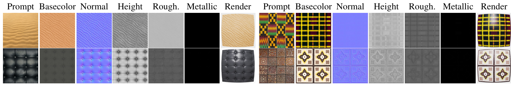

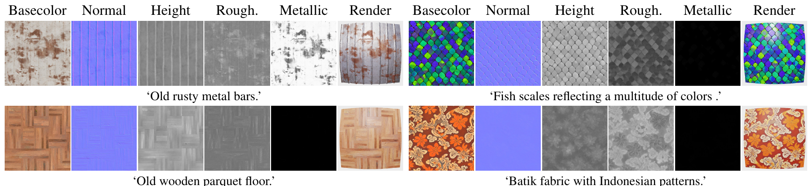

### 3-2. 정성 비교

- 비교 대상 : MatFuse, MatGen, Material Palette, Adobe Substance 3D Sampler
- MatFuse, Material Palette, StableMaterials는 공개 dataset, MatGen과 Sampler는 비공개 data 사용

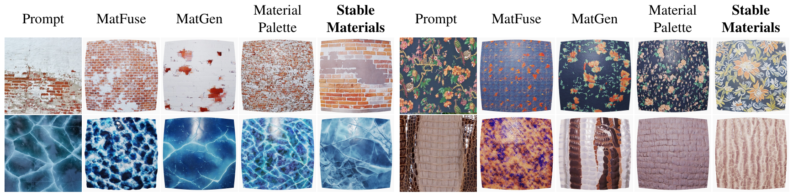

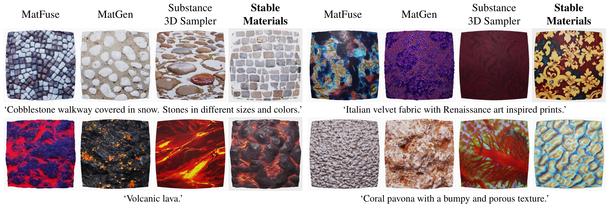

- StableMaterials는 맞춤형 latent 표현과 2단계 생성으로 PBR map을 직접 출력하여 해상도 제약을 줄이고 artifact를 감소
- 입력 prompt를 더 잘 따르고 out-domain material도 잘 modeling, 더 큰 dataset으로 학습한 모델과 비슷하거나 더 좋은 시각 품질

**User Study**
- 도메인 전문가 20명이 10개 prompt에 대해 각 방법의 결과를 비교
- 각 prompt마다 선호 sample을 고르고, 4개 material을 prompt 충실도, 사실감, material 일관성에 대해 1~5점으로 평가

| Method | 선호 횟수 | 평균 점수 |
|---|---|---|
| StableMaterials | **105** | **3.50** |
| Substance 3D Sampler | 66 | 2.71 |
| MatGen | 25 | 2.28 |
| MatFuse | 4 | 1.85 |

- one-way ANOVA로 차이가 통계적으로 유의함 확인 (`F = 60.5`, `p < 0.05`)
- 선호 횟수에 대한 chi-square 적합도 검정 : `χ² = 120.44`, `p < 0.001` (우연과 크게 다름)
- 평균 점수와 선호 횟수의 상관계수 `R = 0.99`

### 3-3. 정량 비교

- material 품질은 자연 이미지와 분포가 달라 FID, IS 같은 표준 지표로 평가하기 어려움
- 대신 CLIP 기반 지표 사용 : CLIP Score(prompt와의 의미 정렬), CLIP-IQA(지각 품질, "high-quality/low-quality" 대비 쌍)
- text 조건 생성 80개에서 비교

| Metric | MatFuse | MatGen | Substance 3D Sampler | StableMaterials |
|---|---|---|---|---|
| CLIP Score ↑ | 26.2 | 28.8 | 24.9 | **29.6** |
| CLIP-IQA ↑ | 0.52 | 0.66 | **0.71** | 0.70 |

- CLIP Score는 최고, CLIP-IQA는 Sampler와 비슷 (MatFuse보다는 크게 향상)

### 3-4. Ablation

**VAE 구조**

| 구조 | Albedo | Normal | Height | Rough. | Metal. |
|---|---|---|---|---|---|
| Multi-E (271M) | 0.030 | 0.035 | 0.030 | 0.032 | 0.016 |
| Single-E (101M) | 0.028 | 0.037 | 0.030 | 0.032 | 0.015 |

- 재구성 RMSE ↓
- 전이 학습 전략으로 더 작은 network가 큰 multi-encoder VAE와 비슷한 성능을 내면서 같은 disentangled latent space 유지

**학습 전략 (semi-supervised distillation 유무)**

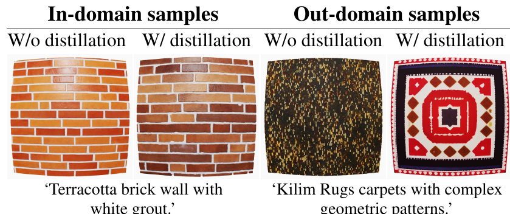

- 순수 supervised baseline은 표현되지 않은 material(out-domain)을 안정적으로 생성하지 못함
- semi-supervised 학습이 생성 다양성을 높이고 새로운 material도 생성

**고해상도 생성**

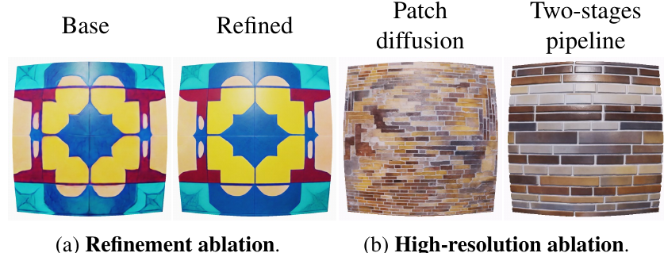

- (a) 2단계 방식(base 생성 + refinement)이 detail을 선명하게 개선
- (b) patch diffusion만 쓰면 patch 사이에 scale과 일관성 artifact, 2단계 방식은 512×512에서 patch를 통합한 뒤 upscaling하여 더 일관된 대형 출력

## 4. 한계 및 향후 방향

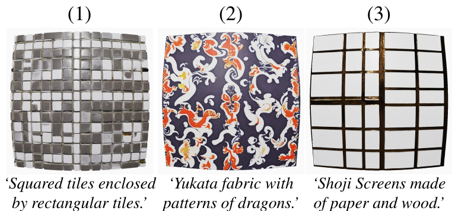

1. 공간 관계를 묘사하는 자연어 prompt에 약하고, 복잡한 개념이나 그림을 정확히 표현하지 못함 → 학습 prompt를 더 다양하게 하면 완화 가능
2. 주석 없는 dataset에만 있는 material class에서 잘못된 반사 속성을 생성할 수 있음 (예 : 금속으로 잘못 분류) → 학습 때 surface 속성을 설명하는 text prompt를 쓰면 완화 가능
3. 주석된 dataset 밖의 다양한 material을 표현할 수 있지만, 여전히 주석 없는 data에 있는 class로 제한됨

## 추가 결과

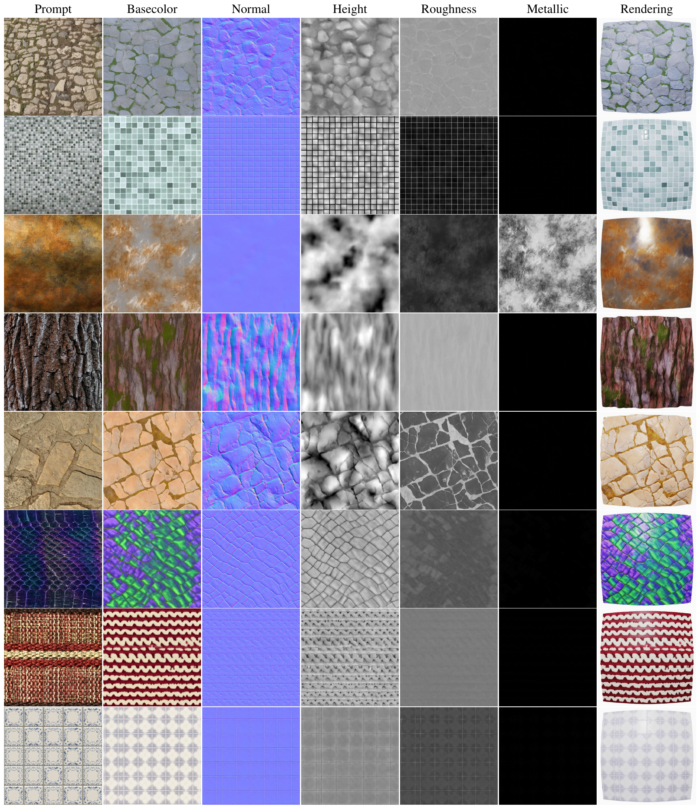

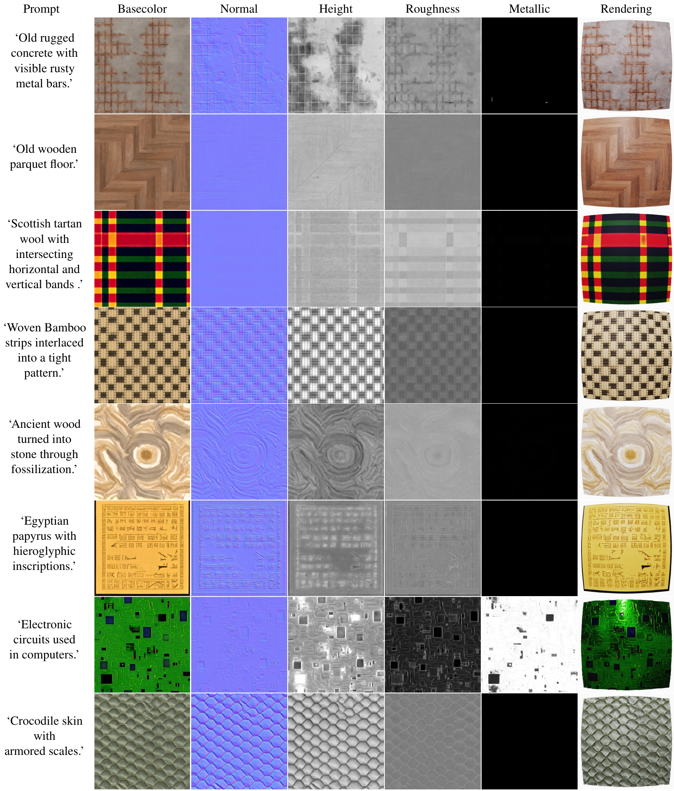
