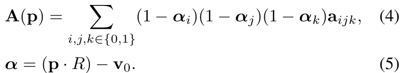
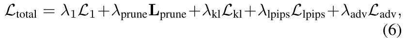
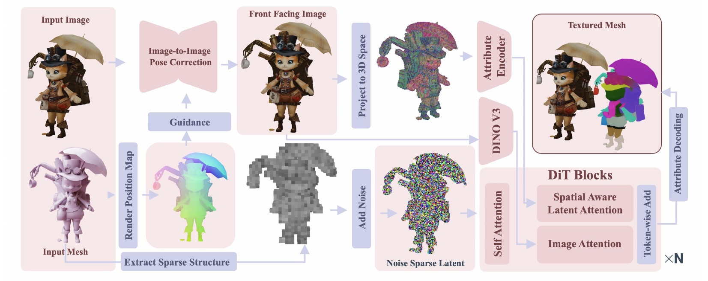
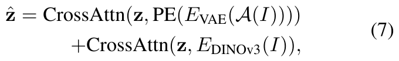

# TEXTRIX — 논문 목적 및 Method 정리

> **논문:** TEXTRIX: Latent Attribute Grid for Native Texture Generation and Beyond  


## 1. 기존 문제와 논문의 해결 방안

### 기존 방법의 한계

**① Multi-view 기반 Texture Generation**

- 여러 시점에서 생성한 이미지를 Mesh에 투영·융합하므로 **시점 간 불일치**, Seam, Blurring이 발생할 수 있음.
- 가려진 영역(Occlusion)의 Texture Coverage와 품질이 불완전할 수 있음.

**② UV 공간에서 직접 생성하는 방식**

- 3D 표면을 2D UV Island로 펼치면서 원래 3D에서 인접한 표면의 연결 관계가 끊어짐.
- UV Island 경계에서 불연속성과 Seam이 발생할 수 있음.

**③ 기존 3D Appearance Representation — TRELLIS(원 논문)**

Multi-view Image → DINOv2 Feature 추출 → 대응하는 3D Voxel에 투영 → Appearance Representation으로 사용.

논문이 지적한 한계:

1. DINOv2 Feature 추출에서 미세한 색상·고주파 Texture Detail이 손실될 수 있음.
2. Voxel마다 고차원 Feature를 저장해 메모리·연산 부담이 크고 고해상도(예: 1024³)로 확장하기 어려움.
3. DINOv2 Feature는 Roughness, Metallic, Semantic Label 같은 Attribute를 직접 나타내는 표현이 아니어서 다양한 속성으로 확장하기 불편함. **다른 속성을 표현하는 것이 원천적으로 불가능하다는 뜻은 아님.**


### TEXTRIX의 해결 방법과 목적

- 고차원 이미지 Feature 대신, Mesh 표면 주변 **Sparse 3D Voxel Grid에 실제 Attribute 값(RGB 등)을 저장·생성**하는 Native 3D Attribute Representation 제안.
- Attribute VAE로 이를 압축하고, **Sparse Latent Conditioned DiT**로 입력 이미지에 맞는 3D Attribute Latent를 생성.
- **주요 목표:** 단일 View 이미지로부터 입력 Mesh의 Geometry와 정렬되고, Seam이 적으며, 가려진 영역까지 자연스럽게 완성된 고충실도 Texture 생성.
- 동일한 **표현 및 Architecture를 기반으로** 3D Part Segmentation과 PBR Material Generation에도 확장. 단, 모든 Attribute를 하나의 모델이 항상 동시에 생성한다는 의미는 아님.

**핵심:** Texture를 2D View나 UV 공간에서 직접 생성하는 대신 **3D 공간에서 생성한 후 최종 결과만 UV Map으로 추출**함.

---

## 2. Latent 3D Attribute Representation

### 2.1 Native 3D Attribute Grid

전체 Attribute는 다음과 같이 표현함.


<sub>**Eq. 1, 2** · 활성 Voxel M개 각각에 k차원 Attribute 벡터 `a_i`를 저장한 집합이 `A`. k는 color, semantic, PBR 등 속성별 채널 수의 합.</sub>

- \(M\): 활성화된 Sparse Voxel 개수
- \(\mathbf a_i\): 활성 Voxel \(i\)에 저장된 Attribute Vector
- \(k\): Voxel 하나의 Attribute Channel 수
- RGB 작업에서는 예를 들어 \(\mathbf a_i=[R_i,G_i,B_i]\), \(k=3\)
- 개념적으로 \(k=k_{\mathrm{color}}+k_{\mathrm{semantic}}+k_{\mathrm{PBR}}+\cdots\)처럼 다양한 속성의 Channel로 확장 가능

**Sparse Voxel:** 전체 1024³ 격자에 값을 모두 저장하는 것이 아니라, **Mesh 표면 부근의 활성 Voxel에만 Attribute를 저장**함. 1024³은 공간 해상도이고 실제 활성 Voxel 수는 이보다 적음.

학습 데이터 준비 시 기본 흐름:

```text
Texture가 존재하는 Mesh + GT UV Texture
    → Mesh 표면 부근 Sparse Voxel 구조 구성
    → 기존 Texture의 RGB를 3D 위치에 Projection
    → Sparse 3D Attribute Grid
    → Attribute VAE 입력
```

**주의:** 표면 부근 Voxel의 정확한 선정 기준과 Projection의 세부 구현은 본문에 공개되지 않음.

### 2.2 Querying via UV Position Map

**사용 위치:** (1) VAE 학습의 Rendering-based Reconstruction에서 복원 Attribute를 표면 Texture로 변환할 때, (2) **최종 추론에서 생성한 3D Attribute Grid를 UV Texture로 추출할 때**.

1. **UV Position Map 생성:** 일반 UV Texture는 픽셀 \((u,v)\)에 RGB를 저장하지만, UV Position Map은 그 픽셀이 대응하는 **Mesh 표면의 3D 좌표** \(P(u,v)=(x,y,z)\)를 저장함.
2. **주변 Voxel Corner 탐색:** 해당 3D 위치를 Grid 좌표로 변환하고 기준 Corner를 찾음. 예: Grid 좌표가 \((120.3,240.7,500.2)\)이면 기준 Corner는 \((120,240,500)\), 주변 Corner는 x·y·z 축에서 각각 기준값 또는 기준값+1을 선택한 **8개**.
3. **Trilinear Interpolation:** Cell 내부 상대 위치 \((0.3,0.7,0.2)\)를 이용해 8개 Corner의 RGB를 거리 가중 평균하여 해당 3D 표면 지점의 RGB를 계산.
4. **UV Texture 구성:** 이 연산을 UV Position Map의 유효한 모든 픽셀에서 반복하여 2D UV RGB Texture 생성.


<sub>**Eq. 3** · 한 Cell의 8개 Corner Voxel 집합 `V`. 각 Corner `v_ijk`는 i, j, k가 각각 0 또는 1.</sub>



<sub>**Eq. 4, 5** · 표면 점 `p`의 속성 `A(p)`는 8개 Corner 값 `a_ijk`의 가중합(Trilinear). `α`는 `p`의 Grid 좌표(`p·R`)에서 기준 Corner `v_0`를 뺀 Cell 내부 상대 위치.</sub>

```text
UV Pixel (u,v)
    → UV Position Map에서 3D 좌표 (x,y,z) 조회
    → Attribute Grid의 주변 8개 Corner 조회
    → Trilinear Interpolation으로 RGB 계산
    → 해당 UV Pixel에 RGB 기록
    → 최종 UV Texture
```

**구분:** **생성 공간 = 3D Attribute Grid / 최종 Texture 추출 공간 = 2D UV Map.** Condition 생성을 위해 이미지를 3D로 투영할 때 쓰는 **Front-view Position Map**과는 방향과 용도가 다름.

---

## 3. Attribute VAE


### 3.1 목적과 전체 구조

1024³ 해상도의 3D Attribute Grid를 직접 DiT로 생성하기에는 비용이 크므로 **압축 가능한 Latent Space**를 학습함.

```text
GT UV Texture
    → Projection → Sparse Attribute Grid (1024³)
    → [VAE Encoder: Sparse Convs → Sparse Transformer]
    → Sparse Latent (공간 해상도 128³, 활성 위치당 16채널)
    → [VAE Decoder: Sparse Transformer → Sparse Transposed Convs + Pruning]
    → 복원된 Sparse Attribute Grid (1024³)
    → UV Position Map Query / Interpolation → Textured Mesh → Rendering
    → GT Rendering과 비교해 VAE 학습
```

여기서 **입력은 Voxel 하나가 아니라 여러 활성 Voxel과 그 Attribute로 구성된 Sparse Grid 전체**임. 128³ 역시 Dense Token이 반드시 \(128^3\)개 있다는 뜻이 아니라 **Sparse Latent의 공간 해상도**를 뜻함.

### 3.2 Encoder

1. **Sparse Convolution:** 활성 Voxel의 이웃 Feature를 결합하고, 여러 Stage에서 공간 해상도를 점차 낮추며 Local Feature를 추출.
2. **Serialization:** 낮아진 Sparse Feature Grid를 Token Sequence로 변환.
3. **Sparse Transformer:** 떨어져 있는 영역 간 관계를 모델링하고 Compact Latent Representation 형성.

- 입력 공간 해상도: **1024³**
- 최종 Latent 공간 해상도: **128³**
- 최종 Latent Feature 차원: **16**

**미공개:** Sparse Convolution의 Kernel, 각 Stage의 정확한 Channel 수, Transformer Layer/Head 수, 구체적 직렬화 방식.

### 3.3 Decoder와 Pruning

1. Sparse Transformer로 Latent를 해석.
2. Sparse Transposed Convolution으로 공간 해상도를 높여 Attribute Grid 복원.
3. **각 Upsampling Stage 뒤에 Pruning**을 적용해 유효 표면 영역과 대응하지 않는 불필요한 후보 Voxel을 제거.
4. **Pruning BCE Loss** 사용: 유효/무효 영역을 구분하도록 학습 신호를 제공하는 것으로 해석할 수 있음. 그러나 Pruning Prediction Head, Threshold, 추론 시 GT 구조를 직접 사용하는지 여부는 논문에 명확하지 않음.

### 3.4 VAE 학습과 Loss

복원 Grid를 원본 Grid와 단순히 Voxel 단위 MSE로 비교하는 대신, **복원된 Attribute를 Mesh에 적용해 Rendering하고 그 이미지에서 Reconstruction을 감독**함. 최종 시각적 품질에 직접 맞춘 학습 방식임.



<sub>**Eq. 6** · VAE 전체 손실 = L1 + Pruning BCE + KL + LPIPS + Adversarial의 가중합. `λ`는 각 항의 가중치.</sub>

| Loss | 목적 |
|---|---|
| L1 | Rendering 결과와 GT의 값 차이 감소 |
| Pruning BCE | 유효한 Sparse Voxel 영역 식별을 위한 감독 |
| KL | VAE Latent Distribution 정규화 |
| LPIPS | 시각적·지각적 세부 정보 보존 |
| Adversarial (GAN) | Texture의 시각적 사실성과 고주파 Detail 개선 |

**Ablation (Table 5):** Rendering Loss를 사용한 VAE가 직접 Cube MSE Loss를 사용한 VAE보다 좋은 복원 성능을 보임(PSNR 33.21 vs. 31.59; LPIPS 0.0246 vs. 0.0421).

---

## 4. Attribute DiT with Sparse Latent Conditioning



### 4.1 목적과 DiT 입력

**목적:** 학습된 VAE의 3D Latent 공간에서 입력 Mesh와 Reference Image에 맞는 Texture Attribute Latent 생성.

DiT에는 다음 세 종류의 정보가 사용됨.

1. **Geometry / Sparse Structure:** 생성할 Attribute가 배치될 3D 공간 구조.
2. **Sparse Latent Condition:** 입력 이미지의 RGB를 3D 공간에 정렬한 조건.
3. **DINOv3 Image Feature:** 입력 이미지의 전역 시각 정보를 제공하는 추가 조건.

**Geometry 경로:**

```text
Input Mesh (Vertices, Faces)
    → Extract Sparse Structure
    → 해당 Sparse Structure에 대응하는 Noisy Sparse Latent 구성
    → DiT 입력
```

**중요:** Mesh만 VAE Encoder에 넣어 학습된 Latent Feature를 만든다고 설명한 것은 **논문에 없음**. Figure 5는 Sparse Structure 추출과 Noise 추가를 보여주지만, Noise Feature와 Sparse Latent 좌표의 정확한 생성 방식은 미공개.

### 4.2 Sparse Latent Condition이 필요한 이유

CLIP/DINO 등 일반적인 2D Image Feature만 사용하면 **이미지의 시각 Feature와 3D Attribute Latent 사이의 Domain Gap** 때문에 입력 이미지와 Texture가 공간적으로 정렬되지 않을 수 있음.

해결책은 입력 RGB를 **먼저 3D 공간으로 투영한 다음, Attribute VAE Encoder를 사용해 생성 대상과 같은 Latent 표현으로 인코딩**하는 것.

**조건 경로 A — Sparse Latent Condition:**

1. **Image-to-Image Pose Correction:** Target Mesh를 정면에서 본 **Front-view Position Map**을 만들고, 이를 조건으로 하는 별도 Fine-tuned Diffusion Model로 Reference Image를 정면 이미지 \(I_{\mathrm{front}}\)로 변환.
2. **3D Projection:** 정면 이미지 픽셀의 RGB와 Front-view Position Map의 \((x,y,z)\)를 대응시켜 **Partial Sparse 3D Attribute Grid** 구성.
3. **Attribute VAE Encoder:** 이 부분 Attribute Grid를 학습된 VAE Encoder에 넣어 **Sparse Latent Condition** 생성.
4. **Position Embedding:** VAE Encoder 출력 조건 Latent에 Position Embedding을 적용해 Cross-Attention 조건으로 전달.

**조건 경로 B — DINOv3:**

- Reference Image를 Pretrained DINOv3 Encoder에 넣어 추가 Image Feature 추출.
- 논문에서 명시한 목적은 **Global Semantic Feature 제공 및 생성 안정성 향상**.

**미공개:** Pose Correction Diffusion Model의 정확한 Backbone/학습법, Position Embedding 종류 및 좌표 인코딩 방식, DINOv3 세부 Variant.

### 4.3 DiT 내부 구조

논문 Figure 5는 **Spatial Aware Latent Attention, Image Attention, Token-wise Add**를 주요 구성요소로 표시하며, Direct3D-S2와 **유사한** Spatial Sparse Attention 설정을 사용한다고 설명함.

두 Image Condition의 결합은 Equation (7)에 제시됨.



<sub>**Eq. 7** · Latent `z`가 두 조건을 각각 Cross-Attention으로 참조한 뒤 합산. 첫 항은 투영 RGB → VAE Encoder → Position Embedding 조건, 둘째 항은 DINOv3 Feature 조건.</sub>

- \(z\): DiT가 처리 중인 Sparse Latent Token
- 첫 번째 Cross-Attention: **Projected RGB → VAE → Position Embedding** 조건 참조
- 두 번째 Cross-Attention: **DINOv3 Feature** 조건 참조
- 두 Attention 결과를 합하여 생성 Latent에 조건 정보를 제공
- Spatial Sparse Self-Attention은 3D Sparse Latent Token 간 관계를 처리

**미공개:** DiT Block 수, Hidden Size, Attention Head, MLP/Normalization/Residual의 정확한 배치. 따라서 **Direct3D-S2 전체 Block을 그대로 사용한다고 단정하면 안 됨**.

### 4.4 DiT 학습 Objective

- **Rectified Flow / Flow Matching** 사용.
- GT Attribute Grid를 VAE Encoder로 인코딩한 **GT Latent**를 학습 타깃으로 사용하고, Noisy Sparse Latent와 Image Conditions를 통해 생성 방향을 학습하는 구조로 이해할 수 있음.
- 원문에 Flow Matching의 구체적 수식과 Noise Sampling 세부 구현은 제시되지 않음.

**공개 설정:** 1,000 Training Timesteps, Condition Drop Probability 0.1(CFG 학습), AdamW, Learning Rate 1e-4, GPU당 Batch Size 16, A100 32개, 약 30,000 Iterations. 추론은 **15 Steps, CFG Scale 3.0**.

---

## 5. 전체 학습 과정과 추론 과정

### 5.1 학습 과정

**A. Attribute VAE 학습**

```text
Texture가 존재하는 GT Mesh + UV Texture
    → GT RGB를 3D 공간에 Projection
    → Sparse Attribute Grid (1024³)
    → VAE Encoder (Sparse Convs → Sparse Transformer)
    → Sparse Latent (128³, 16ch)
    → VAE Decoder (Sparse Transformer → Transposed Sparse Convs + Pruning)
    → Reconstructed Attribute Grid
    → UV Position Map Query → Textured Mesh Rendering
    → GT Rendering과 비교
    → L1 + LPIPS + GAN + KL + Pruning BCE로 VAE 학습
```

**B. Attribute DiT 학습**

```text
[GT 경로]
GT Attribute Grid → 학습된 VAE Encoder → GT Attribute Latent
                                              ↓
[Geometry 경로]                               Flow Matching 학습 타깃
Input Mesh → Sparse Structure → Noisy Sparse Latent ──┐
                                                     │
[Image Condition 경로 1]                             │
Reference Image → Pose Correction → Front-view RGB    │
    → 3D Projection → VAE Encoder → Position Embedding├→ DiT
                                                     │
[Image Condition 경로 2]                             │
Reference Image → DINOv3 Image Features ──────────────┘
                                                     ↓
                                      Rectified Flow Objective로 학습
```

이 도식은 논문 Figure 5를 기반으로 정보를 분리해 보여준 **설명용 재구성**임. 실제 Flow Matching Target과 조건의 내부 결합 시점까지 모든 연산을 공개한 구조는 아님.

### 5.2 추론 과정

```text
[입력] Texture가 없는 Target Mesh + Reference Image

① Mesh → Sparse Structure 추출
② Reference Image → Pose Correction으로 Front-facing Image 생성
③ Front-facing Image + Front-view Position Map → Partial 3D Attribute Grid
④ Partial Attribute Grid → VAE Encoder + Position Embedding → Sparse Latent Condition
⑤ Reference Image → DINOv3 → Image Condition
⑥ Sparse Structure에 대응하는 Noisy Sparse Latent 구성
⑦ DiT에서 두 조건을 사용해 15-Step Rectified Flow Sampling (CFG 3.0)
⑧ 생성된 Sparse Attribute Latent → 학습된 VAE Decoder
⑨ 3D Attribute Grid 복원
⑩ UV Position Map Query + Trilinear Interpolation → 2D UV Texture 추출
⑪ Target Mesh에 UV Texture 적용 → 최종 Textured Mesh
```

**정리:** VAE는 **3D Attribute 표현의 압축·복원**을, DiT는 **조건부 3D Attribute Latent 생성**을 담당함. UV Position Map은 **VAE 학습의 Rendering Supervision**과 **최종 추론의 UV Texture 추출**에서 사용되며, **Front-view Position Map**은 입력 이미지를 3D Condition으로 변환할 때 사용됨.
