# TEXTRIX

> **한 줄 요약** : 3D native (sparse voxel attribute grid)  
> texture를 sparse voxel에 저장한 3D attribute grid로 표현하고, 이를 압축하는 attribute VAE와 sparse latent conditioning을 쓰는 DiT로 3D 공간에서 직접 색을 생성 (같은 구조로 3D part segmentation, PBR 생성까지 확장)

## 1. 배경

**목표**
- 단일 view 입력으로 geometry와 정렬된 고충실도 texture 합성
- 같은 표현과 구조로 3D part segmentation 같은 perception 작업까지 통합

**기존 방식의 문제**

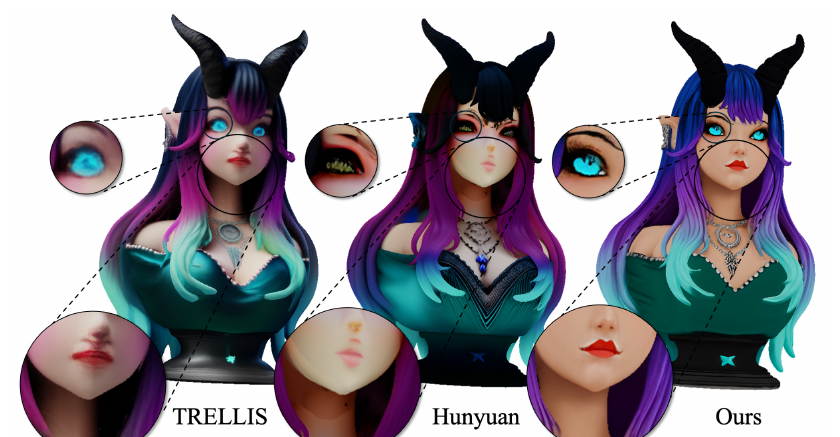

| 방식 | 대표 | 한계 |
|---|---|---|
| 2D diffusion lifting (SDS 최적화, multi-view 생성 후 재구성, mesh 위 fusion) | TEXTure, Text2Tex, MVAdapter, Hunyuan3D 2.0 | view 간 불일치로 seam과 흐린 detail, 조명 비일관, 복잡하거나 가려진 영역의 coverage 부족 |
| 2D UV 공간 직접 생성 | TEXGen, Paint3D | UV mapping이 연속 surface를 끊어진 2D island로 펼쳐 geodesic 이웃이 끊김 → UV seam artifact, texture 패턴과 3D geometry의 단절 |
| TRELLIS의 표현 | TRELLIS | multi-view DINOv2 feature를 voxel에 투영, 고주파 정보 손실, channel 차원이 커서 1024³ 같은 고해상도로 확장 어려움, PBR 등 다른 속성으로 확장 제한 |

**핵심 아이디어**
- texture를 native 3D attribute grid(다양한 정보를 저장하는 sparse voxel field)로 표현하고 생성
- sparse attention을 갖춘 DiT로 3D grid의 분포를 학습 (sparse voxel(XCube)이나 structured voxel(TRELLIS) 기반 3D shape 생성의 발전을 활용)
- multi-view 불일치와 2D UV 조각화 문제를 근본적으로 우회 → seamless, 고해상도, geometry-aware texture
- 입력 조건과의 정렬을 위해 sparse latent conditioning 도입 : 전역 feature(CLIP 등)에만 의존하지 않고 입력 이미지를 3D voxel grid에 투영해 sparse latent 조건으로 사용

**기여**
1. sparse attribute grid 기반 native 3D texturing framework (view 불일치와 seam artifact 해결)
2. 시각 정보를 3D grid로 투영하는 sparse latent conditioning (정면 정렬과 detail 보존)
3. 같은 sparse grid 구조로 다양한 속성을 예측하여 3D segmentation 등으로 확장, SOTA

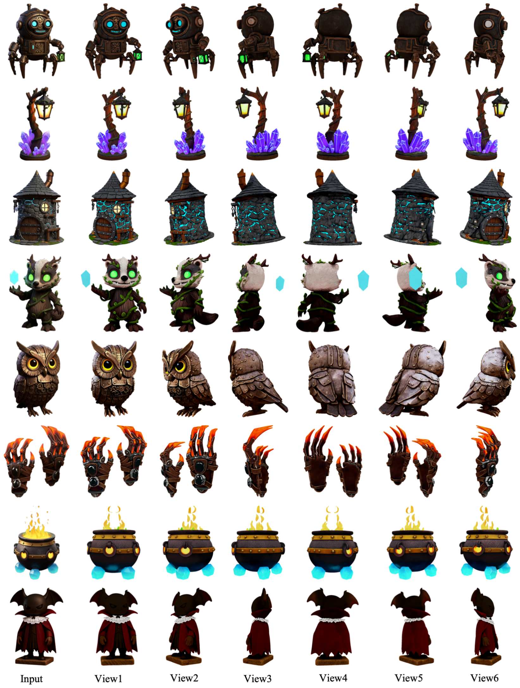

## 2. 방법론

### 2-1. Latent 3D Attribute 표현

**Native 3D Attribute Grid**
- sparse voxel grid 구조로 object surface 근처 영역에 고해상도 원본 3D 속성을 저장 (효율과 확장성)
- object의 native 3D 속성 `A`

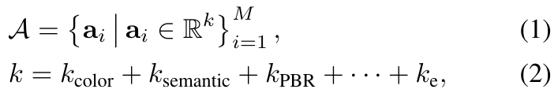

- `a_i` : 각 voxel에 저장된 속성 vector, `M` : sparse voxel 총 수
- `k` : 속성 공간의 전체 channel 차원 = color + semantic + PBR + 기타 속성 channel의 합

**UV position map으로 질의**
- 각 pixel `(u, v)`가 대응하는 mesh surface의 3D 좌표 `p = (x, y, z)`를 저장한 고해상도 UV position map을 미리 계산 (2D 속성 좌표 → 3D 점의 lookup table)
- 3D 질의점 `p ∈ [-0.5, 0.5]^3`의 속성을 sparse voxel grid에서 trilinear interpolation으로 획득
  1. 해상도 `R`인 grid에 맞게 좌표를 scale하여 점이 속한 voxel cell을 찾음, 원점 corner index `v0 = ⌊p · R⌋`
  2. 감싸는 voxel의 8개 corner와 각 corner 속성 `a_ijk` 획득

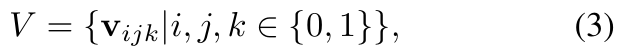

  3. voxel 내부 국소 좌표로 가중한 trilinear interpolation

- 간단하지만 효율적인 연속 속성 질의, 비선형 속성 field를 학습할 수 있는 유연성 덕분에 sparse 표현에서도 높은 생성 충실도와 perception 정밀도

### 2-2. Attribute VAE

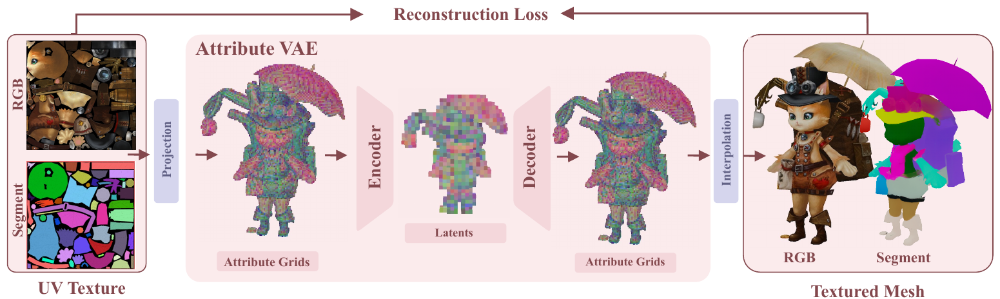

**End-to-end 구조**
- TRELLIS는 multi-view 이미지의 DINOv2 feature를 VAE 입력으로 쓰고 FlexiCubes나 3D Gaussian Splatting으로 decoding해 외관을 supervision → 학습이 비효율적이고 256³ 해상도로 제한
- TEXTRIX는 native 3D 속성 표현을 써서 완전한 end-to-end 대칭 attribute VAE 구성, 1024³ 같은 고해상도로 확장 가능

**Network 구조** : sparse 3D convolution과 transformer의 hybrid
- Encoder : sparse convolution module 계층으로 해상도를 점진적으로 낮추며 다중 scale 국소 feature 추출 → 거친 feature grid를 token sequence로 serialize → sparse transformer backbone으로 장거리 의존성과 전역 맥락 modeling → 압축된 latent 분포
- Decoder : 대칭 구조, sparse transformer가 latent를 해석한 뒤 sparse transposed convolution으로 점진적 upsampling하여 고해상도 속성 grid 복원

**학습 목표**
- decoding된 sparse grid에는 유효 영역과 중복 영역이 섞여 있어, 각 upsampling 단계 후 pruning 적용 (입력 grid를 2, 4, 8배 downsample하여 유효 surface 영역과의 공간 대응으로 grid 요소 제거)
- 입력 grid를 직접 supervision하지 않고 online rendering 방식 사용 (view 의존 렌더링으로 속성 supervision)
- KL loss로 latent 정규화, LPIPS와 adversarial(GAN) loss로 시각 사실감 향상

- `L_1` : L1 loss, `L_prune` : pruning용 binary cross-entropy loss

### 2-3. Attribute DiT와 Sparse Latent Conditioning

**문제** : CLIP, DINO 같은 pretrained visual encoder feature를 조건으로 쓰면, feature embedding과 latent 표현 사이의 domain gap 때문에 생성 속성이 입력 이미지와 어긋남

**Sparse latent conditioning**
1. 임의의 알 수 없는 시점의 reference 이미지 `I`를 canonical화 : target 정면 view에서 렌더링한 position map을 조건으로 받는 fine-tuned diffusion model이 reference `I'`를 바탕으로 새 정면 이미지 `I_front`를 합성
2. 같은 정면 position map으로 `I_front`의 pixel을 3D volume에 projection → 조건용 attribute grid 생성
3. 이 sparse voxel grid를 pretrained attribute VAE의 encoder에 넣어, latent token `z`와 같은 latent space에 조건을 embedding (조건과 latent space의 domain gap 해소)

**Hybrid cross-attention**
- sparse latent 조건에 더해, 모델 안정성을 위해 pretrained DINOv3의 전역 semantic feature도 조건으로 사용

- `PE` : position embedding, `E_VAE` : attribute VAE encoder, `A(I)` : 입력 이미지를 투영한 sparse volume, `E_DINOv3` : DINOv3 encoder
- Direct3D-S2와 비슷한 spatial sparse attention으로 self-attention의 계산 효율 향상
- rectified flow 목표로 DiT 학습

### 2-4. 응용과 확장성

**3D part segmentation**
- 생성 문제로 정식화 : 색 대신 part label을 나타내는 latent attribute grid를 예측
- 학습 : 각 part에 고유한 무작위 RGB 색을 이산 label로 할당한 ground-truth UV map 사용
- 추론
  1. 기존 2D segmentation 방법으로 렌더링 view에서 초기 part mask 생성 (보통 과분할)
  2. 인접 segment 쌍의 DINO feature 유사도로 비슷한 쌍을 병합하여 의미 있는 component로 통합
  3. 이 조건으로 색 코딩된 attribute grid 생성, grid를 질의해 3D segmentation과 대응하는 UV map 획득
  4. label 값에 clustering을 적용해 최종 segmentation
- face 수가 매우 많은 위상적으로 복잡한 mesh에서도 경계가 날카롭고 정밀

**PBR material 생성** : 같은 sparse grid 구조로 roughness, metallic, normal map 같은 속성을 예측하도록 학습

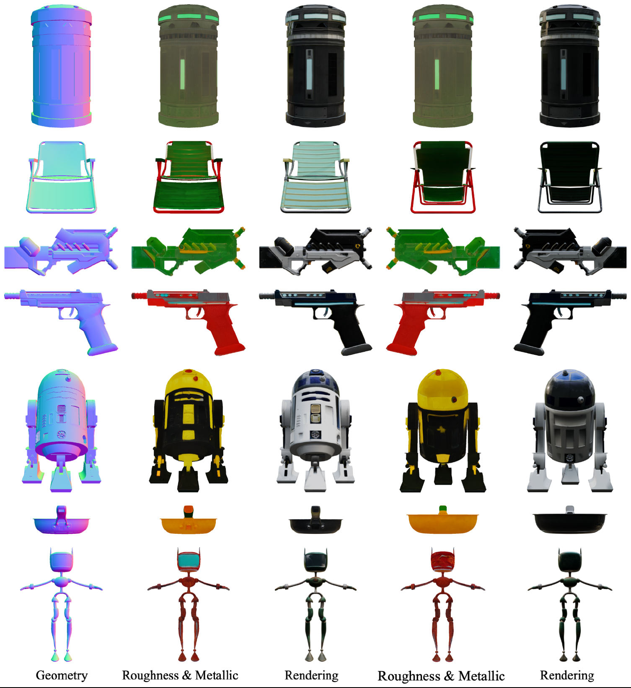

## 3. 구현

- Dataset : Objaverse, Objaverse-XL, 비공개 data, asset마다 texture와 segmentation의 색 코딩 UV map을 2048×2048로 생성(학습 target), 같은 해상도로 조건 이미지 렌더링
- Sparse VAE : texture map과 segmentation map을 모두 압축, 입력 sparse grid 1024³ → latent grid 128³, 최종 latent embedding 차원 16
- Latent diffusion : sparse transformer 기반, 전역 이미지 feature는 pretrained DINOv3, classifier-free guidance(조건 drop 확률 0.1)
- 학습 : AdamW (lr 1e-4, betas (0.9, 0.999)), GPU당 batch 16, A100 32장, flow matching scheduler 1000 timestep, 약 30,000 iteration
- 추론 : 같은 scheduler로 15 step, guidance scale 3.0

## 4. 실험

### 4-1. 정성 결과

**단일 view texture 생성**

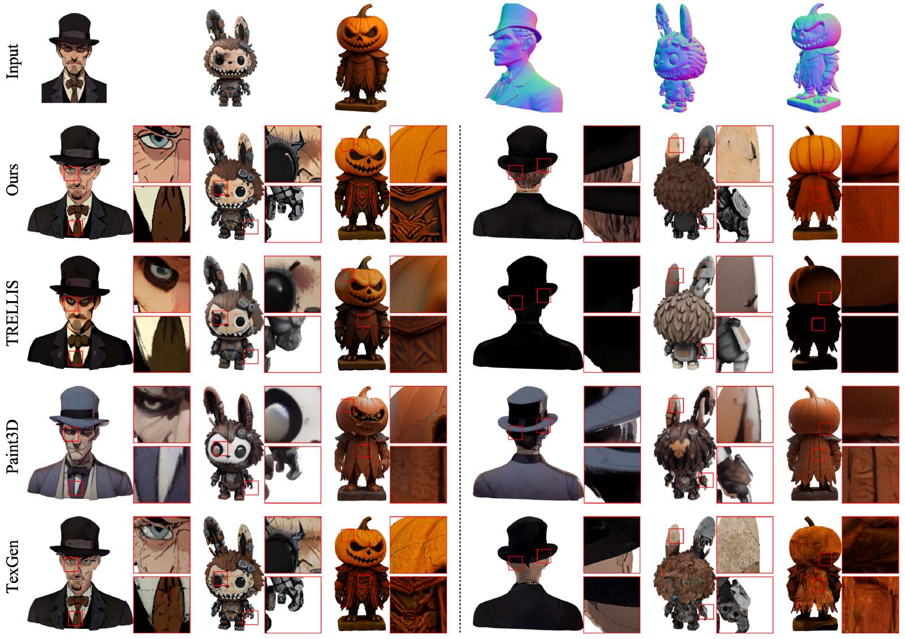

- Paint3D : 낮은 충실도, 뚜렷한 seam, 입력과의 일관성 부족
- TexGen : 보이는 surface는 합리적이지만 가려진 영역의 texture가 혼란스럽고 비일관적
- TRELLIS : 변색 artifact, 정면의 세밀한 detail 재현 실패
- TEXTRIX : 입력 view와 정렬된 고품질 고해상도 texture, seam과 불일치 없음

**Multi-view 조건 생성**

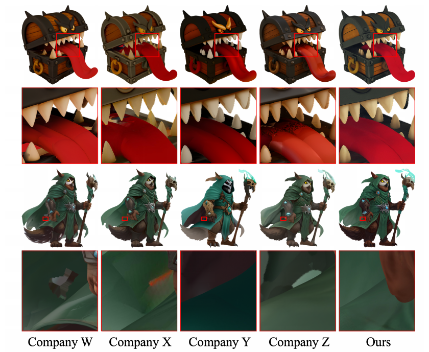

- 가려진 영역에서 더 깨끗하고 그럴듯한 texture, 왜곡이나 어긋남 없이 mesh에 더 정확히 맞음

**복잡한 mesh의 part segmentation**

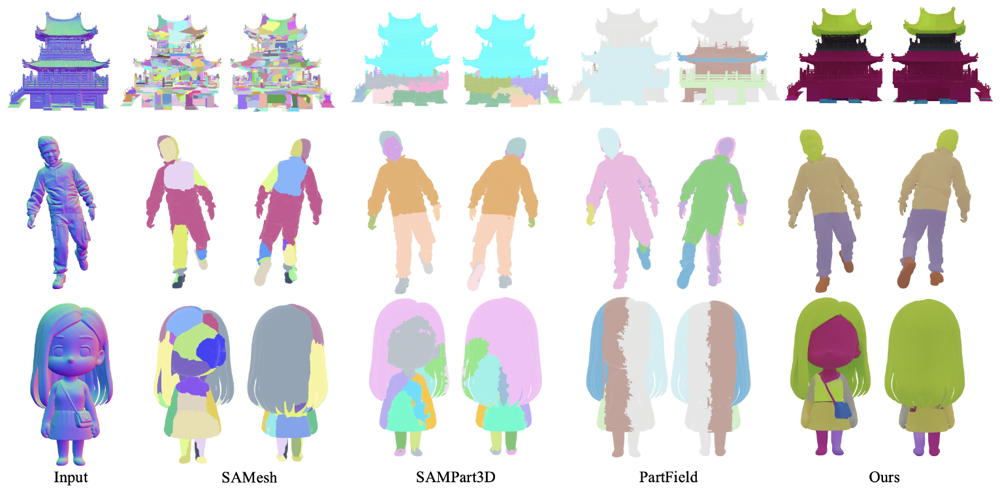

- 경쟁 방법은 조각나고 noisy하며 경계가 불분명 (고주파 geometry detail 처리 실패)
- TEXTRIX는 깨끗하고 날카로우며 직관적으로 맞는 경계

### 4-2. 정량 결과

**Texture 생성** (정면 재구성은 입력 view와의 충실도, novel view 생성은 보이지 않는 영역의 품질)

| Method | SSIM ↑ | PSNR ↑ | LPIPS ↓ | CLIP Score ↑ | CLIP FID ↓ |
|---|---|---|---|---|---|
| Paint3D | 0.8903 | 21.5729 | 0.1051 | 0.8013 | 23.1599 |
| TexGen | 0.8976 | 22.4177 | 0.1005 | 0.8206 | 22.1541 |
| TRELLIS | 0.9150 | 25.5405 | 0.0856 | 0.8346 | 21.3961 |
| **Ours** | **0.9421** | **30.0985** | **0.0627** | **0.8545** | **19.8543** |

- 앞 3개 열은 Front-View Reconstruction, 뒤 2개 열은 Novel-View Generation
- sparse latent conditioning이 강한 일관성을 강제하여 입력 view에 충실

**Multi-view 조건 생성** (MVAdapter와 결합)

| Metric | Hunyuan2.0 | MVAdapter | MVAdapter + Ours |
|---|---|---|---|
| CLIP ↑ | 0.8124 | 0.8305 | **0.8357** |
| CLIP-FID ↓ | 23.1458 | 21.9120 | **21.7571** |

- 기존 multi-view 방법과 결합하면 보이지 않는 시점의 texture 일관성과 지각 품질 향상

**VAE 재구성 품질**

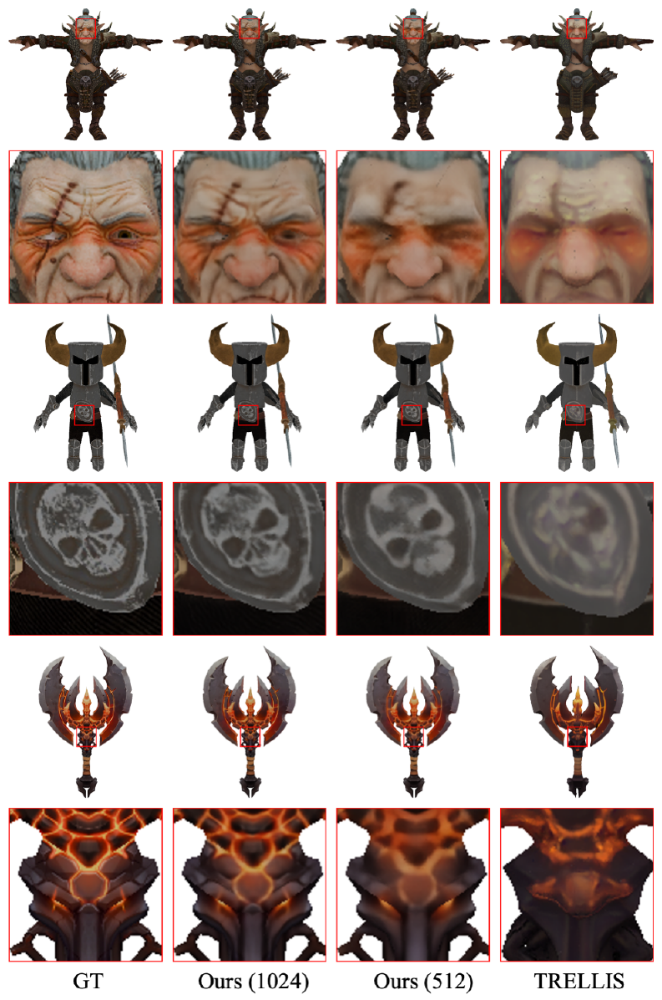

- TRELLIS의 VAE보다 낮은 해상도에서도 경계가 더 날카롭고 색 충실도가 높음

**Class-agnostic part segmentation** (mIoU ↑, Objaverse 100-mesh subset 2개)

| Dataset | SAMesh | SAMPart3D | PartField | Ours |
|---|---|---|---|---|
| Objaverse (Random) | 44.84 | 46.34 | **74.63** | 72.26 |
| Objaverse (Complex) | 31.07 | 36.67 | 51.79 | **60.82** |

- Complex : DORA로 날카로운 edge가 10,000개 이상인 mesh만 선택
- 일반 benchmark에서는 SOTA(PartField)와 비슷 : 크고 단순한 face가 여러 voxel cell에 걸쳐 grid 기반 질의가 약간의 불일치를 만들 수 있음
- 복잡한 mesh에서는 큰 차이로 최고 : 고해상도 volumetric grid가 복잡한 고주파 geometry를 보존

### 4-3. Ablation

**Sparse latent condition**

| Model Variant (DiT) | SSIM ↑ | PSNR ↑ | LPIPS ↓ |
|---|---|---|---|
| Ours (Single View) | **0.9421** | **30.0985** | **0.0627** |
| w/o Sparse Latent Condition | 0.9052 | 24.3984 | 0.0942 |

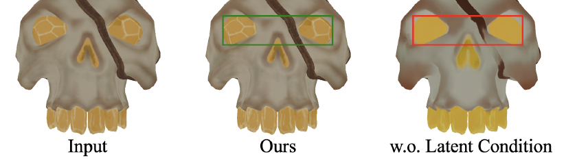

- 제거하면 정면 일관성이 크게 저하 → 생성 과정을 고정하고 입력과의 고충실도 정렬을 보장하는 핵심 요소

**Rendering 기반 loss vs. MSE loss**

| Model Variant (VAE) | SSIM ↑ | PSNR ↑ | LPIPS ↓ |
|---|---|---|---|
| Ours (w. Rendering Loss) | **0.9841** | **33.21** | **0.0246** |
| w/ Cube MSE Loss | 0.9788 | 31.59 | 0.0421 |

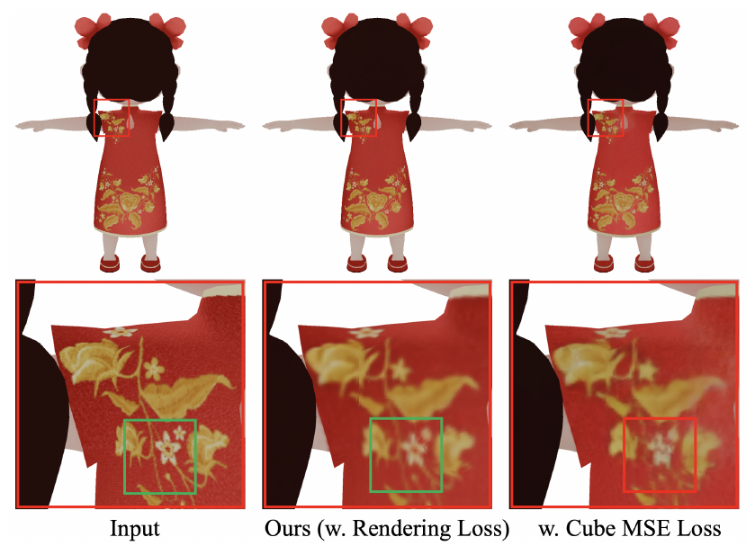

- sparse color grid에 직접 거는 MSE("cube" loss)는 계산이 단순하지만 가시성이나 최종 이미지 기여와 무관하게 모든 voxel을 동등하게 취급
- rendering 기반 loss는 이미지 공간에서 동작하여 사람의 인식과 더 맞고 최종 시각 projection을 최적화 → 더 선명하고 artifact가 적음

## 5. 한계

- latent attribute grid에 의존하므로 mesh 결함이나 심한 self-intersection이 있으면 입력 mesh의 품질과 topology에 성능이 민감할 수 있음
