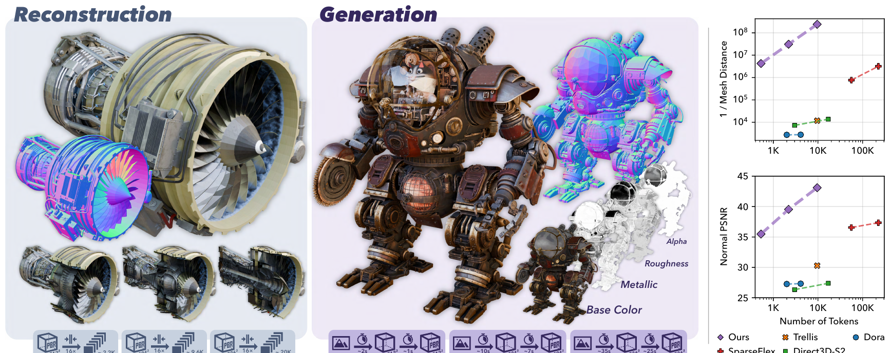
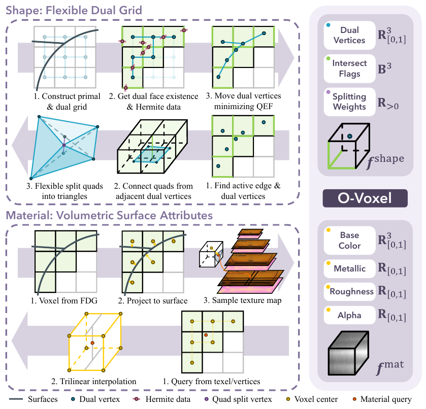
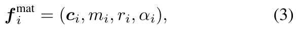
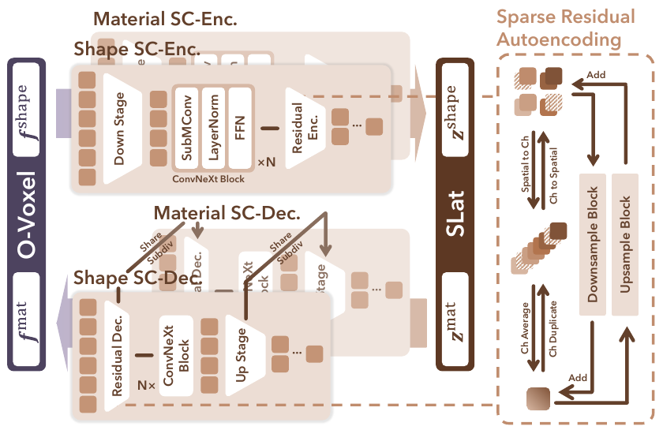
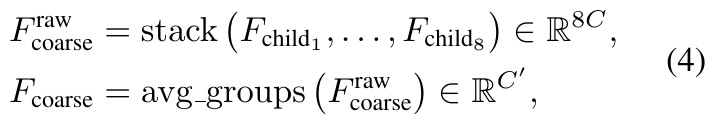
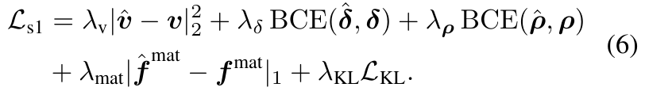

# TRELLIS.2 정리

> 참고 : TRELLIS(2024)의 후속작 **TRELLIS.2** (Native and Compact Structured Latents for 3D Generation, arXiv 2512.14692)

## 1. 기존 문제와 논문의 해결 방안

### 기존 방법의 한계

- SDF·FlexiCubes 같은 등가면 기반 표현을 사용하는 기존 생성 방법은 열린 표면, 비매니폴드 형상, 완전히 둘러싸인 내부 표면을 다루는 데 제약이 있음.
- 기존 연구는 형상 생성에 집중하거나, 형상과 완전한 PBR 재질을 함께 생성하는 데 한계가 있음.
- 기존 TRELLIS는 멀티뷰 2D 이미지 특징과 렌더링 기반 감독에 의존하므로, 이미지에서 관찰하기 어려운 복잡한 구조와 재질 정보를 충분히 표현하기 어려움.

### 기존 latent 표현의 차이

- **비구조 latent**
  - latent 토큰이 규칙적인 3D 격자 위치와 명시적으로 대응하지 않는 표현.
  - 높은 압축률을 얻을 수 있지만, 세부 구조의 재구성 정확도에 한계가 생길 수 있음.
- **구조 latent**
  - latent 특징이 3D 공간 위치와 명시적으로 대응하는 표현.
  - 공간 구조를 유지하기 유리하지만, 기존 방식에서는 고해상도 표현에 많은 토큰이 필요함.
  - 활성 위치에만 latent를 저장하는 방식 자체는 기존 TRELLIS에서도 사용됨.

### TRELLIS.2의 핵심

1. **O-Voxel**
   - 원본 메시의 형상과 PBR 재질을 직접 담는 희소 복셀 표현.
   - 2D 이미지 특징으로 3D 정보를 대체하지 않고, 원본 3D 데이터에서 특징을 구성함.
2. **SC-VAE**
   - O-Voxel을 각 축에서 16배 다운샘플링하여 compact structured latent로 압축함.
3. **세 가지 DiT**
   - 활성 위치 → 형상 → 재질 순서로 생성함.

논문에서는 1024³ 해상도의 asset을 약 9,600개의 latent 토큰으로 표현함. 토큰 수는 고정값이 아니라 asset의 활성 위치 수에 따라 달라짐.

---

## 2. O-Voxel과 latent의 크기

1024³은 전체 기준 격자의 해상도이며, 모든 칸에 특징을 저장한다는 의미는 아님. 실제로는 활성 복셀의 좌표와 특징만 저장함.

**Eq. 1** · 활성 복셀 L개 각각에 (좌표 `p_i`, 형상 특징 `f_i^shape`, 재질 특징 `f_i^mat`)를 저장하는 희소 표현. 비활성 칸은 저장하지 않음.

| 구분 | O-Voxel 입력 | SC-VAE latent |
|---|---|---|
| 기준 격자 해상도 | 1024³ | 64³ |
| 활성 위치당 Shape 특징 | 6채널 | 32채널 |
| 활성 위치당 Material 특징 | 6채널 | 32채널 |
| 저장 방식 | 활성 좌표와 특징만 저장 | 활성 좌표와 특징만 저장 |

전체 정규화 공간의 한 변을 1로 두면, 원본 격자 한 칸의 한 변은 1/1024이고 latent 격자 한 칸의 한 변은 1/64임.

### Shape 입력 6채널

- 복셀 내부 dual vertex 좌표: 3개.
- 미리 정한 x·y·z 방향 격자 모서리의 교차 플래그: 3개.

dual vertex는 원본 메시와 격자가 만난 교차점 자체가 아니라, 여러 교차 정보를 이용해 QEF를 풀어 결정한 대표 정점임.

논문의 형상 표현에는 quad를 삼각형으로 나누는 splitting weight도 포함됨. 따라서 “Shape Encoder 입력이 6채널”과 “형상 복원에 사용하는 모든 정보가 6개뿐”은 구별해야 함.

### Material 입력 6채널

- Base color: R, G, B.
- Metallic.
- Roughness.
- Opacity.

### 공간 압축의 의미

각 축을 16배 줄이므로, latent 격자 한 칸은 좌표상 원본 격자의 최대 16³개 칸에 대응함.

- 해당 영역에 활성 복셀이 있으면 부모 활성 위치로 모임.
- 해당 영역이 모두 비활성이면 그 부모 위치에도 latent를 저장하지 않음.
- 다만 convolution은 주변 특징도 읽으므로, latent의 정보가 해당 16³ 영역에만 엄격히 제한되는 것은 아님.

---

## 3. O-Voxel: Shape 변환

설명용 격자가 8³이라면 실제 처리 원리는 같고, 사용하는 격자 해상도만 달라짐. 1024³은 고해상도 설정의 한 예시임.

### 3.1 격자 모서리와 원본 삼각형의 교차 검사

원본 메시의 삼각형과 격자 모서리의 교차 여부를 검사함.

교차가 발생하면 다음 정보를 구함.

- 교차점 q: 격자 모서리와 삼각형이 만나는 3D 위치.
- 법선 n: 교차한 삼각형의 표면 방향.
- 교차 플래그: 해당 격자 모서리가 표면과 교차했는지 나타내는 값.

교차 플래그는 QEF를 풀기 전에 결정됨.

메시의 내부나 외부에 있다는 이유만으로 셀을 활성화하지 않음. 표면과의 교차를 기준으로 처리하므로, 완전히 둘러싸인 내부 표면도 원본 메시에 존재하면 처리 대상이 될 수 있음.

### 3.2 활성 셀 지정

격자 내부의 모서리 하나는 주변 복셀 네 칸이 공유함.

교차한 모서리 주변의 셀들을 활성화하고, 교차점과 법선을 각 셀의 QEF 계산에 사용함.

한 셀에는 여러 모서리에서 얻은 교차 정보가 모일 수 있음.

### 3.3 QEF로 dual vertex 계산

각 활성 셀에서 여러 교차점과 법선을 이용해 dual vertex 하나를 구함.

**Eq. 2** · 복셀 안에서 `e(v)`가 최소인 점이 dual vertex. 항 순서대로 ① 교차점 평면까지 거리 `d_Π` ② 메시 경계 edge까지 거리 `d_L` (열린 표면용) ③ 교차점 평균 `q̂`까지 거리 `d_q̂` (안정화). `λ`는 가중치. 2차식이라 closed form으로 풀림.

QEF는 다음 조건을 함께 고려함.

- 교차점과 법선으로 정의되는 표면 평면들에 가까울 것.
- 열린 표면의 경계가 있다면 해당 경계에 가까울 것.
- 교차점들의 평균 위치에서 지나치게 멀어지지 않을 것.
- 정점이 해당 복셀 내부에 위치할 것.

법선은 이 계산에 사용되며, Shape Encoder 입력 6채널에 별도로 저장되는 것은 아님.

### 3.4 교차 플래그와 dual vertex로 메시 복원

교차 플래그가 켜진 격자 모서리에 대해 주변 네 셀의 dual vertex를 순환 순서로 연결하면 quad 하나가 만들어짐.

이 quad를 splitting weight에 따른 규칙으로 두 삼각형으로 분할하여 메시를 구성함.

즉, 교차점들을 직접 연결하는 것이 아니라 **주변 셀에서 QEF로 구한 dual vertex들을 연결**함.

---

## 4. O-Voxel: Material 변환

Shape와 Material은 같은 활성 복셀 구조에 대응하지만, 특징을 계산하는 방법은 다름.

**Eq. 3** · 재질 6채널 = base color `c`(3) + metallic `m` + roughness `r` + opacity `α`.

### 4.1 원본 메시에서 복셀 재질 가져오기

Shape는 격자 모서리와 삼각형의 교차 정보를 사용하지만, Material은 활성 복셀의 중심을 기준으로 재질을 샘플링함.

1. 활성 복셀과 교차하는 원본 메시의 삼각형들을 찾음.
2. 복셀 중심을 각 삼각형에 투영하여 재질을 조회할 대응점을 구함.
3. 대응점의 UV 좌표를 이용해 원본 텍스처에서 PBR 속성을 읽음.
4. 여러 삼각형에서 값을 얻었다면 거리 기반 가중 평균으로 합침.
5. 최종적으로 해당 복셀에 6채널 재질값 하나를 저장함.

따라서 재질은 QEF로 복원한 메시에서 가져오는 것이 아니라 **원본 asset의 재질에서 가져옴**.

### 4.2 복셀 재질을 메시 표면으로 복원하기

복원하거나 생성한 메시 표면의 3D 위치를 질의점으로 사용함.

- 해당 위치 주변 복셀의 재질값을 삼선형 보간함.
- 보간 결과를 정점 색상이나 UV 텍스처의 texel에 기록함.

Shape 복원만으로 정점에 색이 자동으로 지정되는 것은 아님. 형상 복원과 재질 질의를 연결해야 최종 재질이 있는 asset이 됨.

---

## 5. SC-VAE

SC-VAE는 **Sparse Compression Variational Autoencoder**의 약자임.

형상과 재질을 분리해 압축하기 위해 두 개의 SC-VAE를 사용함.

- Shape SC-VAE: 형상 특징을 압축·복원.
- Material SC-VAE: PBR 재질 특징을 압축·복원.

### 5.1 인코더의 전체 흐름

1024³ 입력을 기준으로 하면 다음과 같음.

| 단계 | 기준 격자 해상도 | 활성 위치당 채널 | 연산 |
|---|---:|---:|---|
| O-Voxel 입력 | 1024³ | 6 | 형상 또는 재질 특징 |
| 입력 투영 | 1024³ | 64 | Linear(6, 64) |
| 다운샘플링 1 | 512³ | 128 | 다운샘플링 + residual block 4개 |
| 다운샘플링 2 | 256³ | 256 | 다운샘플링 + residual block 8개 |
| 다운샘플링 3 | 128³ | 512 | 다운샘플링 + residual block 16개 |
| 다운샘플링 4 | 64³ | 1024 | 다운샘플링 + residual block 4개 |
| posterior 투영 | 64³ | 64 | Linear(1024, 64) |
| latent 구성 | 64³ | 32 | 평균 사용 또는 분포에서 샘플링 |

다운샘플링은 총 4번이며, 매번 각 축 해상도를 1/2로 줄임.

`4, 8, 16, 4`는 다운샘플링 횟수가 아니라, 다운샘플링 이후 같은 해상도에서 반복하는 residual block 개수임.

### 5.2 Sparse Residual Autoencoding

다운샘플링 블록에는 두 경로가 있음.

#### 비파라미터 shortcut 경로

1. 자식 좌표의 오프셋으로 8개 자식 슬롯 중 위치를 결정함.
2. 자식 특징들을 채널 차원에 모음.
3. 없는 자식의 슬롯은 이 재배열 연산 안에서 0으로 채움.
4. 그룹 평균으로 출력 채널 수를 맞춤.

자식 특징이 각각 C채널이고 출력이 2C채널이면:

- 8개 자식을 모아 8C채널 구성.
- 4개 값씩 그룹 평균하여 2C채널로 축소.

이 경로는 고정 연산이며 학습 파라미터가 없음.

**Eq. 4** · 자식 8개의 C채널 특징을 채널로 이어 붙이고(`stack`, 8C) 그룹 평균(`avg_groups`)으로 C'채널로 줄임. 파라미터 없음.

#### 학습 경로

학습 가능한 연산으로 다운샘플링된 특징을 계산함.

두 경로의 출력을 더하여 부모 특징을 만듦. shortcut이 제공하는 기본 정보 전달을 바탕으로 학습 경로가 필요한 보완을 학습함.

shortcut은 좌표나 원래 특징을 손실 없이 보관하는 장치가 아님. 공간 위치에 따른 특징 재배열을 통해 높은 압축률에서의 학습을 돕는 역할임.

### 5.3 같은 해상도의 ConvNeXt-style residual block

주요 연산 흐름은 다음과 같음.

SubMConv → LayerNorm → Linear(C, 4C) → SiLU → Linear(4C, C) → residual add

- SubMConv: 활성 위치를 유지하면서 주변 활성 복셀의 정보를 결합.
- Linear: 각 위치의 채널 특징을 변환.
- Residual add: 블록 입력과 변환 결과를 더함.

### 5.4 평균·로그분산과 latent

마지막 64채널은 다음 두 부분으로 나뉨.

- 평균 μ: 32채널.
- 로그분산 log σ²: 32채널.

이 둘은 latent 분포의 파라미터임.

샘플링할 때는 다음과 같이 32채널 latent를 얻음.

z = μ + exp(0.5 × log σ²) × ε

- z: 최종 latent.
- μ: 평균.
- log σ²: 로그분산.
- ε: 표준 가우시안 노이즈.
- 곱셈은 원소별 연산.

샘플링하지 않는 경우 평균 μ를 latent로 사용함.

### 5.5 디코더와 Early Pruning

디코더는 압축된 특징으로부터 해상도를 단계적으로 높임.

- 부모 특징에서 자식 특징을 생성함.
- Shape Decoder는 각 부모의 8개 자식 중 활성화할 위치를 예측함.
- 비활성 자식은 이후 연산에서 제외함.
- 업샘플링에도 비파라미터 shortcut과 학습 경로를 사용함.

**Eq. 5** · Eq. 4의 역방향. 부모의 C'채널을 8등분해 자식에게 나누고(`unstack`) 그룹 복제(`dup_groups`)로 C채널로 늘림. 파라미터 없음.

인코더에서 평균·압축한 특징을 단순히 역변환하는 것이 아니라, 학습된 디코더가 세부 특징과 활성 구조를 복원함.

### 5.6 Shape와 Material의 정렬

이미지로부터 asset을 생성하는 디코딩 과정에서:

- Shape Decoder는 형상과 단계별 subdivision 구조를 생성함.
- Material Decoder는 자신의 material latent를 입력받음.
- 동시에 Shape Decoder의 subdivision 구조를 안내 정보로 사용하여 복원 위치를 맞춤.

따라서 두 디코더는 서로 다른 특징을 복원하지만, 형상과 재질의 공간 위치는 정렬됨.

### 5.7 coords와 feats

희소 텐서는 좌표와 특징을 따로 저장함.

- `coords: [N, 4]`
  - N개 활성 위치의 `[batch, x, y, z]`.
- `feats: [N, C]`
  - 각 활성 위치의 C채널 특징.

비활성 위치에는 coords 행도, feats 행도 없음.

다운샘플링 shortcut 내부에서 없는 자식 슬롯을 0으로 채우는 것과, 전체 비활성 격자를 0벡터로 저장하는 것은 다른 의미임.

### 5.8 SC-VAE 학습

| 단계 | 해상도 | 학습 내용 |
|---|---:|---|
| 1단계 | 256³ | O-Voxel 직접 재구성 손실 + KL 손실 |
| 2단계 | 512³ | 기존 손실 + 렌더링 기반 손실 |
| 고해상도 사용 | 1024³ 이상 | 추가 파인튜닝 없이 적용 |

직접 재구성 감독에는 다음 항목들이 포함됨.

- Dual vertex 위치: MSE.
- 교차 플래그: BCE.
- 자식 활성 구조: BCE.
- Material 속성: L1.
- Latent 분포: KL.

**Eq. 6** · 1단계 손실. (^)는 예측, 없으면 정답. 항 순서대로 dual vertex 위치 MSE, 교차 플래그 `δ` BCE, 자식 활성 구조 `ρ` BCE, 재질 L1, 분포 KL. `λ`는 가중치.

2단계의 렌더링 기반 손실은 다음과 같음.

**Eq. 7** · 2단계 손실 = Eq. 6 + 렌더링 손실 `L_render` (mask, depth, normal, material map을 렌더링해 L1·SSIM·LPIPS로 비교, 카메라를 표면 안쪽까지 배치).

각 VAE는 자신의 복원 대상에 해당하는 손실을 사용하므로, Shape VAE와 Material VAE의 손실 구성이 완전히 같은 것은 아님.

---

## 6. DiT 기반 전체 생성 흐름

이미지 조건 → 활성 좌표 생성 → Shape latent 생성 → Material latent 생성 → 형상·재질 디코딩

세 가지 DiT는 각각 별도의 모델이며, 모두 flow matching으로 학습함.

추론에서는 각 DiT를 여러 샘플링 단계에 걸쳐 반복 호출함. 한 번의 출력은 최종 asset이 아니라 latent를 갱신하기 위한 velocity임.

### 6.1 이미지 조건

이미지를 DINOv3-L에 입력하여 이미지 특징 토큰을 추출함.

- 배치 차원을 생략하면 `[M, 1024]`.
- M은 이미지 특징 토큰 수.
- 1024는 토큰당 특징 차원.

이 이미지 특징은 세 DiT 모두에서 cross-attention 조건으로 사용됨.

### 6.2 Structure 생성

배치 차원을 생략하면:

1. Dense 가우시안 노이즈 `[8, 16, 16, 16]` 생성.
2. 이미지 조건을 받는 Structure DiT로 반복 샘플링.
3. Structure latent `[8, 16, 16, 16]` 획득.
4. Structure Decoder로 `[1, 64, 64, 64]` 활성 logit 복원.
5. `logit > 0`으로 활성 마스크 생성.
6. 활성 위치를 추출하여 `coords: [N, 4]` 구성.

Structure Decoder의 1채널을 Shape의 32채널로 변환하는 것이 아님. 여기서는 사용할 공간 주소를 결정함.

512 생성에서는 마스크를 32³로 줄여 주소를 추출함. 직접 1024 생성에서는 64³ 주소를 사용함. 기본 1024 cascade는 낮은 해상도에서 시작해 고해상도로 확장함.

### 6.3 Shape latent 생성

1. Structure 단계가 정한 활성 주소마다 새로운 32차원 가우시안 노이즈를 생성.
2. `coords: [N, 4]`, `feats: [N, 32]`의 희소 텐서 구성.
3. 이미지 조건을 받는 Shape DiT로 반복 샘플링.
4. 해당 주소들의 Shape latent `[N, 32]` 생성.

### 6.4 Material latent 생성

1. Shape와 동일한 활성 주소마다 별도의 32차원 가우시안 노이즈 생성.
2. 현재 material 특징 32채널과 고정된 shape latent 32채널을 채널 방향으로 연결.
3. 이미지 조건도 함께 사용하여 Material DiT로 반복 샘플링.
4. Material latent `[N, 32]` 생성.

Material DiT의 입력은 위치당 64채널이지만, 출력 velocity는 material을 위한 32채널임.

이 과정에서는 material만 갱신하며, 조건으로 사용하는 shape latent는 고정함.

### 6.5 최종 디코딩

- Shape latent → Shape Decoder → 형상과 subdivision 구조.
- Material latent + subdivision 안내 → Material Decoder → PBR 복셀 속성.
- 형상과 재질 복셀을 결합하여 MeshWithVoxel 구성.
- 필요하면 메시 표면에서 재질을 질의하여 UV 텍스처 등의 asset 형식으로 변환.

---

## 7. Structure VAE

Structure VAE는 Shape·Material SC-VAE와 별도의 모델임.

복원 대상은 정밀한 dual vertex나 PBR 속성이 아니라, **어느 격자 위치가 활성인지 나타내는 이진 격자**임.

배치 크기를 B라고 하면:

| 구분 | 텐서 크기 |
|---|---|
| Encoder 입력 | `[B, 1, 64, 64, 64]` |
| Structure latent | `[B, 8, 16, 16, 16]` |
| Decoder 출력 | `[B, 1, 64, 64, 64]` |

- Dense 3D convolution 기반 VAE.
- 공간 해상도는 각 축에서 4배 압축.
- Encoder와 Decoder를 함께 학습하여 활성 격자를 재구성.
- Decoder 출력은 이진값 자체가 아니라 logit.
- 이미지로부터 새 asset을 생성할 때는 Structure Encoder 대신 Structure DiT가 latent를 생성하고, Structure Decoder가 이를 활성 격자로 복원함.

여기서 활성 격자는 물체의 내부 전체를 채운 solid occupancy와 동일한 의미로 해석하면 안 됨. 이후 sparse latent를 배치할 활성 공간 구조를 나타냄.

---

## 8. 세 DiT의 입출력과 학습

### 기본 구조

세 DiT는 공통적으로 다음 규모의 Transformer 구조를 사용함.

- Hidden width: 1536.
- Transformer block: 30개.
- Attention head: 12개.
- FFN 내부 차원: 8192.
- 이미지 조건: cross-attention.
- 시간 조건: AdaLN-single.
- 공간 위치 표현: RoPE.

다만 입력 형식과 입력·출력 투영 차원은 다름.

| 모델 | 입력 | 출력 |
|---|---|---|
| Structure DiT | Dense structure 특징 8채널 | Structure velocity 8채널 |
| Shape DiT | 활성 위치당 shape 특징 32채널 | Shape velocity 32채널 |
| Material DiT | Material 32채널 + Shape 조건 32채널 | Material velocity 32채널 |

Structure DiT의 16³ 위치는 4,096개 토큰으로 처리함. Shape·Material DiT의 토큰 수는 활성 위치 수 N에 따라 달라짐.

### 학습 시 사용하는 데이터

- **Structure DiT**
  - 정답 활성 격자를 Structure Encoder로 인코딩한 latent에 노이즈를 섞음.
  - 이미지 조건으로 velocity를 예측하도록 학습.
- **Shape DiT**
  - 정답 Shape O-Voxel을 Shape Encoder로 인코딩한 latent에 노이즈를 섞음.
  - 정답 latent의 활성 주소에서 이미지 조건으로 학습.
- **Material DiT**
  - 정답 Material latent에 노이즈를 섞음.
  - 같은 asset의 정답 Shape latent와 이미지를 조건으로 학습.
  - 조건 Shape latent는 그대로 두고 Material에 대한 velocity를 예측.

즉, Material DiT는 학습할 때도 Shape 조건을 받음. 추론에서는 그 Shape 조건이 앞 단계에서 생성한 latent이거나, 주어진 메시를 인코딩한 latent가 됨.

### VAE 학습과 DiT 학습의 구분

- VAE: 원본 3D 표현을 latent로 압축하고 다시 복원하도록 학습.
- DiT: 학습된 latent 공간에서 노이즈로부터 새로운 latent를 생성하도록 학습.

DiT의 512³→1024³ 점진적 학습과 SC-VAE의 256³→512³ 두 단계 학습은 서로 다른 과정임.
