# TRELLIS.2 (Native and Compact Structured Latents for 3D Generation)

> **한 줄 요약** : 3D native (O-Voxel + structured latent)  
> geometry와 PBR material을 함께 담는 sparse voxel 표현 O-Voxel을 제안하고, 16배 공간 압축 Sparse Compression VAE와 대형 flow matching DiT(총 4B)로 shape → material 순서로 고해상도 PBR textured 3D asset을 3D 공간에서 직접 생성

> 참고 : 폴더의 TRELLIS.pdf는 원조 TRELLIS(Structured 3D Latents, 2024)의 후속작인 **TRELLIS.2** 논문 (arXiv 2512.14692)

## 1. 배경

**문제**
- 최근 대형 3D 생성 모델은 geometry를 iso-surface field(SDF, FlexiCubes)로 표현 → 열린 surface, non-manifold geometry, 닫힌 내부 구조를 다루기 어려움
- 대부분 shape 생성에 집중하고 shape과 근본적으로 연관된 외관과 material 정보는 소홀
- 원조 TRELLIS의 SLAT(structured 3D latent)는 geometry와 외관을 함께 다루지만, multi-view 2D 이미지 feature 입력과 순수 rendering 기반 supervision에 의존하여 복잡한 구조와 material 포착에 한계
- 2단계(shape 생성 + multi-view texture 합성) 방식은 2D diffusion backbone의 이점이 있지만, 복잡한 multi-view 렌더링, baking, texture 정렬이 필요해 확장성이 낮고 외관 불일치 발생

**기존 3D latent 표현 비교**

| 방식 | 대표 | 특징 |
|---|---|---|
| 비구조 latent (Perceiver 계열, 순서 없는 feature vector) | 3DShape2VecSet, CLAY, Dora 등 | 압축률은 높지만 재구성 충실도 제한 |
| 희소성 prior 기반 구조 latent | TRELLIS, Direct3D-S2, SparseFlex | geometry 정확도는 높지만 latent token이 많아 압축 효율 낮음 |
| 본 논문 | O-Voxel + SC-VAE | native 3D 입력에서 직접 학습한 compact structured latent, 더 높은 공간 downsampling과 더 적은 token |

**핵심 아이디어**
- "field-free" sparse voxel 구조 O-Voxel : geometry와 외관을 모두 encoding하는 omni-voxel 표현, mesh asset과 신경망 사이의 연결고리
- geometry : flexible dual grid로 열린 surface, non-manifold, 완전히 닫힌 surface까지 임의 topology를 손실 있는 전처리 없이 표현, 날카로운 edge와 normal 불연속 보존
- 외관 : texture color를 넘어 PBR 속성(base color, metallic, roughness)과 opacity(반투명 surface)까지 표현
- 원본 3D asset과의 즉시 양방향 변환 : 최적화와 렌더링이 필요 없음 (mesh → O-Voxel은 CPU 1개에서 수 초, 복원은 수십 ms)

**기여 요약**
- O-Voxel 기반 Sparse Compression VAE : 16배 공간 downsampling, 1024³ fully textured asset을 약 9.6K latent token으로 encoding (지각적 열화 거의 없음)
- 약 4B parameter flow matching 생성 모델 : H100 기준 512³ 약 3초, 1024³ 약 17초, 1536³ 약 60초로 fully textured asset 생성
- 모델, code, dataset 공개

## 2. 방법론

### 2-1. O-Voxel : Native 3D 표현

- 해상도 `N × N × N`의 regular 3D grid 위 sparse voxel에 대응하는 feature tuple 집합

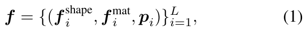

- `f_i^shape` : 국소 geometry 정보, `f_i^mat` : material 속성, `p_i` : `i`번째 active voxel의 좌표
- asset과 교차하지 않는 빈 voxel은 inactive

#### Flexible Dual Grid (Shape)

- dual grid : primal cell마다 vertex 하나, primal edge마다 사각형 face 하나 (인접 primal cell의 dual vertex를 연결)
- dual vertex 위치와 dual face 존재 여부를 유연하게 조정하여 임의 surface 표현
- Dual Contouring(DC)에서 영감, 단 DC는 SDF 같은 이산 scalar field를 처리하도록 설계된 반면 여기서는 field 표현을 전혀 쓰지 않음
  - sign 변화 대신 asset의 mesh surface로 edge 교차 flag를 직접 결정하고 Hermite data(교차점과 normal) 할당
  - mesh와 교차하는 각 edge가 해당 dual face를 활성화
- Hermite data `{q_i, n_i}`로 dual vertex `v`를 closed form으로 계산하는 QEF(quadratic error function)

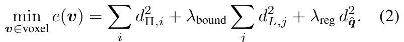

| 항 | 의미 |
|---|---|
| `d_Π,i^2 = (n_i · (v - q_i))^2` | `v`에서 `{q_i, n_i}` 평면까지 거리 제곱 (원래 DC의 QEF) |
| `d_L,j^2` | primal cell과 교차하는 mesh 경계 edge까지의 거리 → 열린 surface 표현 개선 |
| `d_q̂^2 = ‖v - q̄‖^2` | 교차점 평균에 가깝게 하는 정규화 → vertex 분포를 부드럽게 하고 QEF 특이점 방지 |

**active voxel의 geometry feature `f_i^shape`**
- Dual vertex `v_i ∈ R^3_[0,1]` : 국소 surface 형태를 나타내는 grid 내부 vertex
- Edge intersection flag `δ_i ∈ {0,1}^3` : X, Y, Z 축의 미리 정한 voxel edge 3개(최소 좌표 corner를 공유)와 surface 교차 여부, 이웃 dual vertex 사이 사각형 연결을 결정 (나머지 9개 edge flag는 이웃 voxel에 저장)
- Splitting weight `γ_i ∈ R_>0` : 사각형 face를 삼각형으로 나누는 방식 조절 (FlexiCubes의 flexible topology 규칙)

**변환 알고리즘**
- Mesh → O-Voxel : mesh surface와 교차하는 voxel edge를 찾아 이웃 voxel을 active로 표시, 교차점과 normal을 해석적으로 계산(Hermite data), QEF로 dual vertex 계산
- O-Voxel → Mesh : 교차 edge를 따라 dual vertex를 연결해 이웃 active voxel 사이 사각형 face 생성, splitting weight로 삼각형 두 개로 분할

**장점**
1. 즉시 양방향 변환 : SDF 평가, flood-fill, 반복 최적화 같은 비싼 처리 불필요
2. 임의 topology : watertight, manifold 제약 없이 self-intersecting surface와 완전히 닫힌 내부 구조 처리
3. 높은 정밀도와 날카로운 feature 보존 : dual vertex가 국소 geometry feature에 정렬되고, dual vertex 위치와 splitting weight는 rendering loss 등으로 신경망이 학습적으로 조정 가능

#### Volumetric Attributes (Material)

- active voxel마다 6 channel의 material feature

- `c_i ∈ R^3_[0,1]` : base color, `m_i` : metallic, `r_i` : roughness, `α_i` : opacity (표준 PBR 규약)
- Texture → O-Voxel : active voxel 중심을 교차하는 각 삼각형에 projection하고 UV 좌표와 적절한 mipmap level로 texture map에서 각 속성을 sampling, 점-surface 거리 기반 가중 평균
- O-Voxel → Texture : mesh vertex(vertex coloring) 또는 texture texel에 대응하는 3D surface 점에서 이웃 voxel 속성을 trilinear interpolation, 추가 후처리 없이 바로 렌더링 가능

### 2-2. Sparse Compression VAE (SC-VAE)

- 목표 : 효율적인 고해상도 3D 생성을 위한 compact latent space
- 기존 transformer 기반 설계(TRELLIS, SparseFlex)와 달리 완전한 sparse convolution network : 고해상도에서 계산 효율이 높고 scale 간 일반화가 좋음
- U자형 VAE : encoder가 여러 residual block으로 sparse voxel feature를 계층적으로 downsample, decoder는 대칭으로 복원

**Sparse Residual Autoencoding Layer**
- DC-AE의 Residual Autoencoding 원리를 sparse voxel에 적용 : downsampling/upsampling block 안에 parameter 없는 residual shortcut, 공간과 channel 차원 사이에서 정보를 재배치하여 높은 압축에서의 최적화 어려움 완화
- downsampling(배율 2) : 각 voxel의 자식 8개를 channel 차원으로 모음, 입력 `F_fine ∈ R^C`, 목표 `F_coarse ∈ R^C'` (보통 `C' = 2C`)

- `avg_groups` : 묶인 channel을 평균하여 거친 residual 추정, sparsity 때문에 없는 voxel은 0 vector
- upsampling : 대칭인 channel-to-space shortcut으로 각 거친 feature를 이웃에 다시 분배

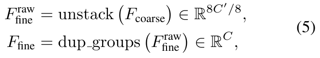

- `dup_groups` : 목표 차원에 맞게 그룹 안 channel 복사

**Early-pruning upsampler** : 각 upsampling 전에 부모 node마다 활성 자식 voxel을 나타내는 binary mask `ρ̂ ∈ {0,1}^8`를 예측하고, 비활성 node는 이후 건너뜀 → 실행 시간과 메모리 크게 절약

**Optimized residual block**
- sparse convolution은 희소성이 높은 data에서 계산과 parameter 효율이 낮음
- 두 개의 conv layer 대신 conv layer 하나와 더 적은 normalization/activation(ConvNeXt 스타일 단순화), 두 번째 conv는 넓은 point-wise MLP(Transformer FFN과 유사)로 교체 → 효율은 그대로, 재구성 품질 향상

**VAE 학습 (2단계)**
- 1단계 : 저해상도(256³) data로 O-Voxel 직접 재구성 loss와 KL loss로 빠르게 학습 안정화
  - dual vertex는 MSE, dual face flag와 pruning mask는 BCE, material 속성은 L1

- 2단계 : 고해상도(512³)에서 rendering 기반 지각 supervision 추가
  - mask, depth, normal map을 렌더링하여 L1으로 supervision하고 normal에는 SSIM과 LPIPS 추가, material 속성도 렌더링하여 같은 지각 loss 적용
  - 얕은 near plane으로 camera를 무작위 배치해 surface를 잘라 보며 외부와 내부 구조를 모두 포착

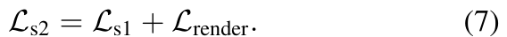

- Appendix A.3의 rendering loss : `d_p(a, b) = ‖a - b‖_1 + 0.2 · d_SSIM + 0.2 · d_LPIPS`, shape은 `‖m̂ - m‖_1 + 10 · ‖d̂ - d‖_1 + d_p(n̂, n)`, material은 base color와 metallic-roughness-alpha map에 `d_p` 적용
- shape과 material을 순서대로 생성하고 주어진 shape에 material만 생성하는 응용을 위해, 분리된 latent space를 학습하는 SC-VAE 두 개 사용 : 하나는 shape, 다른 하나는 shape VAE의 upsampling subdivision 구조를 조건으로 material
- 전체 SC-VAE는 약 800M parameter (encoder 354M, decoder 474M), 완전 sparse convolution이라 해상도에 무관하여 512³보다 큰 입력에도 fine-tuning 없이 그대로 적용

### 2-3. 생성 modeling

**3단계 생성 pipeline (모델 3개)**
1. Sparse structure 생성 : sparse voxel grid의 occupancy layout 예측
2. Geometry 생성 : active voxel 안의 geometry latent 생성
3. Material 생성 : geometry 구조에 정렬된 material latent 합성 (입력 이미지와 생성된 geometry latent를 함께 조건으로 받는 sparse DiT)
- 1, 2단계는 원조 TRELLIS 전략을 대체로 따름, 3단계가 새로운 부분으로 PBR material을 native 3D 공간에서 직접 modeling → geometry와 material을 같은 latent domain에서 생성하고 임의 topology에서도 공간 정렬 보장

**구조와 학습 세부**
- DiT : AdaLN-single(timestep modulation, parameter 절감), RoPE(확장성과 해상도 간 일반화), QK-Norm(RMSNorm으로 attention 안정화)
- 이미지 조건 : DINOv3-L feature를 cross-attention으로 주입, shape 조건은 입력 tensor와 channel 방향으로 concat
- SC-VAE의 높은 압축 덕분에 원조 TRELLIS의 convolution packing과 skip connection을 없앤 vanilla 스타일 DiT로 단순화
- 학습 : sparse structure 생성은 512×512 조건 이미지로 학습, 이후 단계는 출력 512³(latent 32³) → 1024³(latent 64³), 조건 이미지도 1024로 점진적 확대
- 목적함수 : rectified flow, CFM loss, logitNorm(1, 1) timestep sampling
- 각 DiT 약 1.3B parameter (width 1536, block 30, head 12, MLP width 8192)

## 3. 실험

**구현**
- SC-VAE : Trellis-500K 설정에서 PBR material 없는 asset을 제외한 Objaverse-XL, ABO, HSSD 모음 (material VAE는 표준 metallic-roughness workflow를 쓰는 약 35만 개), Submanifold convolution의 최적화된 Triton 구현, H100 16장, batch 128
- 생성 모델 : TexVerse를 추가한 약 80만 개 (Sketchfab thumbnail 기반 aesthetic score 4.5 미만 제외), asset당 Blender로 16 view 렌더링(FoV 10°~70° 무작위, 조명 무작위), AdamW (lr 1e-4, weight decay 0.01), CFG drop 0.1, H100 32장, batch 256
- 자체 sparse convolution backend FlexGEMM : Triton으로 구현한 Masked Implicit GEMM, Gray code ordering, Split-K, 기존 sparse conv library 대비 최대 2배 빠름 (NVIDIA와 AMD 모두 지원)

### 3-1. Shape 재구성

- 평가 set : Toys4K, 최근 2년 Sketchfab "Staff Picks" 중 PBR workflow asset 90개
- 지표 : Mesh Distance(MD, 내부 구조 포함 전체 surface)와 F1, Chamfer Distance(CD, 바깥 surface)와 F1, normal map PSNR과 LPIPS

| Method | #Token | f_down | Dec. (s) ↓ | Toys4K MD ↓ | Toys4K Normal PSNR ↑ | Sketchfab MD ↓ | Sketchfab Normal PSNR ↑ |
|---|---|---|---|---|---|---|---|
| Dora | 4.1K | – | 43.0 | 360.8 | 27.32 | 1139. | 22.09 |
| TRELLIS | 9.6K | 4× | 0.108 | 85.07 | 30.29 | 49.20 | 24.31 |
| Direct3D-S2 1024 | 17K | 8× | 13.0 | 73.17 | 27.38 | 70.13 | 23.82 |
| SparseFlex 1024 | 225K | 4× | 3.21 | 0.3132 | 37.34 | 0.7593 | 32.12 |
| Ours 512 | 2.2K | 16× | 0.077 | 0.0323 | 39.54 | 0.1572 | 31.00 |
| **Ours 1024** | 9.6K | 16× | 0.301 | **0.0042** | **43.11** | **0.0170** | **35.26** |

- MD는 ×10⁶, 논문 Table 1에서 주요 열만 발췌 (CD, F1, LPIPS 열도 모두 Ours 1024가 최고)
- 훨씬 적은 token과 짧은 실행 시간으로 모든 지표에서 큰 차이로 최고

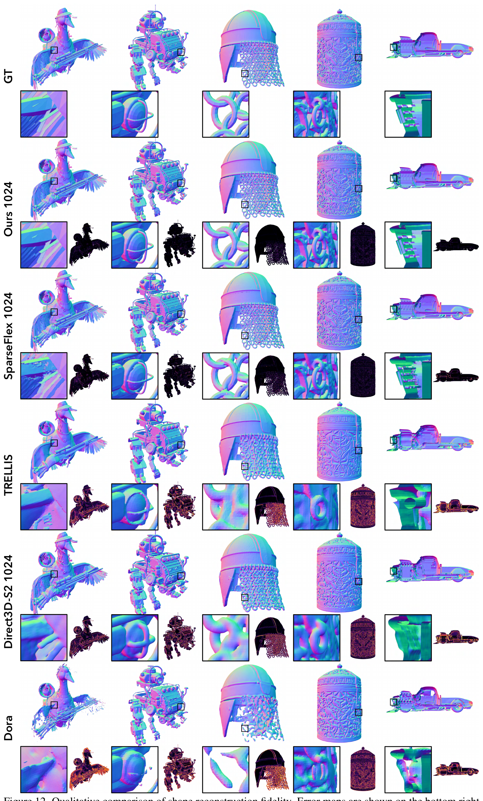

**Material 재구성** : material만 encoding하는 적절한 baseline이 없어 본 방법만 보고, PBR 속성 38.89 dB / LPIPS 0.033, shaded 이미지 38.69 dB / 0.026

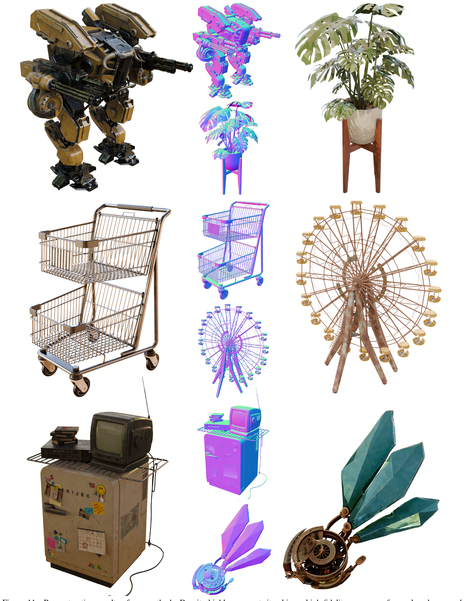

### 3-2. Image-to-3D 생성

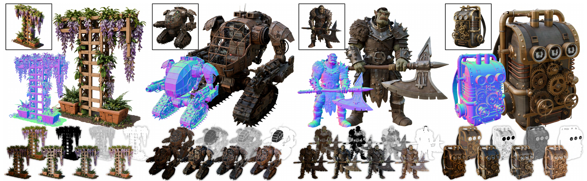

- 세밀한 구조, 날카로운 feature, 닫힌 cockpit, 열린 잎과 꽃 같은 내부가 복잡하거나 non-manifold인 형태 보존
- 유리, 금속 같은 반투명·반사 재질까지 새 조명에서 물리적으로 일관된 PBR texture

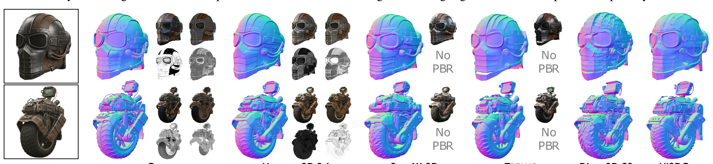

**정량 비교** (AI 생성 이미지 100장, `-N`은 normal map으로 측정)

| Method | CLIP ↑ | CLIP-N ↑ | ULIP-2 ↑ | Uni3D ↑ | Pref % ↑ | Pref-N % ↑ |
|---|---|---|---|---|---|---|
| TRELLIS | 0.876 | 0.748 | 0.470 | 0.414 | 6.40% | 2.82% |
| Hi3DGen | – | 0.753 | 0.395 | 0.373 | – | 6.57% |
| Direct3D-S2 | – | 0.746 | 0.420 | 0.392 | – | 12.2% |
| Step1X-3D | 0.875 | 0.738 | 0.464 | 0.411 | 11.8% | 0.469% |
| Hunyuan3D 2.1 | 0.869 | 0.753 | 0.474 | 0.427 | 13.3% | 7.51% |
| **Ours** | **0.894** | **0.758** | **0.477** | **0.436** | **66.5%** | **69.0%** |

- 시각 정렬은 CLIP, geometry 유사도는 ULIP-2와 Uni3D
- user study : 약 40명, 전체 품질(texture 포함)과 shape 품질(normal map만) 두 종류 질문

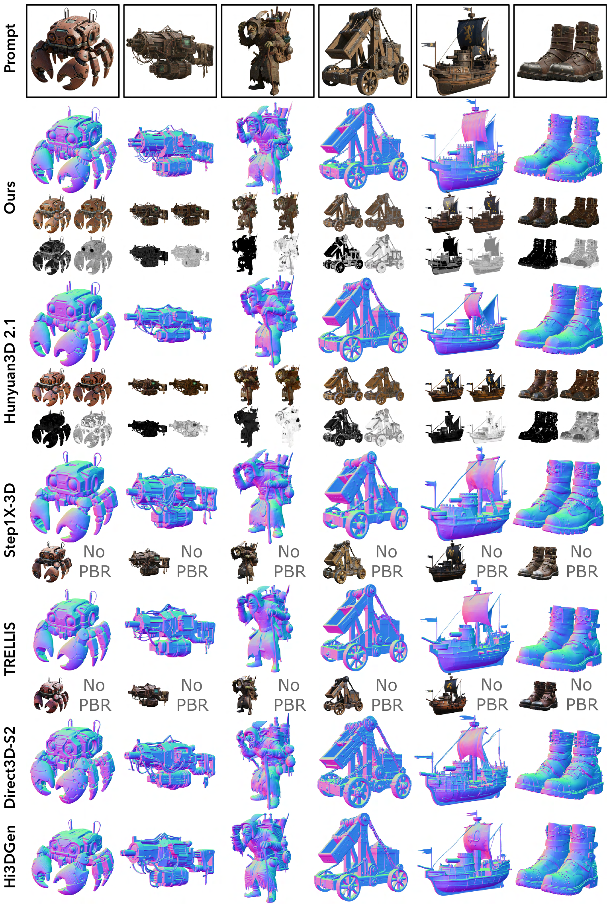

### 3-3. Shape 조건 Texture 생성

- 3단계(material 생성)만 독립적으로 쓰면 mesh와 reference 이미지로 PBR texture를 합성하는 모델

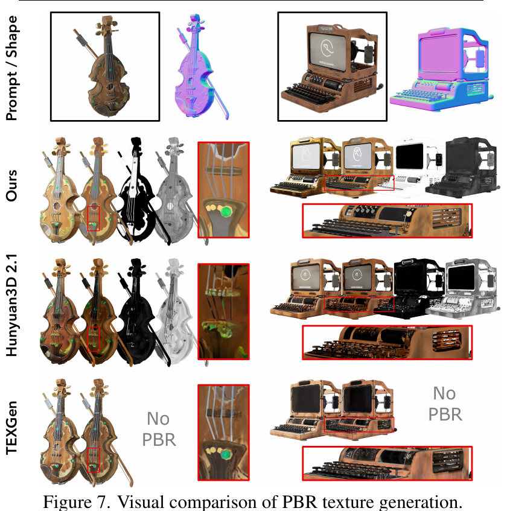

- multi-view 방법(Hunyuan3D-Paint) : shape과 합성 이미지 사이, 그리고 view 사이의 불일치로 ghosting과 흐린 texture
- UV 기반 방법(TEXGen) : 모호한 UV chart와 seam artifact
- 본 방법 : 3D에서 외관을 직접 추론하여 더 선명한 texture, shape-material 정렬 일관성, 가려지거나 non-manifold geometry의 내부 surface texture까지 합성

### 3-4. Ablation (SC-VAE 설계, Sketchfab 256³)

| Setting | #Token | Dec. (ms) ↓ | MD ↓ | F1 ↑ | PSNR ↑ | LPIPS ↓ |
|---|---|---|---|---|---|---|
| SC-VAE f16c32 | 503 | 28.6 | **1.032** | **0.312** | **27.26** | **0.072** |
| w/o Residual AE | 503 | 28.7 | 1.747 | 0.268 | 26.73 | 0.081 |
| w/o Opt. ResBlock | 503 | 29.6 | 1.198 | 0.285 | 26.67 | 0.083 |
| SC-VAE f32c128 | 118 | 33.9 | **1.405** | **0.273** | **26.65** | **0.081** |
| w/o Residual AE | 118 | 34.0 | 7.394 | 0.192 | 25.01 | 0.102 |

- Sparse residual autoencoding을 average pooling과 nearest upsampling으로 바꾸면 16배 압축에서 MD 69% 증가와 PSNR 0.5dB 감소, 32배에서는 MD 526% 증가와 1.6dB 감소 → 강한 압축에서 robust
- 표준 residual block으로 바꾸면 실행 시간은 같지만 MD 16% 증가와 PSNR 0.6dB 감소 → sparse convolution과 point-wise MLP의 hybrid가 세밀한 detail을 더 잘 보존

### 3-5. Test-time 계산량과 해상도 scaling

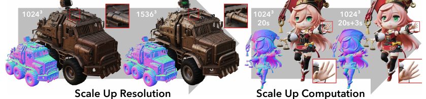

- 16배 압축 덕분에 token이 적어, 2단계 생성기를 cascade로 다시 적용 가능
- 해상도 확대 : 생성한 1024³ O-Voxel을 max-pooling하여 96³ sparse structure로 만든 뒤 geometry 생성 단계를 다시 적용 → 1536³ O-Voxel (학습 해상도를 넘음)
- 같은 해상도에서 품질 향상 : 1단계가 만든 sparse structure 대신, 생성한 512³ O-Voxel을 64³로 downsample한 구조를 사용 → 국소 오류가 수정된 깨끗한 layout으로 1024³ 생성
- 계산 효율과 생성 품질 사이를 조절 가능 (cascade 추론으로 더 세밀한 detail과 구조 안정성)

## 4. 한계 및 향후 방향 (Appendix F)

- voxel 기반 방법처럼 공간 해상도에 표현력이 제한 : voxel 크기보다 작은 geometry는 aliasing 발생 가능
  - 매우 가까운 평행 surface 두 개가 같은 voxel과 교차하면, QEF가 두 surface 모두의 오차를 최소화하는 위치(둘 사이)에 dual vertex를 둠
  - 그 voxel의 material도 두 surface의 평균이 되어 외관이 흐려짐
- 재구성·생성 결과에 작은 구멍이 생기는 경우가 있음 (대부분 hole filling 같은 표준 mesh 후처리로 수정 가능), sparse decoder에서 완전히 닫힌 manifold surface를 보장하기 어려운 탓
- O-Voxel은 geometry와 material만 다루고 상위 구조나 semantic 정보는 encoding하지 않음 → part 단위 segmentation과 graph 기반 topology 구조로 확장하는 방향
