# UniTEX

> **한 줄 요약** : View → 3D functional space  
> 2D diffusion transformer로 multi-view를 생성하고 projection한 뒤, UV inpainting 대신 3D 공간의 Texture Function(TF)을 예측하는 Large Texturing Model(LTM)로 texture를 완성

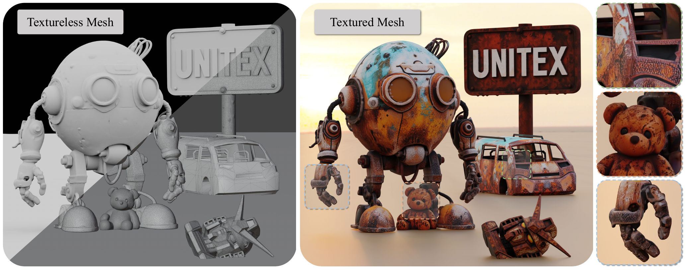

## 1. 배경

**목표**
- artist가 만든 mesh와 생성형 AI pipeline이 만든 mesh 모두에 대해 고품질이며 완전한(complete) texture 생성

**기존 방식의 문제**
- multi-view projection 방식 : 2D 생성 모델로 multi-view texture를 만들어 mesh에 projection하면 self-occlusion과 multi-view inconsistency 때문에 texture가 불완전하거나 조각남
- UV 기반 inpainting을 2단계로 추가한 방식(Paint3D, TEXGen, Meta 3D TextureGen) : partial view를 UV에서 합치지만, 생성형 mesh에서는 잘 동작하지 않음

**Topological ambiguity (핵심 문제)**
- 하나의 3D mesh에 유효한 UV layout이 여러 개이고, 이는 geometry만으로 결정되지 않으며 vertex/face 분포와 UV unwrapping 알고리즘에 민감
- 추론 때의 UV parameterization이 학습 때와 일치한다는 보장이 없음
- 특히 생성형 pipeline(Marching Cubes로 추출한 mesh)의 mesh는 modeling convention이 달라 domain gap이 큼
- 그 결과 UV 기반 inpainting 모델은 clean하고 큰 영역의 UV layout에 편향되어, 작게 조각난 영역을 처리하지 못함

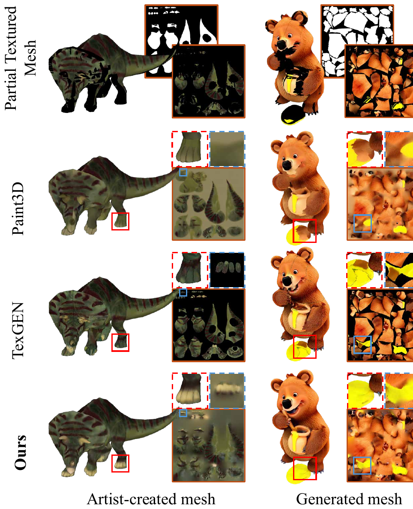

**핵심 아이디어**
- UV mapping을 우회하여 texture를 통일된 3D functional space에서 표현
- Texture Function(TF) : 3D 공간의 임의 점을 texture 값으로 mapping하는 연속 함수, mesh topology와 무관하고 surface 근접성에만 의존
- texture inpainting/prediction을 3D regression 문제로 정식화하고, transformer 기반 LTM으로 TF를 직접 예측

**기여**
1. TF : UV를 우회하고 texture를 완성된 공간 field로 모델링하는 연속 3D texture 표현
2. LTM : image와 geometry 입력에서 TF를 직접 예측하는 transformer 구조
3. LoRA 기반 학습 전략 : 큰 DiT(FLUX, SD3)를 geometry와 reference image 조건의 multi-view 합성에 효율적으로 적응

**관련 연구와의 차이**
- 3D native texturing(Texture Field, Texturify, PointUV, TEXGen, TexOct, TexGaussian) : 3D data 부족으로 generalization 제한
- UniTEX : native 3D texturing을 "2단계 refinement module"로 재배치하고, 생성 조건(multi-view 이미지)은 2D foundation model에서 가져와 제한된 data에서도 robust

## 2. 방법론

### 2-1. Overview

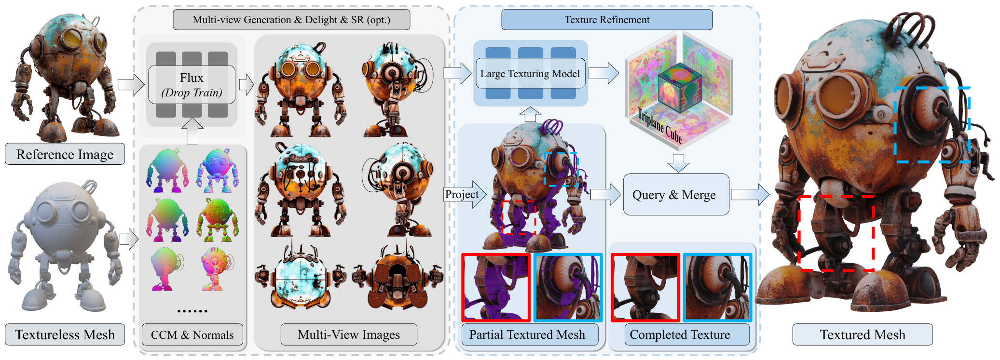

전체 구조 : 2단계 pipeline
- Stage 1 (Multi-view Generation & Delight & SR) : 2D DiT로 multi-view 이미지 생성
- Stage 2 (Texture Refinement) : LTM으로 3D 공간에서 texture 완성

**Stage 1 입력과 출력**
- 입력 : 단일 reference image + textureless mesh
- 두 개의 Flux 1(대형 DiT)을 LoRA 기반으로 fine-tuning (2-2 참고)
- mesh의 normal map과 CCM(Canonical Coordinate Map, 각 pixel이 대응하는 surface 점의 3D 좌표를 담은 렌더링 이미지) 조건으로 6개의 orthographic, illumination-free view 생성
- 3단계 : RGB 생성 → delighting → (선택) super-resolution

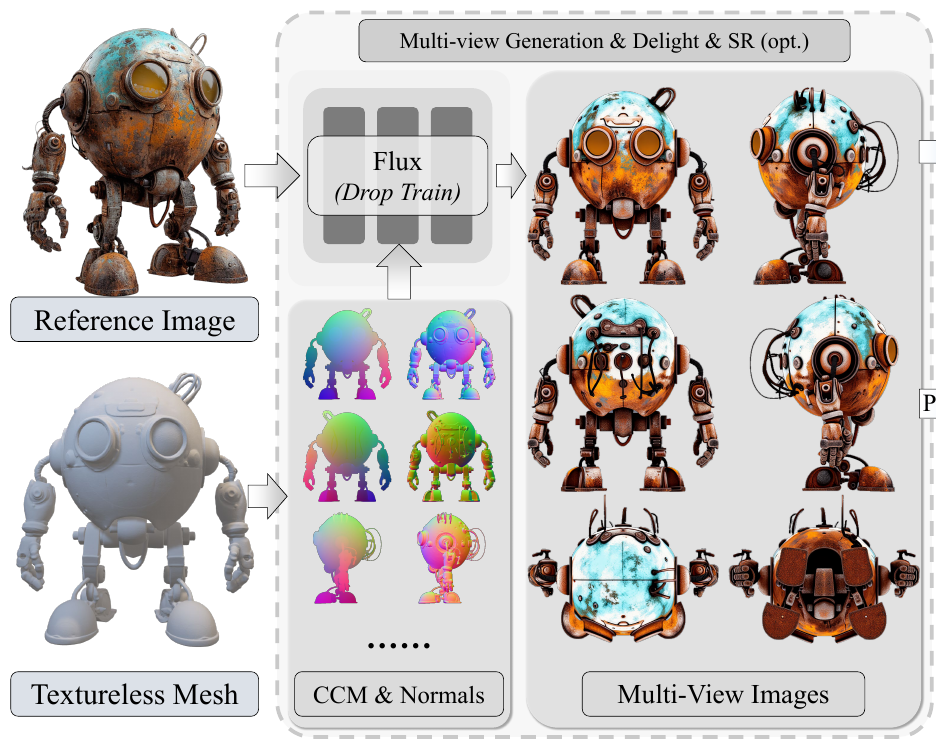

**Stage 2**
1. 생성한 view를 mesh에 reprojection하고 blending하여 partial textured mesh 획득
2. partial textured mesh와 생성 이미지를 LTM에 입력하여 완전한 TF 예측
3. 예측한 TF를 partial textured geometry와 blending하여 최종 texture 합성 (Query & Merge)

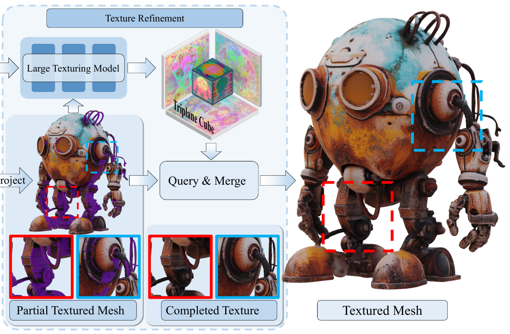

### 2-2. Efficient DiT Tuning for MV Generation

**두 개의 Flux 역할**
- 첫 번째 Flux : reference image, normal map, CCM을 입력받아 shaded 이미지 생성
- 두 번째 Flux : 생성된 이미지를 delighting하여 최종 texturing에 쓸 diffuse color 이미지 생성
- 생성한 diffuse color 이미지는 super-resolution과 함께 사용 가능

**문제**
- 3D texturing은 조건이 많음 (예 : 512×512 six-view 생성에는 reference image와 6개 view의 normal, CCM이 모두 필요)
- DiT는 in-context learning에 크게 의존하여 모든 입력과 조건을 token으로 함께 인코딩하므로, token 수가 크게 늘어 학습 비용이 증가하고 수렴이 느려짐

**Drop training 전략**
- 동기 : Long-LoRA(학습 중 attention window를 잘라 쓰고 추론 때 full attention 복원)와 MVDiffusion++(적은 view로 학습하고 더 많은 view로 추론)가 보여준 것처럼, fine-tuning에서 forward 계산 패턴을 완전히 유지할 필요는 없음
- 관찰 : texture 생성의 fine-tuning에서 이미지 품질 자체를 학습할 필요는 없고, 모델이 배워야 할 패턴은 "multi-view consistency와 조건에의 대응"이며, 이 패턴은 모든 input token에 동시에 접근할 필요가 없음
- 방법 : 학습 step마다 전체 token 중 일부만 남기고, DiT가 이 선택된 token에 대해서만 조건을 받고 생성
- 효과 : 완전한 image token에 대한 의존을 줄여 부분 정보에서 학습하되 task 관련성은 유지 (3-4의 ablation 참고)

**Flux 학습 설정 (Supplementary A)**
- LoRA rank 16, scaling factor 16
- optimizer : Prodigy (lr = 1), bfloat16 mixed-precision
- 입력 해상도 512 × 3072 (1행 6열로 6개 view를 이어 붙인 multi-view conditioning)
- control image(normal, CCM)를 추가 입력 guidance로 사용
- 학습 중 token의 50%를 무작위로 drop (robustness와 regularization 목적)
- 정량 평가에 쓴 모델은 모두 2,000 iteration 학습 (약 1일), ablation 모델과 공정한 비교를 위한 설정
- 일반적인 학습과 달리 Flux LoRA는 오래 학습한다고 성능이 꼭 좋아지지 않음

**Two-stage vs. End-to-End (Supplementary B.7)**
- 생성(MV-gen)과 delighting을 두 Flux로 나눈 2단계 구조와, 하나의 Flux로 한 번에 하는 E2E 구조를 비교
- E2E는 학습이 어렵고, 특히 극단적인 시각 조건에서 성능이 떨어짐
- 추론 효율보다 최종 출력 품질을 우선하여 2단계 설계 채택

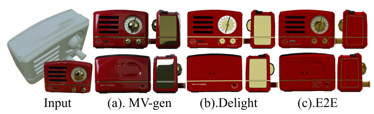

### 2-3. Large Texturing Model (LTM)

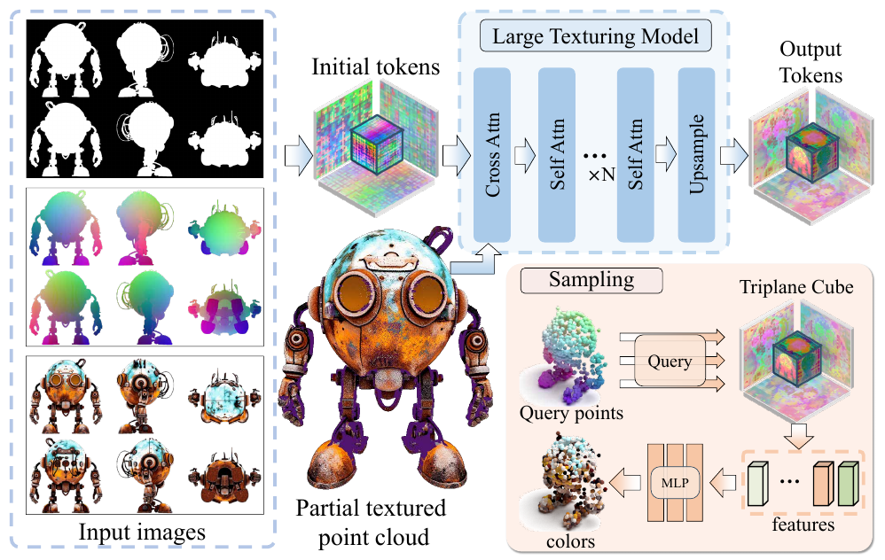

**구조**
1. triplane-cube를 학습 가능한 token으로 초기화
   - 고해상도 triplane `T ∈ R^(3×32×32)`, 저해상도 cube `C ∈ R^(8×8×8)` (triplane만 쓰는 것보다 cube를 함께 쓰는 표현이 우수하다고 알려져 있음)
2. 6개의 orthographic view 이미지, CCM, alpha map을 CRM 방식으로 triplane 형태로 인코딩하여 초기 triplane token에 더함
3. geometry 정보는 Shape2VecSet 방식으로 인코딩
   - partial textured geometry에서 색이 있는 point cloud를 sampling
   - triplane-cube token을 query로 하여 cross-attention으로 point cloud를 읽음
4. self-attention transformer로 token을 처리
5. 출력을 triplane과 cube로 reshape한 뒤, 각각 2D deconvolution, 3D deconvolution으로 upsample

**LTM 구현 (Supplementary A)**
- transformer : attention head 16개, model width 1024, decoder layer 24개, 약 400M parameter
- 학습 : A100 16장, 300,000 iteration, learning rate 1e-5
- ablation용 모델 : 40,000 iteration, learning rate 5e-5, AdamW

**Sampling (색 예측)**
- 임의 3D 점 `x`를 triplane-cube feature `TC`에서 `gridsample`한 값을 MLP에 넣어 RGB 예측

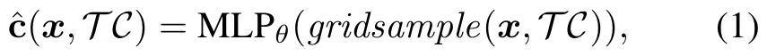

- `ĉ ∈ R^3` : 점 `x`의 예측 RGB 색

### 2-4. Texture Functions (학습 목표)

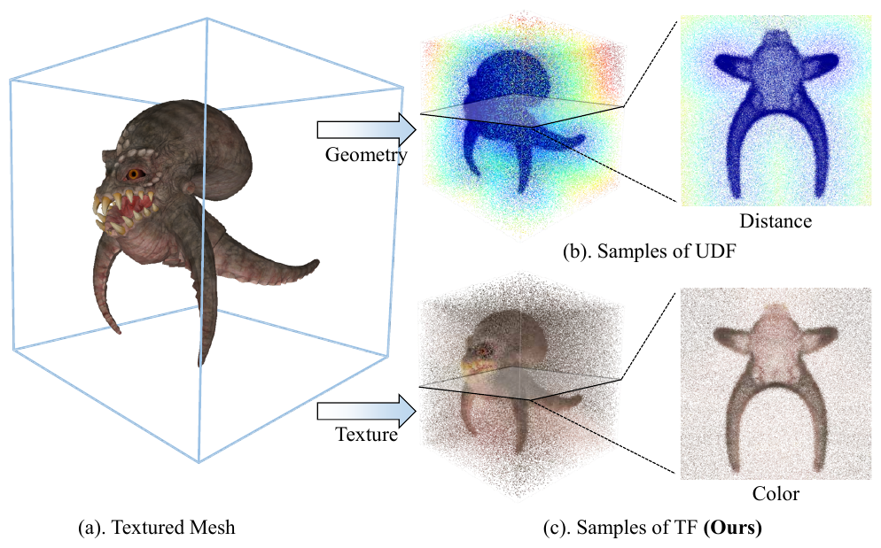

**동기**
- geometry 생성은 SDF/UDF처럼 3D functional space에서 연속적이고 완전한 supervision을 받음
- 반면 texture는 전통적으로 object surface에서만 정의되며, 기존 연구들은 surface/volume rendering이나 2D projection으로 supervision하므로 희소하고 coverage가 제한적
- 따라서 texture를 surface에 국한된 신호에서 3D 공간 전체의 연속 volumetric 함수로 확장

**정의**
- Texture Function : 3D 좌표 `x ∈ R^3`을 mesh surface `Ω` 위의 가장 가까운 점에 orthogonal projection하고, 그 점의 색을 질의하여 얻는 texture 값
- UDF와 같은 방식으로 가장 가까운 surface 점을 찾되, 거리 대신 색을 반환
- mesh face 분포에 무관하고 surface 위치에만 의존하므로 topological ambiguity 우회
- 학습 시 부피 전체에서 조밀하게 sampling한 점으로 supervision하여 더 풍부하고 완전한 신호 확보

**학습 loss**

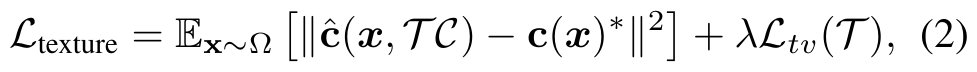

- `x` : surface 점 집합, `ĉ(x)` : 예측 색, `c(x)` : texture function에서 얻은 ground truth 색
- `L_tv` : triplane-cube grid 표현의 variance를 정규화하는 total-variance loss, 가중치 `λ = 0.0005`

**Truncated texture function과 thin shell**
- truncated SDF처럼 threshold 0.025로 truncation, 이 범위를 벗어난 점의 ground truth는 background 색
- surface 점 supervision에 더해 비(非)geometry 영역까지 확장 : 색이 있는 영역을 truncation 후 geometry를 둘러싼 얇은 shell로 확장
- 장점 1 : 색 예측 중 모델이 volumetric 이해를 암묵적으로 갖게 됨
- 장점 2 : 아주 정밀한 mesh modeling이 필요 없고, 정확한 geometry에 의존하지 않고도 색을 질의 가능
- 장점 3 : 완전히 정의된 supervision이 잘 구조화된 latent space와 generalization에 기여

**Texture Function 추출 (학습 data 생성, Supplementary C)**
1. 정규화된 bounding box `[-1, 1]^3` 안에서 3D 점 `p`를 sampling
2. ray-mesh intersection으로 mesh surface 위의 가장 가까운 projection 점 `q` 계산
3. `q`가 속한 삼각형에서 barycentric 좌표를 구하고, 삼각형 vertex들의 UV 좌표를 보간
4. 보간한 UV 좌표로 texture map을 질의하여 `q`의 색 `c` 획득
5. 이 색을 원래 점 `p`에 할당하여 supervision 쌍 `(p, c)` 구성
- UDF와의 유일한 차이 : 가장 가까운 surface 점을 찾은 뒤 UDF는 거리를, TF는 그 점의 색을 반환 (Supplementary B.2)

**최종 texture의 후처리 (Supplementary A)**
- LTM으로 보이지 않는 UV 영역을 채운 뒤, 유효한 UV 색을 바깥으로 dilate하여 map 전체를 채움 (texture padding 또는 bleeding)
- mipmapping 같은 texture filtering이 UV island 경계에서 만드는 seam을 막기 위한 의도적인 처리 (본문 Fig. 2에서 유효하지 않은 UV 영역에 색이 보이는 이유)

## 3. 실험

**비교 대상**
- 정량 비교 : Hunyuan3D-Paint, TexPainter, TexGaussians, Paint3D
- 정성 비교 : 위 방법에 더해 비공개 상용 방법(Tripo, Hyper3D-Rodin, Meshy)
- text prompt만 받는 pipeline에는 GPT-4o로 이미지 caption을 만들어 prompt로 사용, 그 외에는 reference image 사용

**학습 데이터 정제 (Supplementary C)**
1. Objaverse와 Sketchfab의 3D asset에서 low-polygon mesh와 의미 있는 texture map이 없는 model 제거
2. TRELLIS 방식의 aesthetic scoring : 정면과 4개 canonical 각도의 렌더링을 LAION aesthetic predictor로 평가하여 점수가 충분히 높은 것만 유지
3. Sketchfab metadata(tag, category, 설명, 작성자)로 관련 없거나 spam 같거나 annotation이 부실한 model 제거
4. glb 파일의 material node 구조를 분석하여 PBR 원칙을 따르는지 확인 (material 일관성 확보)

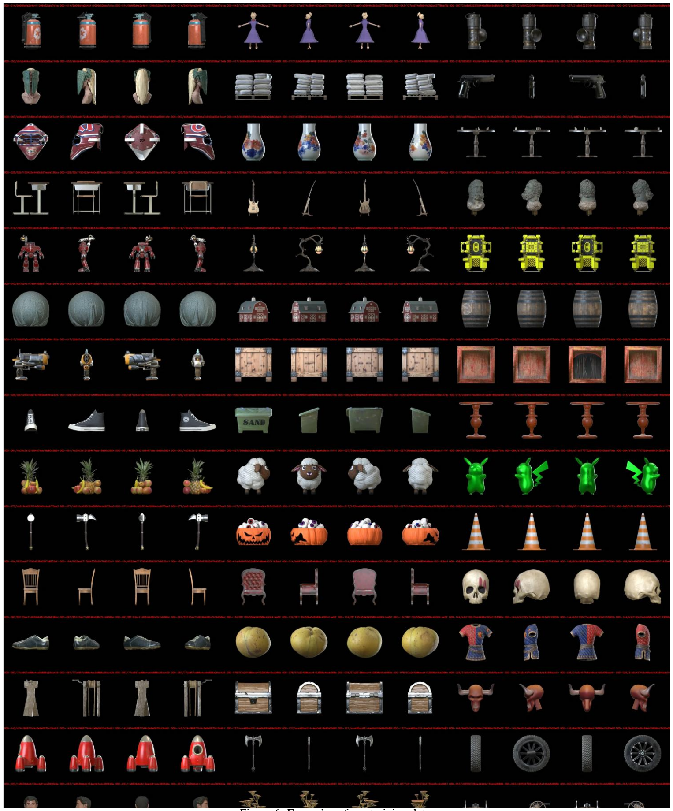

**데이터와 benchmark**
- artist-created mesh : Objaverse에서 무작위 78개 + MetaTexGen이 제공한 test list
- generative mesh : 이미지 30장으로 두 가지 3D 생성 모델에서 각각 30개 instance를 만들어 texturing (본문에는 Craftsman으로 표기)
- 두 benchmark로 artist mesh와 generative mesh 모두 평가 (기존 방법들은 artist mesh만 비교하는 경우가 많음)

**평가 지표**
- 의미 유사도 : `FID_CLIP`(Clean-FID 기반), CMMD(CLIP-MMD, 더 세밀한 fidelity)
- CLIPScore : 입력 prompt와의 정렬
- LPIPS : ground truth와의 지각적 유사도
- User-perf. : 사람 평가
- ground truth supervision이 있는 2단계 평가 : 예측 surface에서 sampling한 UV 점의 PSNR(`PSNR_uv`), 그리고 렌더링 view의 PSNR, SSIM, LPIPS

**평가 세부 (Supplementary A.1)**
- 이미지 기반 평가 : object를 `[-1, 1]`로 정규화하고, 반지름 2.5의 원형 camera 궤적에서 elevation을 -1.45~1.45로 선형 보간하여 object당 24개 view를 렌더링
- User study : method 이름을 숨긴 web interface에서 입력 이미지와 각 방법의 결과를 보여주고 가장 좋은 것을 고르게 함
  - 20명이 각 20세트 평가, "winner-takes-all" 방식으로 선택 비율 집계
  - UniTEX 65.91%, 2위 Hunyuan3D-Paint 21.36% (40%p 이상 차이)

### 3-1. Texture Generation 비교 (전체 pipeline)

| Method | CMMD ↓ | FID_CLIP ↓ | CLIPscore ↑ | LPIPS ↓ | CLIPscore (Generative) ↑ | User-perf. ↑ |
|---|---|---|---|---|---|---|
| Paint3D | 1.196 | 20.52 | 0.840 | 0.107 | 0.737 | 6.82% |
| TexPainter | 1.632 | 27.13 | 0.804 | 0.112 | 0.773 | 1.36% |
| TexGaussians | 1.290 | 21.08 | 0.836 | 0.095 | 0.718 | 4.55% |
| Hunyuan3D-Paint | 0.909 | 20.38 | 0.824 | 0.091 | 0.805 | 21.36% |
| UniTEX | **0.826** | **16.03** | **0.844** | **0.090** | **0.808** | **65.91%** |

- 앞 4개 열은 Artist-created mesh, 뒤 2개 열은 Generative mesh benchmark
- Paint3D는 artist mesh에서 CLIPscore가 비슷하나 generative mesh에서 크게 하락 → UV 기반 mapping의 generalization 한계
- TexGaussians는 real track에서는 비교적 좋지만 in-the-wild generative data에서 나쁨 → 대규모 고품질 native 3D texture dataset의 부족 때문으로 해석
- native 3D 방법은 단독 생성기보다 refinement/inpainting에 더 적합, 따라서 2D diffusion prior 활용이 여전히 핵심

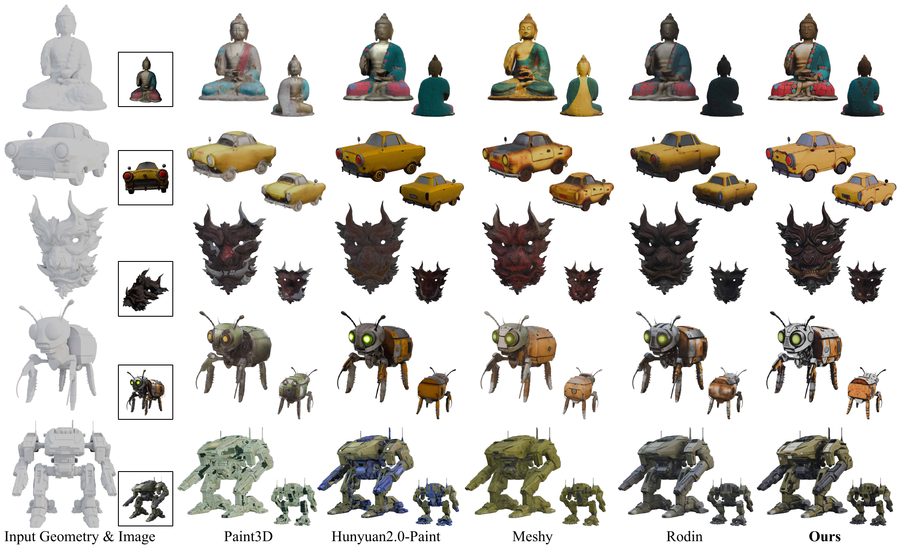

- shaded 이미지에서 세밀한 texture detail을 잘 복원 (가면과 Buddha 예시)
- geometry 구조를 존중 (차량의 문틀과 손잡이를 복원하면서 녹슨 스타일 유지)
- 더 풍부한 detail과 시각적 일관성

### 3-2. Refinement Stage 비교 (Stage 2만)

- 같은 partial textured model(6 view reprojection)과 reference image를 입력으로 각 방법이 texture를 채움
- 비교 대상 : Paint3D의 2단계(UV inpainting), TEXGen (둘 다 UV 기반 inpainting으로 볼 수 있음)

| Method | PSNR_uv ↑ | PSNR_uv* ↑ | PSNR ↑ | SSIM ↑ | LPIPS ↓ |
|---|---|---|---|---|---|
| Paint3D-UVpaint | 18.61 | 15.22 | 23.90 | 0.971 | 0.042 |
| TEXGen | 20.47 | 17.07 | 25.19 | 0.977 | 0.040 |
| UniTEX | **23.01** | **19.89** | **30.45** | **0.989** | **0.023** |

- `PSNR_uv*` : 보이지 않는(occluded) 영역에서만 계산, `PSNR_uv` : 유효한 UV 전체 영역에서 계산
- 보이는 영역의 보존과 가려진 영역의 완성 모두에서 최고

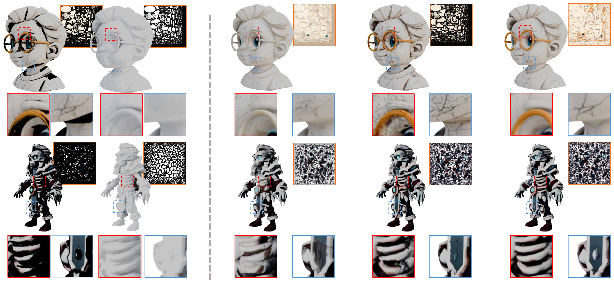

- 자동 UV unwrapping이 얼굴에 작게 조각난 noisy한 UV layout을 만들면 UV 기반 방법은 색 불일치와 저품질 결과 (파란 박스)
- UniTEX는 매끄럽고 일관된 texture를 생성하고 geometry에 더 충실 (안경, 갈비뼈와 작은 emblem을 일관되게 완성)

### 3-3. Stylized Texturing

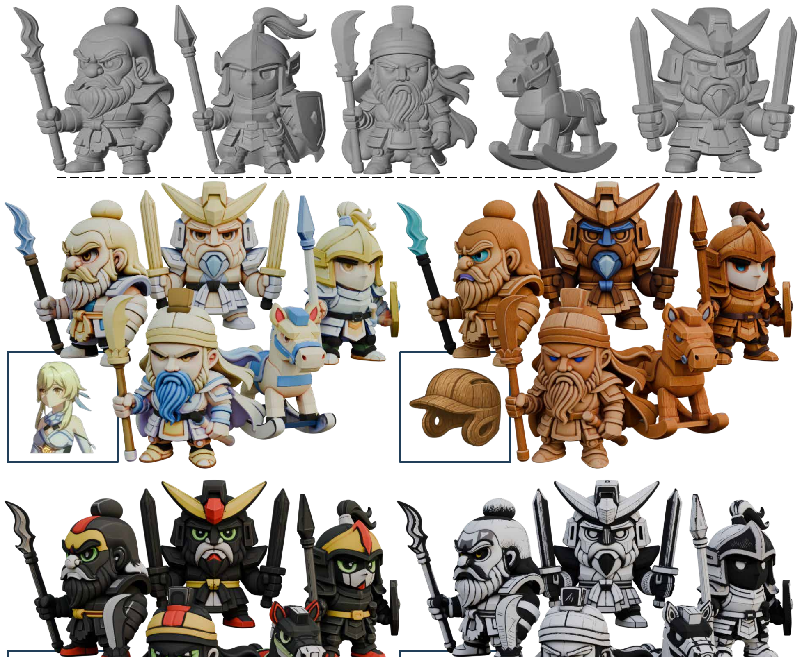

- reference image의 시각 스타일(유화, 금속 마감, 만화 shading 등)을 반영하면서 geometry에 맞는 texture map 생성

### 3-4. Ablation

**Drop training strategy**
- 같은 모델, 같은 dataset, 같은 iteration 수(예 : 1500)에서 drop training 유무만 다르게 비교
- texture 생성은 artist mesh 비교 설정을 사용하고, normal estimation은 GeoWizard의 평가 protocol을 따름 (normal estimation은 대규모 diffusion transformer 학습 전략을 평가하기 위한 보조 task)

| Method | mean ↓ | RMSE ↓ | 11.25° ↑ | 22.5° ↑ | CMMD ↓ | FID_CLIP ↓ | CLIPscore ↑ | LPIPS ↓ | Mem. Cost ↓ | Speed ↓ |
|---|---|---|---|---|---|---|---|---|---|---|
| w/o Drop Training | 22.57 | 29.42 | 44.85 | 55.82 | 0.912 | 17.49 | 0.839 | 0.087 | 69.2GB | 38.76 s/it |
| w/ Drop Training | 22.79 | 29.79 | 45.13 | 55.48 | 0.826 | 16.03 | 0.844 | 0.090 | 53.6GB | 21.50 s/it |

- 앞 4개 열은 Normal Estimation, 이후는 MV Texture Generation
- 선택한 3개 task에서 비슷한 성능을 유지하면서 학습 가속
- MV texture 생성에서 token 50%를 drop하면 메모리 22.5% 절약, 학습 약 44.5% 가속 (A800, batch size 4 기준)
- fine-tuning에 쓸 수 있는 plug-and-play 학습 전략이라는 결론

**Texture Function Supervision vs. Surface Supervision**
- 비교 : 기존 연구처럼 렌더링 이미지나 surface 샘플링 RGB로만 supervision하는 baseline vs. 완성된 3D volume에서 질의하는 TF supervision
- 이 평가는 partial texture geometry와의 blending 없이 LTM의 query 점으로 모델 전체를 바로 texturing (Table 2 설정과 다름)

| Method | PSNR_uv ↑ | PSNR ↑ |
|---|---|---|
| w/o Texture Function Supervision | 20.31 | 25.81 |
| w Texture Function Supervision | **20.99** | **27.01** |

- TF supervision이 가장 높은 PSNR과 가장 낮은 LPIPS, 특히 높은 `PSNR_uv`는 texture 완성도의 큰 향상을 의미

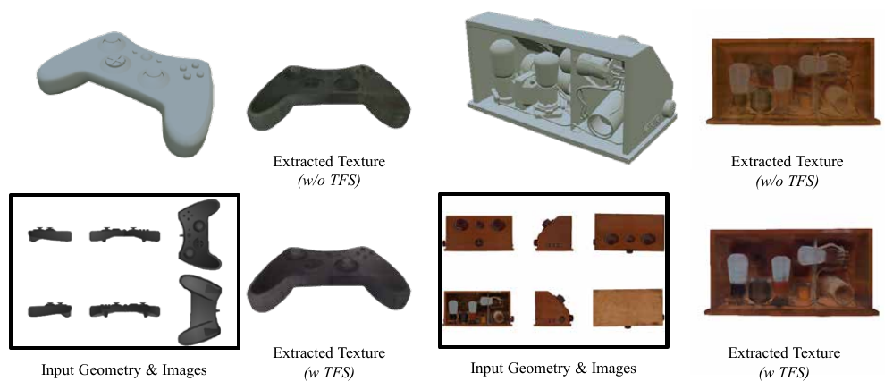

### 3-5. 추가 실험 (Supplementary B)

**UV unfolding 방식에 따른 robustness (B.1)**
- topological ambiguity 검증 : TEXGen repository의 mesh를 xatlas와 Blender 두 UV parameterization으로 펼쳐 비교

| Method | CMMD ↓ | CLIP-score ↑ |
|---|---|---|
| TEXGen w/ xatlas | 0.262 | 0.880 |
| TEXGen w/ Blender | 1.050 | 0.806 |
| UniTEX (둘 다 동일) | **0.247** | 0.862 |

- TEXGen은 학습에 쓴 xatlas UV에서는 좋지만 학습 때 보지 못한 Blender UV에서 크게 하락
- UniTEX는 UV parameterization과 무관하게 같은 결과 → UV 기반 방법이 topological ambiguity에 취약하다는 주장을 뒷받침

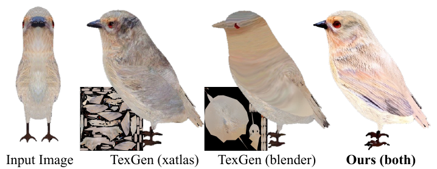

**다른 multi-view diffusion 모델과 LTM 결합 (B.3)**
- ground truth UV map이 있는 RealTrack dataset에서, ground truth multi-view 대신 각 diffusion 모델이 만든 이미지를 넣고 LTM 유무로 `PSNR_uv` 비교

| Multi-view 모델 | w/o LTM | w/ LTM |
|---|---|---|
| Hunyuan2.0-Paint | 11.67 | 12.38 (+0.71) |
| finetuned FLUX (Ours) | 13.75 | 14.54 (+0.79) |

- LTM은 어떤 multi-view diffusion 모델과 결합해도 texture 복원 품질을 일관되게 향상
- 1단계 모델(finetuned FLUX) 자체도 Hunyuan2.0-Paint보다 우수

**Normal estimation에서의 drop training (B.4)**
- 입력 : 6개 view의 multi-view 이미지, 출력 : 첫 번째 입력 view의 좌표계로 정규화한 normal map
- Objaverse LVIS로 학습하고 학습 set에서 100개를 validation으로 분리, GeoWizard 평가 protocol 사용
- drop training으로 비슷한 정확도를 유지하면서 효율 크게 향상 (3-4의 표 참고)

**Multi-view 생성 단독 비교 (B.6)**
- 1단계 모델을 image-to-multi-view(I2MV) 작업에서 MVAdapter와 비교 (66개 case)
- GPTEval3D의 Alignment, Plausibility, Texture Detail 지표 사용 (나머지 두 지표는 geometry 관련이라 제외)

| Method | Alignment | Plausibility | Tex Detail | Overall |
|---|---|---|---|---|
| MVAdapter (I2MV) | 968.060 | 827.932 | **1005.266** | 933.752 |
| UniTEX | **1031.940** | **1172.068** | 994.734 | **1066.247** |

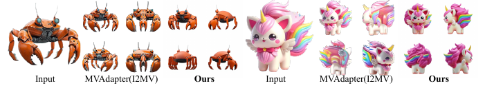

**상용 방법과 추가 비교 (B.5)**
- 생성형 mesh를 다시 texturing하여 Meshy, Tripo, Rodin과 비교 (API는 2025년 5월 기준)

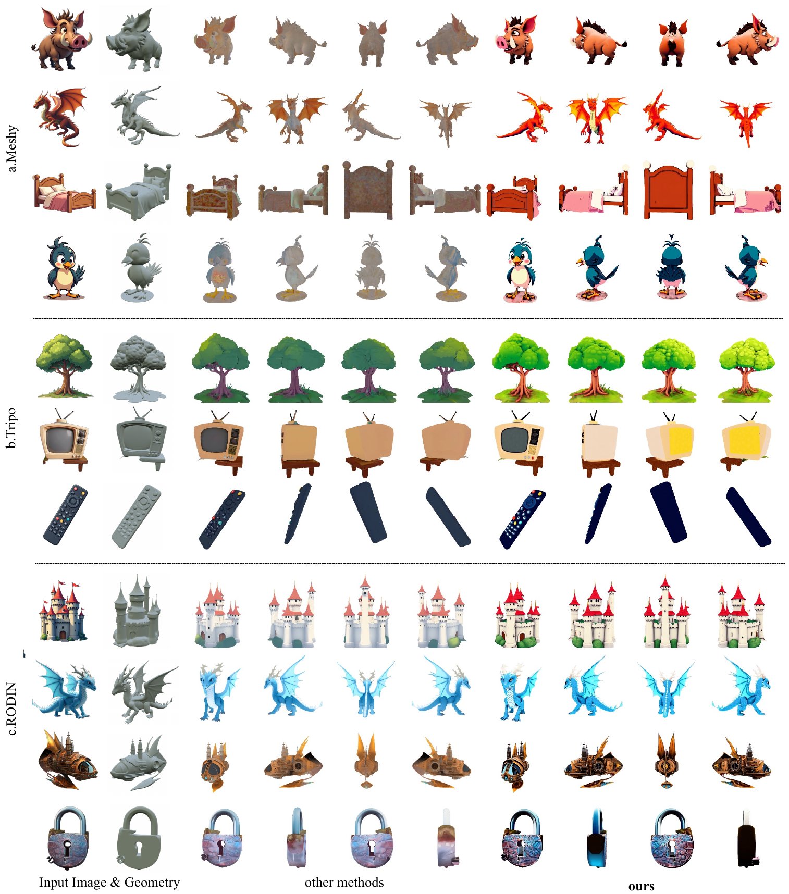

**추가 결과 (B.8)**

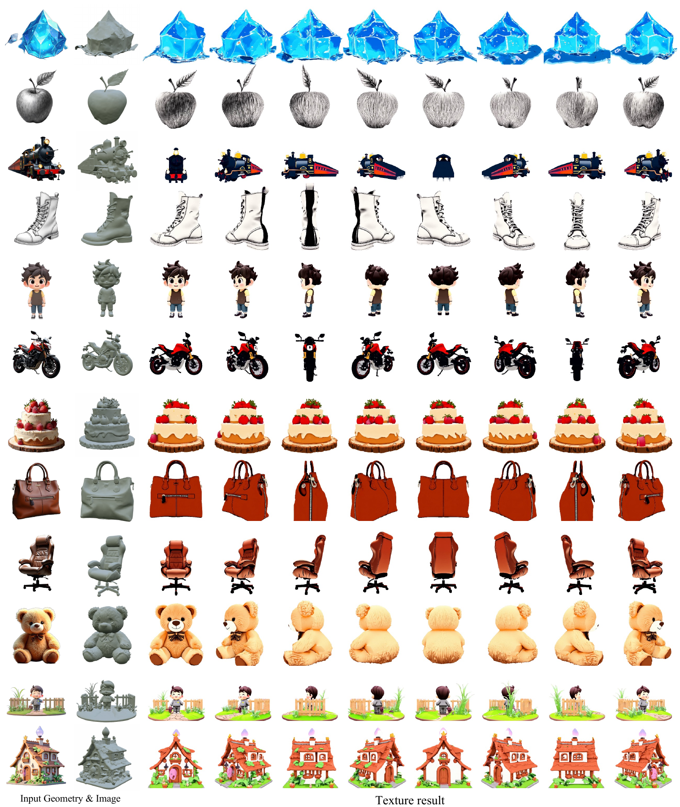

## 4. 한계 및 향후 방향 (Supplementary D)

- **추론 시간 증가** : 대형 Flux backbone과 geometry-aware LTM refinement를 포함한 3단계 pipeline이라, feature 추출과 texture 생성 모두에서 기존 texturing pipeline보다 계산 부담이 큼
- **2D image prior 활용 불가** : UV-free 설계라 functional space가 image modality와 명시적으로 연결되지 않음
  - UV 기반 방법과 달리 LTM은 pixel space에서 학습된 성숙한 이미지 생성 모델의 prior를 직접 쓸 수 없음
- **TF의 SDF/UDF와 같은 문제** : SDF/UDF가 겪는 edge case를 TF도 겪을 수 있음
  - 이런 경우는 흔하지 않고, 주 대상이 거의 watertight한 AI 생성 mesh라 주요 응용에는 영향이 적다고 설명
- **향후 방향** : 계산 시간을 줄이는 효율적 구조, 명시적 UV map 없이 image prior를 통합하는 hybrid 방식
- 본문에서 밝힌 것처럼 일부 ablation은 계산 자원 제약으로 full model보다 적은 iteration으로 수행됨
